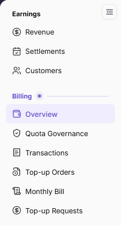
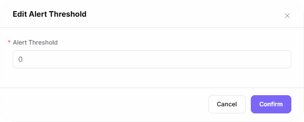

# Overview

::: info Document Information
Version: v2.1
Updated: 2026-11-05
:::

## Feature Overview

| Item | Content |
| --- | --- |
| Applicable Role | Model Provider & User |
| Navigation path | Billing > Overview |
| Page route | `/billing/my/account` |
| Managed objects | Account balance, spending trends, alert threshold, recent transactions, and billing entries. |

Account Overview summarizes the current account's balance and spending. Open detailed records for reconciliation.

#### Beginner Explanation

This page is a billing dashboard: the balance is available funding, trends and estimates are reference readings, and individual income and expense records belong in the details.

#### Terms Quick Reference

| Term | Description |
| --- | --- |
| Account balance | Credits currently available to the account. |
| Estimated days remaining | Available time estimated from recent spending, not a guaranteed duration. |
| MTD EST. | Estimated monthly spending, not the final bill. |
| Alert Threshold | Balance-reminder configuration, with the current setting and an edit entry. |
| Recent transactions | A subset of recent billing records, not the complete history. |

## Prerequisites

1. Use an account with billing-view permission and open `Billing > Overview`.
2. Verify the current account and last-update information.
3. Before changing a threshold or initiating a top-up, confirm the corresponding permission and target account.

## Page Description

The figure shows the left-side Billing menu, locating Overview, Quota Governance, Transactions, Top-up Orders, Monthly Bill, and Top-up Requests; account metrics are not included.

| Area | Description |
| --- | --- |
| Last updated and Refresh current cycle | Shows update information and the `Refresh current cycle` button. |
| ACCOUNT BALANCE and estimated days | Shows the balance and estimated days at the top; without recent spending, the message is “No spend in the last 7 days, so days remaining cannot be estimated”. |
| LAST 7-DAY SPEND | Shows recent spending and the comparison with last week. |
| MTD SPENT, MTD TOP-UP, MTD EST. | Shows month-to-date spending, top-ups, and estimated monthly spending respectively. |
| LAST TOP-UP and Billing support | Shows the latest top-up and billing-support contact information as provided on the current page. |
| Alert Threshold | May currently display `No limit`; `Edit` opens the form. |
| Spend rate | Shows Daily, Peak Spend, Low, and recent comparisons. |
| MTD vs same period last month | Compares MTD, Last MTD, Last mo. total, and MoM. |
| Income & Expense Analysis | Switch between `By Service`, `By Attribution`, and service categories including `Models` and `AI Infra`. |
| Top Spending Sources and recent transactions | Identifies spending sources and recent account changes; use details for complete records. |
| Transactions, Top-up Orders, Top Up | Separate entries for transaction details, top-up orders, and initiating a top-up. |

## Main Operations

### Review Balance and Spend Summaries

1. Open Account Overview, check the last-update information, and click `Refresh current cycle` as needed.
2. Review the balance, estimated days, and last-seven-day spend; an unavailable estimate does not mean zero days remain.
3. Compare `MTD SPENT`, `MTD TOP-UP`, `MTD EST.`, and `LAST TOP-UP`.
4. Scroll to `Spend rate` and `MTD vs same period last month`, then switch `By Service`, `By Attribution`, and service categories in `Income & Expense Analysis` as needed.

### Review or Edit the Alert Threshold

1. Check the current setting under `Alert Threshold`, such as `No limit`.
2. With the corresponding permission and a need to change it, click `Edit` to open `Edit Alert Threshold`.
3. Fill in the required `Alert Threshold` field and check the target account and input before continuing.
4. Click `Cancel` to leave without submitting; click `Confirm` only when submission is needed and permission and content have been checked.

The figure shows the Edit Alert Threshold dialog with a gray `0` visible in the required Alert Threshold input, plus Cancel and Confirm buttons; the pictured `0` does not establish a placeholder, the current configured value, or the meaning of saving an empty value.

### Review Recent Transactions and Choose a Follow-up Entry

1. Check the time, type, amount direction, and description in recent transactions.
2. For complete reconciliation, use `View all →` or `Transactions` and continue with [Transactions](../transactions/).
3. To verify top-up orders, use `Top-up Orders` and continue with [Top-up Orders](../top-up-orders/).
4. To initiate a top-up, use the separate `Top Up` entry; for a request, open [Top-up Requests](../top-up-requests/) from the left menu. Do not treat a top-up and a request as the same operation.

## Parameter Quick Reference

| Field Name | Required | Field Type | Example | Description |
| --- | --- | --- | --- | --- |
| ACCOUNT BALANCE | Not applicable | Credits metric | 0 | Current available account balance. |
| Estimated days | Not applicable | Estimate or message | Estimated days unavailable | Cannot be estimated without spending in the last 7 days. |
| LAST 7-DAY SPEND | Not applicable | Credits metric | 0 | Spending over the last 7 days. |
| MTD SPENT | Not applicable | Credits metric | 0 | Month-to-date spending. |
| MTD TOP-UP | Not applicable | Credits metric | 0 | Month-to-date top-ups. |
| MTD EST. | Not applicable | Credits estimate | 0 | Estimated monthly spending, not the final bill. |
| LAST TOP-UP | Not applicable | Information area | [Latest top-up information] | Amount and time of the latest top-up. |
| Billing support | Not applicable | Contact information | [Support contact] | Use the support information on the current page. |
| Alert Threshold | Yes | Text input | [Threshold] | The form displays a required marker; do not assume that submitting an empty editor means No limit. |
| Spend rate | Not applicable | Metric group | 0 | Daily, Peak Spend, Low, and recent comparisons. |
| MTD vs same period last month | Not applicable | Comparison metrics | 0 | MTD, Last MTD, Last mo. total, and MoM. |
| Income & Expense Analysis | Not applicable | Analysis view | By Service | By Service, By Attribution, and categories including Models and AI Infra. |
| Recent transactions | Not applicable | Record area | [Transaction record] | Partial recent records; use Transactions for complete reconciliation. |
| Transactions | No | Entry | Transactions | Opens transaction details. |
| Top-up Orders | No | Entry | Top-up Orders | Opens top-up orders. |
| Top Up | No | Entry | Top Up | Separate top-up entry, not the same as Top-up Requests. |

## Pitfalls

- An unavailable estimate does not mean zero days remain; read the accompanying no-spend message for the last 7 days.
- MTD EST. and estimated days are estimates, not a final bill or a guaranteed duration of service.
- Recent transactions show only some records; a single credit-gift record cannot establish complete balance continuity.
- `No limit` is the displayed current setting; it does not establish what submitting an empty input would mean.

## Result Validation

| Check Item | Success Signal | If Abnormal |
| --- | --- | --- |
| Account scope | The current account, update information, and balance can be checked. | Recheck the account and update information; do not compare different accounts. |
| Spend summaries | Last-seven-day spend, MTD spending, top-ups, and estimate are separately visible. | Distinguish recent, month-to-date, and estimated figures, then consult details. |
| Threshold editor | Edit opens a dialog containing Alert Threshold, Cancel, and Confirm. | Do not confirm submission before checking the form and input. |
| Reconciliation scope | Recent records are distinguished from the complete transaction scope. | Continue in Transactions and Monthly Bill. |

## FAQ

#### Why Are Estimated Days Unavailable?

**Symptom:** The page displays “Estimated days unavailable”.

**Possible Causes:** The page states “No spend in the last 7 days, so days remaining cannot be estimated”.

**Resolution:** Review the balance and last-seven-day spend together; do not interpret the message as zero days remaining.

#### Why Are Recent Transactions Insufficient to Explain a Balance Change?

**Symptom:** The subset of recent transactions is insufficient for balance reconciliation.

**Possible Causes:** Account Overview is a summary page, and recent transactions are not the complete history.

**Resolution:** Use Transactions or View all to check the complete records and Monthly Bill as needed.

## Notes

- View permission is not configuration permission; only users with the corresponding permission should change a threshold or perform a top-up.
- Check the input before confirming a threshold; do not assume minimum, maximum, or empty-value semantics.
- Share only necessary reconciliation information, without real accounts, emails, contacts, billing amounts, project or member information, or credentials.

## Next Steps

1. For individual balance changes, open [Transactions](../transactions/).
2. For top-up status, open [Top-up Orders](../top-up-orders/); for requests, open [Top-up Requests](../top-up-requests/).
3. For monthly reconciliation, open [Monthly Bill](../monthly-bill/).
4. For member and project usage, open [Quota Governance](../quota-governance/).
