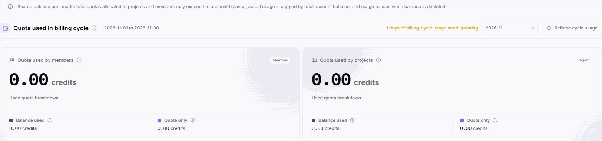

# Quota Governance

::: info Document Information
Version: v2.1
Updated: 2026-11-05
:::

## Feature Overview

| Item | Content |
| --- | --- |
| Applicable Role | Model Provider & User |
| Navigation path | Billing > Quota Governance |
| Page route | `/billing/my/quota-governance` |
| Managed objects | Billing-cycle usage, member and project quotas, usage breakdown, risk categories, and settings entries. |

Quota Governance displays quota usage and risks by member and project and provides the corresponding settings entries.

#### Beginner Explanation

This page is a usage dashboard for a shared wallet: members and projects have quota rules, but actual spending remains limited by the total account balance.

#### Terms Quick Reference

| Term | Description |
| --- | --- |
| Shared balance pool | Allocated quotas may exceed the balance, while actual usage remains capped by the total account balance. |
| Balance used | The part of used quota identified as deducting from the account balance. |
| Quota only | Quota usage shown separately from Balance used; it is not equivalent to an actual balance deduction. |
| Current quota period | The period for the current quota rule; check it separately from the selected billing cycle. |
| Not assessed | A risk category, not equivalent to No current risk. |

## Prerequisites

1. Use an account with billing-view permission and open `Billing > Quota Governance`.
2. Check the selected cycle, date range, and any billing-cycle usage update message.
3. Before entering Member quota settings or Project defaults, confirm the corresponding management permission and affected objects.

## Page Description

The page states: “Shared balance pool mode: total quotas allocated to projects and members may exceed the account balance; actual usage is capped by total account balance, and usage pauses when balance is depleted.”

The figure shows a zero-usage portion of the billing-cycle summary, including the shared balance pool notice, cycle range, Refresh cycle usage, and the Balance used and Quota only breakdown for members and projects; member and project cards are not included.

| Area | Description |
| --- | --- |
| Credits exchange rate | Shows the USD-to-credits exchange rate; use the current value on the page. |
| Quota used in billing cycle | Shows the selected cycle and date range; an update message includes the number of days needing an update and offers `Refresh cycle usage`. |
| Quota used by members | Shows member-level used quota, split into `Balance used` and `Quota only`. |
| Quota used by projects | Shows project-level used quota, split into `Balance used` and `Quota only`. |
| Quota usage details | Defaults to members first; use the `Member` and `Project` buttons to switch dimensions and read object details rather than looking for traditional project-table columns. |
| Member quota settings and Project defaults | The member view shows `Member quota settings`; the project view shows `Project defaults`. |
| Risk categories | `All`, `Critical`, `Warning`, `Configuration`, `No current risk`, and `Not assessed`, with their counts. |
| Period information | `Monthly reset on day 1` describes the schedule; `Current quota period` and the next reset time are displayed information, not a one-click reset operation. |

Where object details display used quota, limits, percentages, remaining quota, or a stop-on-exhaustion policy, read them for the corresponding object and period. These values and policies are not the account balance or top-up records.

## Main Operations

### Review Billing-cycle Usage and Its Breakdown

1. Open Quota Governance and check the month and date range under `Quota used in billing cycle`.
2. Read any update message indicating N days of billing-cycle usage need updating; use `Refresh cycle usage` as needed, then check the actual usage and message displayed. Do not assume the values must change.
3. Review `Quota used by members` and `Quota used by projects`, checking `Balance used` and `Quota only` separately.
4. Apply the shared balance pool notice when assessing funding limits; open [Overview](../overview/) to check the available balance.

### Switch Member and Project Details

1. Start with the default `Member` view in `Quota usage details`.
2. Check risk categories and counts, distinguishing `Critical`, `Warning`, `Configuration`, `No current risk`, and `Not assessed`.
3. Click `Project` to view the project dimension; click `Member` to return.
4. Check the current quota period and next reset time by object; where used/limit values, percentages, remaining quota, or handling policies are displayed, read them for that object. Do not treat the schedule as a manual reset button.

### Enter Quota Settings with the Required Permission

1. For member configuration, click `Member quota settings` in the member view to open tenant settings at `/user/user-space/settings?tab=member`. Configuration changes require the corresponding permission.
2. For default project rules, switch to `Project` and click `Project defaults`.
3. This entry navigates to tenant settings at `/user/user-space/settings?tab=project`. Read the notice that new projects inherit these defaults and existing projects can override them individually within the project.
4. Check the defaults and their scope for new and existing projects as needed; only authorized users should proceed on the target settings page after confirming the impact.

## Parameter Quick Reference

| Field Name | Required | Field Type | Example | Description |
| --- | --- | --- | --- | --- |
| Credits exchange rate | Not applicable | Ratio display | [Exchange rate] | The USD-to-credits rate currently shown on the page. |
| Quota used in billing cycle | Not applicable | Cycle summary | 0 | Read with the selected month and date range. |
| Billing-cycle usage update message | Not applicable | Message | [N days need updating] | Indicates billing-cycle usage awaiting an update. |
| Refresh cycle usage | No | Button | Refresh cycle usage | Check the actual display afterward; values are not guaranteed to change. |
| Quota used by members | Not applicable | Credits metric | 0 | Member-level summary. |
| Quota used by projects | Not applicable | Credits metric | 0 | Project-level summary. |
| Balance used | Not applicable | Credits breakdown | 0 | Shown separately in both dimensions. |
| Quota only | Not applicable | Credits breakdown | 0 | Shown separately from Balance used. |
| Member, Project | No | Switch buttons | Member | Members appear first by default, followed by projects. |
| Risk categories | Not applicable | Categories and counts | No current risk | All, Critical, Warning, Configuration, No current risk, Not assessed. |
| Monthly reset on day 1 | Not applicable | Schedule description | Monthly reset on day 1 | Not a manual reset operation. |
| Current quota period | Not applicable | Date range | [Period start and end] | Quota period for the current object. |
| Next reset time | Not applicable | Time display | [Next reset time] | Displays the next scheduled reset. |
| Used quota, limit, percentage, and remaining quota | Not applicable | Object usage | 0 | Where displayed, check by object and period; not equivalent to the account balance. |
| Handling policy | Not applicable | Policy display | [Current policy] | Where a stop-on-exhaustion or other policy is shown, follow the actual text for that object. |
| Member quota settings | No | Navigation entry | Member quota settings | Opens the member section of tenant settings; configuration changes require the corresponding permission. |
| Project defaults | No | Navigation entry | Project defaults | Navigates to default project rules in tenant settings. |

## Pitfalls

- Total quotas allocated to members and projects may exceed the current balance without increasing available funding; usage pauses when the balance is depleted.
- Members and projects are two statistical views; do not add their usage figures together as total spending.
- Quota only is shown separately from Balance used; do not interpret all used quota as balance deductions.
- The monthly reset schedule, current period, and next reset time do not constitute a manual reset workflow.

## Result Validation

| Check Item | Success Signal | If Abnormal |
| --- | --- | --- |
| Billing-cycle scope | The selected month and cycle date range can be checked. | Recheck the month and range; do not mix billing cycles. |
| Usage breakdown | Members and projects each show Balance used and Quota only separately. | Read both dimensions and their breakdown separately; do not add them together. |
| Dimension switching | Member and Project buttons correspond to different object views and settings entries. | Check the selected dimension before locating the corresponding entry. |
| Period and risk | The current period, next reset time, and risk categories can be checked separately. | Do not equate Not assessed with No current risk or treat schedule text as a button. |
| Project defaults destination | Tenant settings opens the default project rules and displays the inheritance and override notice. | Do not change configuration before checking the target scope. |

## FAQ

#### Why Can Allocated Quotas Exceed the Balance?

**Symptom:** Total project and member quotas may exceed the account balance.

**Possible Causes:** The page explicitly uses a shared balance pool, with actual usage capped by the total account balance.

**Resolution:** Check both the account balance and object quotas; do not treat total allocated quotas as available funding. Usage pauses when the balance is depleted.

#### Why Is Used Quota Different from Balance Used?

**Symptom:** The used-quota summary and Balance used are different items.

**Possible Causes:** The page splits used quota into Balance used and Quota only.

**Resolution:** Check the breakdown separately in member and project views; continue to Transactions for actual funding changes.

#### Do Project Defaults Affect Only New Projects?

**Symptom:** You need to determine the relationship between defaults and existing projects.

**Possible Causes:** The target settings page states that new projects inherit these defaults and existing projects can override them individually within the project.

**Resolution:** Distinguish default rules from project-level overrides and check the applicable scope against the actual project settings.

## Notes

- Viewing billing does not grant member or project configuration permission; entering settings and changing rules require the corresponding authorization.
- Before changing defaults, confirm inheritance for new projects and overrides for existing projects. Opening settings does not mean settings have been saved.
- Do not disclose real members, emails, project names, quota values, or consumption details when sharing results, and do not include credentials.

## Next Steps

1. For funding changes, open [Transactions](../transactions/).
2. For the total account balance, open [Overview](../overview/).
3. For monthly cost reconciliation, open [Monthly Bill](../monthly-bill/).
