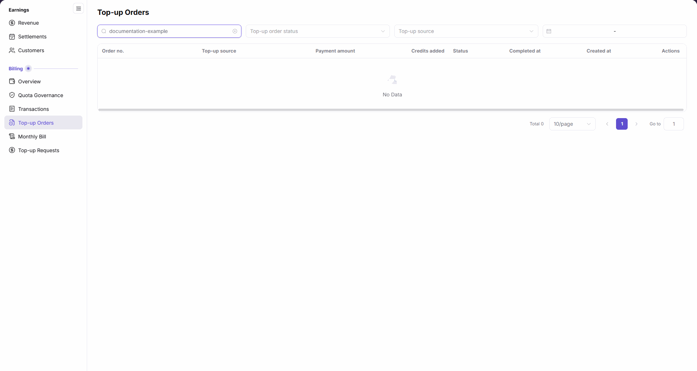

# Top-up Orders

::: info Document Information
Version: v2.1
Updated: 2026-11-05
:::

## Feature Overview

| Item | Content |
| --- | --- |
| Applicable Role | Model Provider & User |
| Navigation path | Billing > Top-up Orders |
| Page route | `/billing/my/top-ups/orders` |
| Managed objects | The current account's top-up orders, sources, original-currency payments, credits added, and order statuses |

Top-up Orders locates records by order number, top-up order status, top-up source, and time range. Check payment amounts, credits added, and processing status separately.

#### Beginner Explanation

A top-up order works like a receipt: payment amounts and account credits are separate columns, so a number in Credits added does not by itself establish completion.

#### Terms Quick Reference

| Term | Description |
| --- | --- |
| Order no. | The top-up order identifier, distinct from payment and billing transaction numbers. |
| Top-up source | The source displayed for an order, also available as a filter. |
| Payment amount | The original-currency payment amount; read it with its currency. |
| Credits added | The credits displayed for an order, not independent proof of posting. |
| Status | The processing status, displayed separately from the credits figure. |
| Invoice | A creation entry that can appear for eligible orders; availability depends on the entry shown in the row. |

## Prerequisites

1. The current account can open `Billing > Top-up Orders` in the Billing subsystem.
2. Prepare the order number or filter scope to query.
3. Check status, amount units, and times together rather than reading only the credits figure.

## Page Description

In the Billing subsystem, the left-menu group is `Billing`. The page has four filters: order number, top-up order status, top-up source, and time range. The order input displays `Enter order no.`. The list has eight columns and a row-level `Details` entry.

| Area | Description |
| --- | --- |
| Order number input | Enter a query value in `Enter order no.` and press Enter. |
| Top-up order status | Filters by processing status. |
| Top-up source | Filters by top-up source. |
| Time range | Restricts the query using start and end dates. |
| Order list | Order no., Top-up source, Payment amount, Credits added, Status, Completed at, Created at, Actions. |
| Row-level details | Use `Details` in the target record's Actions column. |
| Conditional Invoice entry | An Invoice creation entry can appear for eligible orders, not every order; use the entry actually shown in that row. |
| Horizontal scrolling and empty result | Scroll horizontally to view time columns and Actions; an empty result displays `No Data` and `Total 0`. |

The figure shows an empty Top-up Orders result after entering `documentation-example`; the time columns may not all be visible at once. Scroll horizontally to view them and the final Actions column.

## Main Operations

### Query Top-up Orders

1. Open `Billing > Top-up Orders` in the Billing subsystem.
2. To query by order number, enter a value in `Enter order no.` and press Enter; the example uses the placeholder `documentation-example`.
3. Select `Top-up order status` and `Top-up source` as needed.
4. Set a time range as needed and review the list after the conditions update.
5. Read matching orders; if `No Data` appears, check all four filters and change them directly for another scope.

### View the Target Order

1. Locate the target `Order no.` and read `Top-up source`, `Payment amount`, `Credits added`, and `Status`.
2. Scroll horizontally to check `Completed at`, `Created at`, and the final `Actions` column.
3. Use that row's `Details` entry and follow the information actually displayed on the page that opens.

### Check Orders Against Billing Records

1. Read the original-currency `Payment amount`, `Credits added`, and `Status` separately; do not compare the two amounts as if they shared a unit.
2. Check completion and creation times, keeping order numbers distinct from payment and billing transaction numbers.
3. Open [Transactions](../transactions/) and view records for the relevant dates; a number in Credits added alone does not prove posting.
4. Open [Account Overview](../overview/) for the current balance; read order records and the current balance separately.

## Parameter Quick Reference

| Field Name | Required | Field Type | Example | Description |
| --- | --- | --- | --- | --- |
| Order number (filter) | No | Text input | `documentation-example` | The input displays `Enter order no.`; press Enter after entering a value. |
| Top-up order status | No | Select | — | Filters processing status using the options actually displayed. |
| Top-up source (filter) | No | Select | — | Filters by top-up source. |
| Time range | No | Date range | — | Sets the query's start and end dates. |
| Order no. | Not applicable | List column | — | Order identifier, distinct from payment and billing transaction numbers. |
| Top-up source | Not applicable | List column | — | Source displayed for the order. |
| Payment amount | Not applicable | Original-currency amount column | `0` | Read with the row's currency, not directly as credits. |
| Credits added | Not applicable | Credits column | `0` | Check alongside Status; the figure alone does not prove posting. |
| Status | Not applicable | Status column | — | Read the status actually displayed in the row. |
| Completed at | Not applicable | Time column | — | Read the completion time or placeholder displayed in the row. |
| Created at | Not applicable | Time column | — | Creation time of the order. |
| Actions / Details | No | Row-level entry | `Details` | Opens the corresponding top-up order. |
| Invoice creation | No | Conditional row-level entry | — | Provided for some order rows; availability depends on the entry displayed in that row. |

## Pitfalls

- `Payment amount` is in the original currency, while `Credits added` is in credits. Do not compare the numbers without their units.
- A number in `Credits added` does not establish that the order has posted; check `Status` and related billing records as well.
- Horizontal scrolling changes which columns are visible together. Time or action columns outside the viewport are not missing columns.
- Invoice creation is conditional. Its absence from another row does not establish that all orders lack this capability.

## Result Validation

| Check Item | Success Signal | If Abnormal |
| --- | --- | --- |
| Query conditions | Order number, top-up order status, top-up source, and time range match the intended query. | Change the relevant condition directly; press Enter after entering an order number. |
| Empty result | The `documentation-example` placeholder example displays `No Data` and `Total 0`. | Check the input and other filters; do not generalize the example to other orders. |
| List structure | Eight headings include original-currency payments, credits, status, and two time columns. | Scroll horizontally to check columns outside the current viewport. |
| Row-level entries | Records have a `Details` entry in Actions; Invoice availability depends on the actual row. | Confirm the target record and Actions column instead of applying another row's entries to it. |

## FAQ

#### Why Does the Example Value Return No Orders?

**Symptom:** Entering `documentation-example` and pressing Enter displays `No Data`.

**Possible Causes:** The query for this placeholder has no results; the page retains its order headings and `Total 0`.

**Resolution:** Use a different input for an order within your authorized scope and check status, source, and time-range filters.

#### Why Is the Credits Figure Not Proof of Posting?

**Symptom:** A row has a `Credits added` figure, but posting still needs to be confirmed.

**Possible Causes:** The page displays `Credits added` and `Status` separately, and credits use a different unit from the original-currency payment.

**Resolution:** Read status, units, and times together, then check related records in Transactions rather than relying only on Credits added.

#### Why Are Time Columns or Details Not Visible?

**Symptom:** The current table viewport does not show both time columns or the final Actions column together.

**Possible Causes:** The table scrolls horizontally, leaving some columns outside the current viewport.

**Resolution:** Scroll horizontally to `Completed at`, `Created at`, and `Actions`; use `Details` when the target record is present.

## Notes

- Do not publish real customer information, account emails, order numbers, payment evidence, or private billing amounts. Use `0` or placeholders in public examples and empty results in figures.
- Querying records, opening details, or seeing a conditional Invoice entry does not authorize another payment, cancellation, refund, or other funds operation.
- Keep amount units and statuses distinct when investigating discrepancies. An empty result does not establish payment failure, synchronization delay, or where funds went.

## Next Steps

1. To check income and expense records, open [Transactions](../transactions/).
2. To review the current balance, open [Account Overview](../overview/).
3. To check a billing-cycle summary, open [Monthly Bill](../monthly-bill/).
