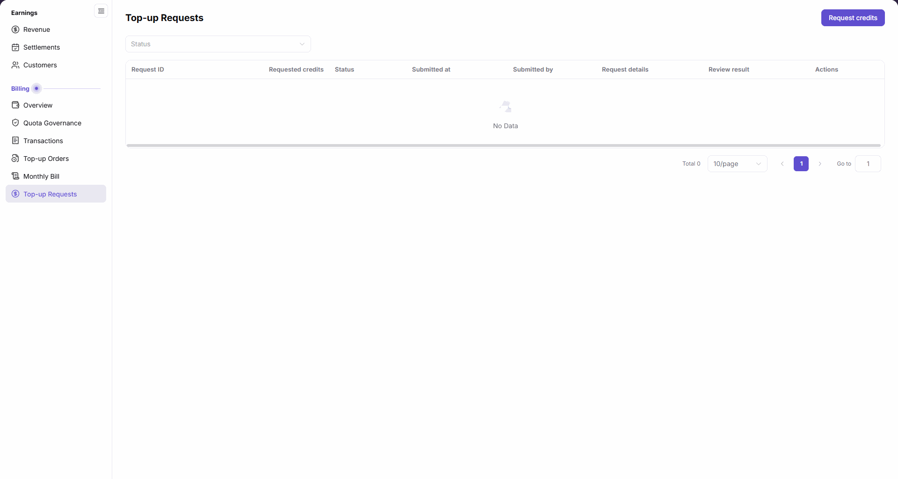
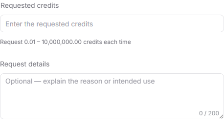

# Top-up Requests

::: info Document Information
Version: v2.0
Updated: 2026-11-05
:::

## Feature Overview

| Item | Content |
| --- | --- |
| Applicable Role | Model Provider & User |
| Navigation path | Billing > Top-up Requests |
| Page route | `/billing/my/top-ups/requests` |
| Managed objects | Account credit requests and review information visible to the current account |

`Top-up Requests` lets you request account credits and view request records by status. The main button is `Request credits`, which opens the `Account Credit Request` dialog. This page is for credit requests, not payment-based top-ups.

#### Beginner Explanation

A top-up request is like a credit request slip: check the request account and the credits needed before filling it in, then review the request record, review result, and actual balance separately.

#### Terms Quick Reference

| Term | Description |
| --- | --- |
| Requested credits | The number of credits you want to add through this request. |
| Review result | The list column that displays review information. |
| Credit Balance | The balance named in the dialog's explanation of adding credits after approval. |

## Prerequisites

1. You are signed in and can open `Billing > Top-up Requests` from the sidebar.
2. Before making a request, determine the number of credits needed and the business purpose.
3. Check the displayed request account, account type, and current balance in the dialog to confirm that the request account matches the intended business scope.

## Page Description

| Area | Description |
| --- | --- |
| Filter | A `Status` dropdown above the list. |
| Request entry | Click `Request credits` to open the `Account Credit Request` dialog. |
| Request list | Eight columns: `Request ID`, `Requested credits`, `Status`, `Submitted at`, `Submitted by`, `Request details`, `Review result`, and `Actions`. |
| Pagination | Shows the total for the current list, page size, and page number. |
| Request dialog | The upper area displays `Request account`, `Account type`, and `Current balance`. The inputs are `Requested credits` and `Request details`, with `Cancel` and `Submit request` at the bottom. |

The figure shows an empty Top-up Requests list: `Request credits` and `Status` appear above the eight column headers. `No Data` and `Total 0` apply only to the current account's visible scope and status condition, not to all top-up requests on the platform.

The dialog states: "Submit an account credit request. After approval, the same number of credits is added to the Credit Balance." This explanation is conditional on approval; clicking `Submit request` is not equivalent to approval or an increased balance.

## Main Operations

### View Request Records by Status

1. Go to `Billing > Top-up Requests`.
2. Open the `Status` dropdown above the list and select the status you need from the options currently offered by the interface.
3. Read the list and total for the current scope. When records are present, identify a request by `Request ID`, then read Requested credits, Status, Submitted at, Submitted by, Request details, and Review result in the same row.
4. If the list shows `No Data`, check the current status condition and the account's visible scope. Do not infer anything about other accounts' requests from this result.

### Fill In and Check an Account Credit Request

1. Click `Request credits` to open the `Account Credit Request` dialog.
2. Check `Request account`, `Account type`, and `Current balance` in the upper area. These are display items and require no manual input.
3. Enter the number of credits needed in the required `Requested credits` field. Each request must be within `0.01 – 10,000,000.00 credits`.
4. Optionally fill in `Request details` and check the character counter. It shows `0 / 200` when blank and allows up to 200 characters.

The figure shows the blank account credit request inputs: the hint below `Requested credits` reads `Request 0.01 – 10,000,000.00 credits each time`, and `Request details` shows the `0 / 200` character counter.

5. Before submitting, recheck the displayed request account, the requested credits, and the request details. Read the dialog's explanation about approval and Credit Balance.
6. To make this request now, click `Submit request`; otherwise, click `Cancel`.

## Parameter Quick Reference

The table distinguishes the filter, form inputs, and display information. Display items require no input; the example credit amount illustrates the input format only.

| Field Name | Required | Field Type | Example | Description |
| --- | --- | --- | --- | --- |
| Status (filter) | No | Dropdown filter | Current UI options | Narrow the request list by status. |
| Request account | Not applicable (display item) | Account information | — | Check which account the credit request applies to. |
| Account type | Not applicable (display item) | Account information | — | Check the type of the request account. |
| Current balance | Not applicable (display item) | Balance information | — | Read the account's currently displayed balance in credits, not the requested amount. |
| Requested credits (form) | Yes | Number (credits) | `100.00` | Request `0.01 – 10,000,000.00 credits` each time. |
| Request details (form) | No | Multiline text | — | Describe the purpose in up to 200 characters; the blank counter is `0 / 200`. |
| Request ID | Not applicable (display item) | List column | — | Identify the request record to review. |
| Requested credits (list) | Not applicable (display item) | List column | — | The number of credits requested in the record. |
| Status (list) | Not applicable (display item) | List column | — | The request record's status, distinct from the status filter above the list. |
| Submitted at | Not applicable (display item) | List column | — | The request submission time. |
| Submitted by | Not applicable (display item) | List column | — | Information about the person who submitted the request. |
| Request details (list) | Not applicable (display item) | List column | — | The request description in the record. |
| Review result | Not applicable (display item) | List column | — | Review information in the record. |
| Actions | Not applicable (display item) | List column | — | The action area for a request row. |

## Pitfalls

- The page is named `Top-up Requests`, while the dialog is named `Account Credit Request`. These names do not indicate two separate entry points.
- `Requested credits` is measured in credits, not a payment amount. The request list's `Status` is also distinct from a top-up order's status.
- The dialog makes a balance increase conditional on "After approval". Opening or submitting a request alone is not proof that credits have been added.

## Result Validation

These checks cover the visible page, form, and request list. They do not establish approval or credited funds.

| Check Item | Success Signal | If Abnormal |
| --- | --- | --- |
| Page location | The title is `Top-up Requests`, with a `Request credits` button and `Status` filter above the list. | Check the page entry through `Billing > Top-up Requests`. |
| Request account | The dialog title is `Account Credit Request`, with Request account, Account type, and Current balance displayed above the inputs. | Check the displayed request account first; do not submit for an unintended account. |
| Input requirements | The required `Requested credits` field, the `0.01 – 10,000,000.00 credits` range hint, and the optional `Request details` character counter are visible. | Check the inputs against the range hint and character counter; do not treat display information as input fields. |
| List scope and fields | The eight column headers remain visible. When records are present, use Request ID to check information in the same row; an empty list shows `No Data` and `Total 0`. | Check the current account's visible scope and status condition. Do not infer platform-wide request activity from an empty result. |

## FAQ

#### Does an Empty List Mean There Are No Top-up Requests on the Platform?

**Symptom:**

The Top-up Requests list shows `No Data` and `Total 0`.

**Possible Causes:**

This is the request list visible to the current account and restricted by the current status condition, not the total for the entire platform.

**Resolution:**

Check the current `Status` condition and the account scope being viewed, and interpret the empty result only within that scope.

#### Do I Need to Fill In the Request Account and Current Balance?

**Symptom:**

The upper part of the request dialog displays `Request account`, `Account type`, and `Current balance`, with request inputs below.

**Possible Causes:**

The dialog includes both account display information and form inputs. The account information identifies the request account; it is not for manual input.

**Resolution:**

Check the account information above, fill in the required `Requested credits`, and optionally enter `Request details`.

## Notes

- Before making a credit request, confirm that the request account, business purpose, and credit amount are within your authorized scope.
- Include only necessary business information in Request details. Do not enter passwords, Tokens, API Keys, or other credentials.
- Request records, review results, top-up orders, and actual balances are separate items to check. A request record alone does not confirm that credits were added.

## Next Steps

1. To query top-up orders, see [Top-up Orders](../top-up-orders/).
2. To view the account balance, see [Account Overview](../overview/).
