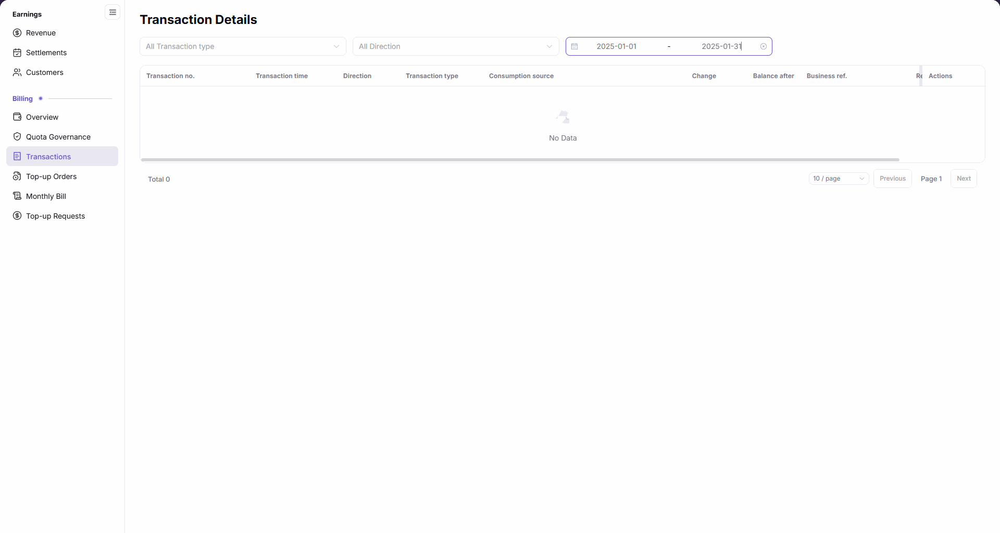

# Transactions

::: info Document Information
Version: v2.1
Updated: 2026-11-05
:::

## Feature Overview

| Item | Content |
| --- | --- |
| Applicable Role | Accounts with access to the `Billing` menu group |
| Navigation path | Billing > Transactions |
| Page route | `/billing/my/account/transactions/records` |
| Managed objects | The current account's transactions, consumption sources, balance changes, and business references |

Transactions queries billing records by transaction type, direction, and date range. Use it to check each record's change amount, balance after the change, and related business information.

#### Beginner Explanation

Transactions works like a list of account receipts: establish the query scope, then read each change and reference number rather than treating filtered results as a complete balance history.

#### Terms Quick Reference

| Term | Description |
| --- | --- |
| Direction | The income or expense direction, displayed separately from transaction type. |
| Transaction type | The business category of a record, also available as a filter. |
| Consumption source | The consumption source displayed in the list. |
| Change | The amount change associated with an individual record. |
| Balance after | The account balance after that transaction, not a project or member quota. |
| Business ref. | The related business reference, displayed separately from the transaction number. |

## Prerequisites

1. The current account can open `Billing > Transactions` in the Billing subsystem.
2. Determine the date range and whether to restrict transaction type or direction.
3. View individual records only within the account and business scope you are authorized to access.

## Page Description

In the Billing subsystem, the left-menu group is `Billing`. The menu item is `Transactions`, while the content title is `Transaction Details`. The corresponding Chinese labels are `流水明细` and `收支明细`.

The page has only three filters: transaction type, direction, and date range. Changing a filter automatically queries the list. The table has ten columns, with `View details` as the row-level entry.

| Area | Description |
| --- | --- |
| Transaction type filter | Displays `All Transaction type` when no type is restricted. |
| Direction filter | Displays `All Direction` when no direction is restricted. |
| Date range | Uses start and end dates to restrict the query. |
| Transaction list | Transaction no., Transaction time, Direction, Transaction type, Consumption source, Change, Balance after, Business ref., Remarks, Actions. |
| Row-level entry | Use `View details` in Actions when a record is present. |
| Empty result and pagination | An empty result displays `No Data` and `Total 0`; pagination browses query results. |

The figure shows Transaction Details with the date range set to `2025-01-01` through `2025-01-31`, including the three filters, headings within the current horizontal viewport, `No Data`, and `Total 0`; the Remarks heading is obscured by the fixed Actions column and requires horizontal scrolling on the page to view. Individual transaction details are not shown.

## Main Operations

### Query Transactions

1. Open `Billing > Transactions` in the Billing subsystem and confirm the content title is `Transaction Details`.
2. Select a transaction type as needed; use `All Transaction type` to include all types.
3. Select a direction as needed; use `All Direction` to leave the direction unrestricted.
4. Set the start and end dates and wait for the list to update automatically with the current filters.
5. Read the matching records or the `No Data` state; change filters directly when another scope is needed.

### Check an Individual Transaction

1. Locate the target record and check `Transaction no.` and `Transaction time`.
2. Read `Direction`, `Transaction type`, and `Consumption source` as separate attributes.
3. Check `Change` and `Balance after` separately; do not interpret the balance as a quota.
4. Review `Business ref.` and scroll the table horizontally to view `Remarks`, keeping the business reference distinct from the transaction number.
5. Use that row's `View details` entry when more information is needed; follow the content actually displayed on the page that opens.

## Parameter Quick Reference

| Field Name | Required | Field Type | Example | Description |
| --- | --- | --- | --- | --- |
| Transaction type (filter) | No | Select | `All Transaction type` | Restricts the business category and automatically queries the list. |
| Direction (filter) | No | Select | `All Direction` | Restricts transaction direction and automatically queries the list. |
| Date range | No | Date range | `2025-01-01` through `2025-01-31` | Restricts the query to start and end dates. |
| Transaction no. | Not applicable | List column | — | Identifier of an individual transaction. |
| Transaction time | Not applicable | Time column | — | Occurrence time displayed for the record. |
| Direction | Not applicable | List column | — | Income or expense direction of the record. |
| Transaction type | Not applicable | List column | — | Business category of the record. |
| Consumption source | Not applicable | List column | — | Consumption source displayed for the record. |
| Change | Not applicable | Amount column | `0` | Amount change for the record; the example is not an actual transaction. |
| Balance after | Not applicable | Balance column | `0` | Account balance after the transaction, not a quota. |
| Business ref. | Not applicable | List column | — | Reference number for the related business transaction. |
| Remarks | Not applicable | List column | — | Additional information displayed for the record. |
| Actions / View details | No | Row-level entry | `View details` | Opens the corresponding individual record. |

## Pitfalls

- `Change` and `Balance after` are different fields; an amount change is not a remaining quota.
- Filters and pagination limit the list. Adjacent visible rows need not form a continuous balance chain and cannot establish a balance anomaly on that basis.
- `No Data` describes the current query result, not other dates or filter scopes.

## Result Validation

| Check Item | Success Signal | If Abnormal |
| --- | --- | --- |
| Page identity | The menu item is `Transactions` and the content title is `Transaction Details`. | Follow the navigation path; a different title does not require another entry. |
| Query scope | Transaction type, direction, and date controls show the intended conditions. | Change the relevant condition directly and review the result. |
| List structure | All ten headings can be checked on the page with horizontal scrolling; an empty result shows `No Data` and `Total 0`. | Scroll horizontally to view Remarks and check the headings and current filters; an empty result does not mean fields are missing. |
| Row-level entry | A record's Actions column displays `View details`. | Distinguish an empty list from a result containing records before interpreting detail availability. |

## FAQ

#### Why Does the Content Title Differ from the Menu?

**Symptom:** Opening `Transactions` displays the content title `Transaction Details`.

**Possible Causes:** The page uses different menu and content labels; the Chinese equivalents are `流水明细` and `收支明细`.

**Resolution:** Locate the page by its menu and route, then query records in Transaction Details rather than looking for a separate page with the same title.

#### Why Does the List Show No Data?

**Symptom:** The list displays `No Data` and pagination shows `Total 0`.

**Possible Causes:** There are no matching records for the current transaction type, direction, and date range; the figure uses `2025-01-01` through `2025-01-31`.

**Resolution:** Check all three filters and change them directly to view another scope. Do not interpret an empty result as an account-wide absence of transactions.

## Notes

- Do not publish real customer information, account emails, private billing amounts, transaction numbers, business references, or credentials. Use `0` or placeholders in public examples and empty results in figures.
- Use this page to query and check records, not to infer a final monthly settlement from one record or the sum of filtered results.
- When reporting a discrepancy to authorized personnel, describe the filters and differing fields without attaching real billing data to public tickets, comments, or reports.

## Next Steps

1. To check top-up records, open [Top-up Orders](../top-up-orders/).
2. To check a billing-cycle summary, open [Monthly Bill](../monthly-bill/).
3. To review the current balance, open [Account Overview](../overview/).
