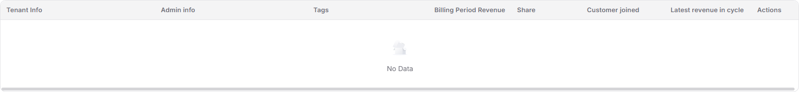
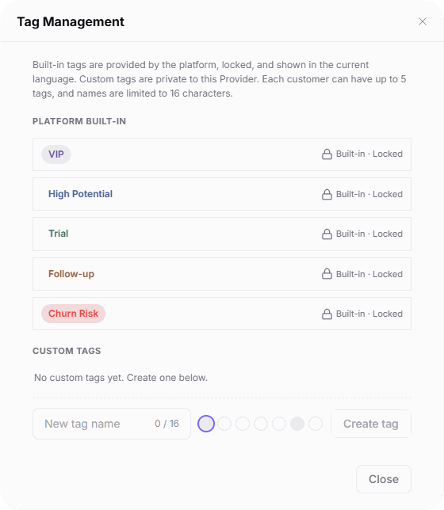

# Customers

::: info Document Information
Version: v2.1
Updated: 2026-11-05
:::

## Feature Overview

| Item | Content |
| --- | --- |
| Applicable Role | Model provider |
| Navigation path | Billing > Earnings > Customers |
| Page route | `/billing/provider/customers` |
| Managed objects | Customer identities, customer tags, and customer revenue information for the selected billing period |

`Customers` locates customers by billing period, a combined keyword search, and customer tags. Use it to review billing-period revenue, share, customer join time, and the latest revenue in the cycle. The page also provides the row-level `Detail` entry and `Manage Tags`.

#### Beginner Explanation

Customers works like a Provider's customer revenue index: read customer statistics at the top, find customers with the filters below, and review each customer's revenue for the selected billing period.

#### Terms Quick Reference

| Term | Description |
| --- | --- |
| Billing period | The month selected for reviewing customer revenue. |
| Billing Period Revenue | Revenue contributed by the customer in the selected billing period. |
| Top 1 customer | The customer with the highest revenue contribution in the selected billing period. |
| Top 5 proportion | The revenue share contributed by the top five customers. |
| Built-in tags | Tags provided by the platform, locked, and shown in the current language. |
| Custom tags | Tags private to this Provider. |

## Prerequisites

1. Sign in with a model provider account that can open `Earnings > Customers`.
2. Confirm the billing period and customer query scope to review.
3. Before preparing to submit a custom tag, confirm its name, color, and owning Provider.

## Page Description

| Area | Description |
| --- | --- |
| Billing period and keyword | Select the billing period. The combined keyword field displays `Search tenant, admin, email, phone, or tenant ID`. |
| Customer tags | Supports multiple selections with OR matching: a customer matches any selected tag. Provides `Manage Tags`. |
| Statistic cards | Show customer total, new customers in the billing period, the Top 1 customer, and Top 5 proportion. Read them separately from the query results below. |
| Statistics update | Provides `Refresh statistics` and displays the statistics update time. |
| Customer table | Shows each customer's identity, tags, and billing-period revenue information. See the full column list below. |

| Area | Description |
| --- | --- |
| Tenant Info | The customer's tenant identity information. |
| Admin info | The customer's administrator information. Both tenant and administrator information provide copy entries. |
| Tags | Tags applied to the customer. |
| Billing Period Revenue | Revenue contributed by the customer in the selected billing period. |
| Share | The customer revenue share displayed on the page. |
| Customer joined | When the customer joined. |
| Latest revenue in cycle | The customer's latest revenue information in the selected billing period. |
| Actions | Provides the row-level `Detail` entry. |

The figure shows the empty customer table after a keyword query, with all eight headings clearly visible: Tenant Info, Admin info, Tags, Billing Period Revenue, Share, Customer joined, Latest revenue in cycle, and Actions, together with the `No Data` state. The figure does not include the top statistic cards or customer details.

## Main Operations

### Query Customer Revenue

1. Go to `Billing > Earnings > Customers`.
2. Select the billing period to review.
3. Enter a keyword in `Search tenant, admin, email, phone, or tenant ID` and press Enter to query.
4. Select one or more customer tags as needed. Multiple selections use OR matching, not a requirement for the customer to have every selected tag.
5. Billing-period and tag selections apply automatically. To run another keyword query, change the text and press Enter.
6. Review the customer table. If it displays `No Data`, check the billing period, keyword, and selected tags rather than interpreting the empty table as no customers across the platform.

### Review Customer Information and the Detail Entry

1. Locate the target customer within the same billing period and check `Tenant Info`, `Admin info`, and `Tags`. Use the corresponding copy entry when an identifier is needed.
2. Read `Billing Period Revenue`, `Share`, and `Customer joined` separately.
3. Review `Latest revenue in cycle`; if any columns are not visible at the current window width, scroll the table horizontally to view them.
4. To continue viewing the customer, verify the target row and use `Detail` in `Actions`.

### Refresh Customer Statistics

1. Confirm the current billing period and read the top cards for customer total, new customers in the billing period, the Top 1 customer, and Top 5 proportion.
2. Click `Refresh statistics` when statistics need updating.
3. Check the statistics update time and values displayed on the page. Read the top cards separately from the customer table; do not derive card values from an empty keyword-query result.

### View Tag Management and Its Input Area

1. Click `Manage Tags` to open `Tag Management`.
2. Review the five `PLATFORM BUILT-IN` tags: `VIP`, `High Potential`, `Trial`, `Follow-up`, and `Churn Risk`. Each is marked `Built-in · Locked`.
3. Review `CUSTOM TAGS`. The illustrated state is `No custom tags yet. Create one below.` Custom tags are private to this Provider.
4. To prepare a custom tag, enter a name of no more than 16 characters in `New tag name` and select a color.
5. `Create tag` is the submission entry. Confirm the name, color, and Provider scope before clicking it. Do not submit if no change is required.
6. Click `Close` to exit the dialog.

The figure shows Tag Management: the five built-in tags are provided by the platform, locked, and shown in the current language; custom tags are private to this Provider. The dialog states a limit of 5 tags per customer and 16 characters per name, and shows the empty custom-tag area, New tag name, color selection, Create tag, and Close.

## Parameter Quick Reference

| Field Name | Required | Field Type | Example | Description |
| --- | --- | --- | --- | --- |
| Billing period | Select for the query | Month selection | `2026-11` | Selects the billing period for reviewing customer revenue. |
| Combined keyword | No | Text | `<query>` | Displays `Search tenant, admin, email, phone, or tenant ID`; press Enter after entering a keyword. |
| Customer tag filter | No | Multiple selection | `VIP`, `High Potential` | A customer matches any selected tag (OR). |
| Refresh statistics | No | Button | `Refresh statistics` | Entry for updating customer statistics. |
| Customer total | Read-only | Statistic card | `<displayed count>` | Top-level customer count; do not derive it from the number of keyword-query table rows. |
| New customers in the billing period | Read-only | Statistic card | `<displayed count>` | Customers added in the selected billing period. |
| Top 1 customer | Read-only | Statistic card | `<customer>` | The customer with the highest revenue contribution in the selected billing period. |
| Top 5 proportion | Read-only | Statistic card | `<displayed share>` | Revenue share contributed by the top five customers. |
| Tenant Info | Read-only | Identity information | `<tenant>` | Customer tenant information in the table, with a copy entry. |
| Admin info | Read-only | Identity information | `<administrator>` | Customer administrator information in the table, with a copy entry. |
| Tags | Read-only | Tag collection | `VIP` | Tags applied to the customer; up to 5 per customer. |
| Billing Period Revenue | Read-only | Revenue amount | `<displayed amount>` | Revenue contributed by the customer in the selected billing period. |
| Share | Read-only | Proportion | `<displayed share>` | Read the customer revenue share displayed on the page. |
| Customer joined | Read-only | Time | `<join time>` | When the customer joined. |
| Latest revenue in cycle | Read-only | Revenue information | `<displayed value>` | Latest revenue information in the selected billing period; read it separately from Customer joined. |
| Actions | No | Table column | `Detail` | Area containing the target customer's row-level entry. |
| Detail | No | Row-level entry | `Detail` | Use after verifying the target customer. |
| Manage Tags | No | Button | `Manage Tags` | Opens Tag Management. |
| New tag name | Enter when creating | Text | `<tag name>` | No more than 16 characters; custom tags are private to this Provider. |
| Color selection | Select as needed | Color options | `<color>` | Color selection in the custom-tag area. |
| Create tag | No | Submission button | `Create tag` | Confirm the name, color, and Provider scope before submitting. |
| Close | No | Button | `Close` | Exits Tag Management. |

## Pitfalls

- Multiple tags use OR matching; customers do not need to have every selected tag.
- `No Data` after a keyword query means only that the current query result is empty. It does not mean there are no customers across the platform or that every top KPI is 0.
- The table has horizontal content. Columns such as `Latest revenue in cycle` outside the current viewport are not missing fields.
- The limit of 5 tags per customer applies to tags assigned to one customer, not the total number of custom tags in the library.
- Built-in tags are locked. Custom tags are private to this Provider, not Operator-private tags or a shared custom-tag library for both roles.

## Result Validation

| Check Item | Success Signal | If Abnormal |
| --- | --- | --- |
| Query conditions | The billing period, keyword, and selected tags match the review target; empty results display `No Data` | Check and adjust the relevant conditions; press Enter after changing the keyword. |
| Table fields | Tenant, administrator, tags, revenue, share, join time, latest revenue, and action columns can be identified | Scroll horizontally to view right-hand columns rather than judging field availability from the current viewport alone. |
| Statistics review | Top customer statistics, statistics update time, and customer query results are reviewed separately | Do not convert an empty table directly into a customer total or revenue statistic of 0. |
| Tag Management | The dialog shows five locked built-in tags, the Provider-private notice, and the custom-tag area | Check the built-in and custom areas separately; click `Close` if no change is required. |

## FAQ

#### Why does an empty customer table not mean all customer statistics are 0?

**Symptom:**

The customer table displays `No Data` after entering a keyword.

**Possible Causes:**

The current keyword query has no matching records. The table contains results for the current conditions, not the total customer population across the platform.

**Resolution:**

Check the billing period, keyword, and selected tags. Press Enter after changing the keyword, and read the top statistic cards separately from the customer table.

#### Why are built-in tags marked as locked?

**Symptom:**

All five built-in tags in Tag Management display `Built-in · Locked`.

**Possible Causes:**

The dialog states that built-in tags are provided by the platform, locked, and shown in the current language. Custom tags occupy a separate area and are private to this Provider.

**Resolution:**

Identify built-in categories by their names in the current language. To prepare a custom tag, use the custom area, keep its name within 16 characters, and confirm the Provider scope before submitting.

## Notes

- Do not publish real customer identities, accounts, email addresses, phone numbers, or billing data. Share only information that recipients are authorized to receive and actually need.
- `Create tag` submits a change. Opening the dialog or entering a name and color does not mean tag creation is complete; use `Close` when no change is required.
- Keep the billing period consistent when reviewing customer revenue. Do not infer KPI scope or the revenue-share denominator from an empty keyword- or tag-filtered table.
- The row-level `Detail` entry belongs to the target customer. Confirm the customer's identity before using it to avoid mixing up records.

## Next Steps

1. For a summary of customer revenue, see [Revenue](../revenue/).
2. To review billing-period settlement records, see [Settlements](../settlements/).
