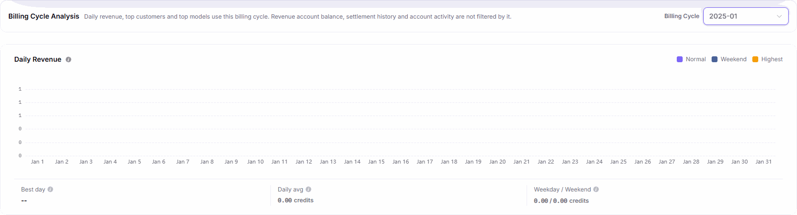

# Revenue Overview

::: info Document Information
Version: v2.1
Updated: 2026-11-05
:::

## Feature Overview

| Item | Content |
| --- | --- |
| Applicable Role | Model provider |
| Navigation path | Billing > Earnings > Revenue |
| Page route | `/billing/provider/revenue` |
| Managed objects | Revenue account balance, current calendar-month estimate, billing cycle analysis, and account activity |

Revenue Overview separates the current revenue account balance, unsettled estimates, and historical settlement results. It also provides daily revenue, top customers, and top models by billing cycle. Use `Settlements`, `Customers`, and `Account Activity` to continue reconciliation.

#### Beginner Explanation

Think of this page as a ledger with separate sections: the account section shows the current balance and all-time totals, while the analysis section shows revenue sources for a selected month. They do not share the same time scope.

#### Terms Quick Reference

| Term | Description |
| --- | --- |
| LIVE REVENUE ACCOUNT BALANCE | Current revenue account balance, independent of the analysis billing cycle. |
| Current Calendar-Month Estimate | Unsettled estimated revenue, not included in the revenue account balance. |
| All-time Net Settled | Net total of all completed settlements, independent of the selected billing cycle. |
| TOTAL PAID OUT | Cumulative transfers to Credit; excludes settlement clawbacks. |
| Billing Cycle Analysis | Daily revenue, top customers, and top models for the selected billing cycle. |

## Prerequisites

1. Use a model provider account to open `Billing > Earnings > Revenue`.
2. Decide whether you need account totals, monthly analysis, or outflow records.
3. Identify the billing cycle to compare when reconciling settlement results.

## Page Description

The menu entry is `Revenue`, the content heading is `Revenue Overview`, and the tabs are `Overview` and `Account Activity`.

| Area | Description |
| --- | --- |
| Overview header | Provides Last updated, Refresh, Account Activity, Settlements, and Customers entries. |
| Account and historical metrics | Shows LIVE REVENUE ACCOUNT BALANCE, All-time Net Settled, and paid-out totals, independent of the analysis billing cycle. |
| Current Calendar-Month Estimate | States `Unsettled; not included in the revenue account balance` and provides `View details →`. |
| Next Settlement Cue | States `Calendar cue only; not settled revenue yet`. |
| Billing Cycle Analysis | Use the `Billing Cycle` dropdown to select the month for daily revenue, top customers, and top models. |
| Account Activity | Shows ACCOUNT BALANCE, NET SETTLED, TOTAL PAID OUT, and the outflow area. |
| Transfer to Available | Opens the form of the same name with Transferable balance, Transfer amount, and Remarks. |

The analysis scope notice reads: `Daily revenue, top customers and top models use this billing cycle. Revenue account balance, settlement history and account activity are not filtered by it.`

There are no page-wide model, customer, or settlement-status filters. The `Billing Cycle` dropdown controls only the analysis section.

## Main Operations

### View Revenue Overview and Billing Cycle Analysis

1. Open `Billing > Earnings > Revenue` and select `Overview`.
2. Review LIVE REVENUE ACCOUNT BALANCE, Current Calendar-Month Estimate, Next Settlement Cue, and All-time Net Settled, keeping their respective definitions separate.
3. Select the target month from `Billing Cycle` in `Billing Cycle Analysis`.
4. Review Daily Revenue, Top Customers, and Top Models for that cycle. Use `Settlements` or `Customers` to reconcile settlements or customer sources.

The figure shows the billing cycle analysis toolbar and Daily Revenue card with `2025-01` selected, including the scope notice, cycle selection, and daily statistics. It does not show account balances or customer and model rankings.

### View Account Activity

1. Switch to the `Account Activity` tab, or use the `Account Activity` entry in the Overview header.
2. Review the three summaries: `ACCOUNT BALANCE`, `NET SETTLED`, and `TOTAL PAID OUT`.
3. Read the NET SETTLED notice, `Normal settlements plus rounding-adjustment credits and clawbacks`, and the TOTAL PAID OUT notice, `Transfers to Credit; excludes settlement clawbacks`.
4. Review the outflow area. An empty area displays `No outflow records`. When historical outflows are available, check their time, method, amount, month, and voucher against the information actually shown, then check [Settlements](../settlements/) for settlement results.

The figure shows `No outflow records` in the outflow area. It does not include the three account summaries above it.

### Inspect the Revenue Transfer Form

1. Click `Transfer to Available` to open the form of the same name.
2. Review the displayed `Transferable balance`.
3. Identify the required numeric `Transfer amount` input and the `Remarks` text field, which has no required marker. The actions are `Cancel` and `Confirm transfer`.
4. For inspection only, click `Cancel` to close the form. `Confirm transfer` submits the form and is not part of a read-only check.

## Parameter Quick Reference

| Field Name | Required | Field Type | Example | Description |
| --- | --- | --- | --- | --- |
| Overview | No | Tab | `Overview` | Shows account metrics and billing cycle analysis. |
| Account Activity | No | Tab | `Account Activity` | Shows account summaries and the outflow records area. |
| LIVE REVENUE ACCOUNT BALANCE / ACCOUNT BALANCE | Not applicable | Amount display | — | Appears in Overview and Account Activity respectively; independent of the analysis cycle. |
| Current Calendar-Month Estimate | Not applicable | Estimated amount | — | Unsettled; not included in the revenue account balance. |
| Next Settlement Cue | Not applicable | Calendar cue | — | Does not indicate that settlement has started. |
| All-time Net Settled / NET SETTLED | Not applicable | Total amount | — | Historical net settlements; the Account Activity notice includes normal settlements, rounding-adjustment credits, and clawbacks. |
| TOTAL PAID OUT | Not applicable | Total amount | — | Transfers to Credit; excludes settlement clawbacks. |
| Billing Cycle | No | Month dropdown | `2025-01` | Affects only Daily Revenue, Top Customers, and Top Models analysis. |
| Daily Revenue | Not applicable | Chart | — | Daily revenue, daily average, and weekday/weekend statistics for the selected cycle. |
| Top Customers | Not applicable | Ranking | — | Customer revenue contributions for the selected analysis cycle. |
| Top Models | Not applicable | Ranking | — | Model revenue contributions for the selected analysis cycle. |
| Transferable balance | Not applicable | Display | — | Balance shown in the transfer form, not an input. |
| Transfer amount | Yes | Numeric input | — | Required transfer-form field. |
| Remarks | No | Multiline text | — | Transfer-form field without a required marker. |

## Pitfalls

- Changing the analysis cycle does not change the scope of revenue account balance, settlement history, or account activity. Account totals are not revenue for the selected month.
- Current Calendar-Month Estimate explicitly states that it is unsettled. Do not count it as a posted balance.
- Next Settlement Cue provides calendar information, not proof that settlement has started.
- NET SETTLED includes rounding-adjustment credits and clawbacks; TOTAL PAID OUT excludes settlement clawbacks. The two definitions are not interchangeable.

## Result Validation

| Check Item | Success Signal | If Abnormal |
| --- | --- | --- |
| Analysis scope | The dropdown shows the target cycle and the scope notice still excludes account totals from filtering. | Recheck the month in Billing Cycle Analysis; do not use the account balance to judge the filter result. |
| Estimate basis | The estimate states `Unsettled; not included in the revenue account balance`. | Use `View details →` on the estimate; do not treat it as posted revenue. |
| Outflow area | The records area is visible in Account Activity; its empty state is `No outflow records`. | Check the selected tab and distinguish the empty outflow area from the account summaries above it. |
| Transfer form | The title, Transferable balance, Transfer amount, Remarks, Cancel, and Confirm transfer are visible. | Check the form title. Use `Cancel` for read-only inspection rather than submitting to validate the page. |

## FAQ

#### Why does selecting a historical cycle not change the balance to that month's amount?

**Symptom:** A historical month is selected in the analysis section, while the balance and historical totals remain account summaries.

**Possible Causes:** The scope notice explicitly excludes revenue account balance, settlement history, and account activity from the analysis cycle selection.

**Resolution:** Use Daily Revenue, Top Customers, and Top Models for the selected cycle. Open [Settlements](../settlements/) to review that month's settlement.

#### Why is the current estimate not an account balance?

**Symptom:** The page shows both Current Calendar-Month Estimate and the revenue account balance.

**Possible Causes:** The estimate card explicitly states `Unsettled; not included in the revenue account balance`.

**Resolution:** Click `View details →` to inspect the estimate composition. Read it as an estimate, not a posted amount.

## Notes

- Read account totals, analysis cycles, and estimated details separately. A single amount does not establish that revenue has settled or been transferred.
- `Confirm transfer` and `Cancel` have different purposes. Do not submit the form when only inspecting it.
- Do not publish real customers, account email addresses, private financial values, credentials, or internal addresses when sharing reconciliation results.

## Next Steps

1. Open [Settlements](../settlements/) for settlement records and current-cycle estimated details.
2. Open [Customers](../customers/) to reconcile revenue sources by customer.
3. Return to this page's `Transfer to Available` form when you need to inspect the transfer entry.
