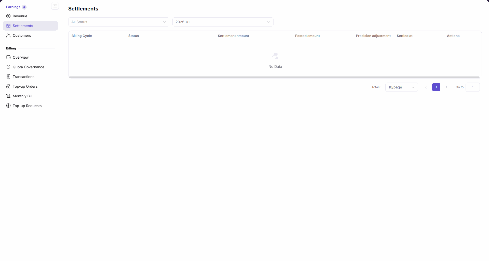
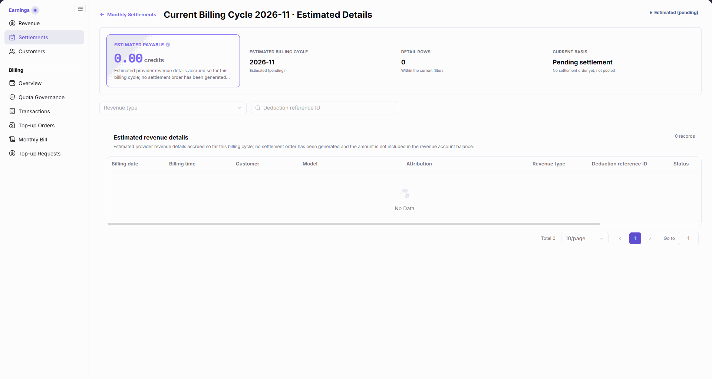

# Settlements

::: info Document Information
Version: v2.1
Updated: 2026-11-05
:::

## Feature Overview

| Item | Content |
| --- | --- |
| Applicable Role | Model provider |
| Navigation path | Billing > Earnings > Settlements |
| Page route | `/billing/provider/settlements` |
| Managed objects | Billing-cycle settlement records, settlement amount, posted amount, precision adjustment, and current-cycle estimated details |

Settlements lists revenue settlement records by status and billing cycle. Use the row-level `Detail` entry to view the corresponding content. The current-cycle estimated row opens an estimated-details page; no settlement order has been generated and its amount is not included in the revenue account balance.

#### Beginner Explanation

The list is a monthly reconciliation index: find the month and status, then open its details. An estimated row contains current-cycle estimates, not a settlement order that has already been posted.

#### Terms Quick Reference

| Term | Description |
| --- | --- |
| Billing Cycle | Month covered by a list record or estimated details. |
| Settlement amount | Settlement or estimated amount shown for the cycle; read it together with the row status. |
| Posted amount | Posting-result field that can also show `Pending`, rather than a numeric amount. |
| Precision adjustment | Separate precision-adjustment column, distinct from Settlement amount and Posted amount. |
| Estimated (pending) | Current-cycle estimated status: no settlement order yet and not posted. |
| Estimated Details | Estimated provider revenue accrued so far this cycle, not included in the revenue account balance. |

## Prerequisites

1. Use a model provider account to open `Billing > Earnings > Settlements`.
2. Identify the target cycle and distinguish current-cycle estimates from historical settlement records.
3. For cross-checking, be ready to inspect account summaries and Account Activity in [Revenue Overview](../revenue/).

## Page Description

Both the menu entry and the list content heading are `Settlements`. Current-cycle estimated details open as a full page, not a drawer. The heading follows `Current Billing Cycle YYYY-MM · Estimated Details`; the return entry is `Monthly Settlements`.

| Area | Description |
| --- | --- |
| List filters | Only `All Status` and `Billing Cycle` are provided. There are no Search, Reset, statement-number, generation-time, or export controls. |
| List columns | Billing Cycle, Status, Settlement amount, Posted amount, Precision adjustment, Settled at, and Actions. |
| Row-level detail | Click `Detail` to view the row's content. The current estimated row opens estimated details. |
| Estimate header | Shows ESTIMATED PAYABLE, ESTIMATED BILLING CYCLE, DETAIL ROWS, and CURRENT BASIS. DETAIL ROWS is counted within the current filters. |
| Estimate scope notice | `Estimated provider revenue details accrued so far this billing cycle; no settlement order has been generated and the amount is not included in the revenue account balance.` |
| Estimate query area | Provides the `Revenue type` filter and `Deduction reference ID` input. |
| Estimated detail table | Billing date, Billing time, Customer, Model, Attribution, Revenue type, Deduction reference ID, Status, and Amount. |

Visible list statuses include `Estimated (pending)` and `Processing`. Read each row's actual status rather than treating an estimated row as a completed settlement.

## Main Operations

### Query the Settlement List

1. Open `Billing > Earnings > Settlements`.
2. Select the query scope using `All Status` and `Billing Cycle`.
3. Review Billing Cycle, Status, Settlement amount, Posted amount, Precision adjustment, and Settled at in the target row. Read `Pending` in Posted amount as a text status.
4. If the list displays `No Data`, check the two selected filters. Change the Billing Cycle selection directly to inspect another month.

The figure shows the Settlements list with `2025-01` selected, including All Status, the billing-cycle filter, seven table columns, and the `No Data` empty state.

### View Current-Cycle Estimated Details

1. Select the current billing cycle in the list and locate the row marked `Estimated (pending)`.
2. Click its `Detail` entry to open `Current Billing Cycle YYYY-MM · Estimated Details`. The address includes the corresponding `cycle` and `view=estimated`.
3. Review ESTIMATED PAYABLE, ESTIMATED BILLING CYCLE, DETAIL ROWS, and CURRENT BASIS. Confirm `No settlement order yet; not posted` and the notice that the amount is not included in the revenue account balance.
4. Select `Revenue type` as needed, or enter the reference to check in `Deduction reference ID`.
5. On the page, review Billing date, Billing time, Customer, Model, Attribution, Revenue type, Deduction reference ID, and Status, then scroll horizontally to review Amount at the far right and check all nine columns. The table displays `No Data` when there are no matching detail records.
6. Click `Monthly Settlements` to return to the list.

The figure shows current-cycle estimated details, including four header metrics, the notice that no settlement order exists and the amount is excluded from the balance, the Revenue type filter, the Deduction reference ID input, and the empty detail table; the current horizontal viewport includes only the eight headings from Billing date through Status. The far-right Amount column is outside the image and requires horizontal scrolling on the page to view.

### Review Historical Settlements and Cross-Check Results

1. Return to the list and select the historical month to review in `Billing Cycle`.
2. When records are present, check the row's Status, Settlement amount, Posted amount, Precision adjustment, and Settled at.
3. Use the row's `Detail` entry to inspect its settlement content. Reconcile the information actually displayed; do not apply the current-cycle estimate basis to every historical detail view.
4. Open [Revenue Overview](../revenue/) to cross-check account summaries and Account Activity. The revenue-to-Credit transfer entry belongs to Revenue Overview, not this list's action buttons.

## Parameter Quick Reference

| Field Name | Required | Field Type | Example | Description |
| --- | --- | --- | --- | --- |
| All Status | No | List filter | `All Status` | Filters settlement records by status. |
| Billing Cycle | No | List filter | `2025-01` | Selects the month to query. |
| Billing Cycle | Not applicable | List column | — | Billing cycle covered by the record. |
| Status | Not applicable | List column | `Estimated (pending)` | Visible statuses also include `Processing`; follow the row's displayed value. |
| Settlement amount | Not applicable | List column | — | Read the settlement or estimated amount together with the row status. |
| Posted amount | Not applicable | Amount or text | `Pending` | Not every row is a numeric amount. |
| Precision adjustment | Not applicable | List column | — | Separate precision-adjustment item. |
| Settled at | Not applicable | List column | — | Review the row's displayed settlement time or placeholder. |
| Actions / Detail | No | Row-level entry | `Detail` | Opens the row's content; estimated rows open a full estimated-details page. |
| ESTIMATED PAYABLE | Not applicable | Estimate metric | — | Unsettled and not included in the revenue account balance. |
| ESTIMATED BILLING CYCLE | Not applicable | Month display | — | Billing cycle covered by the estimate. |
| DETAIL ROWS | Not applicable | Count display | — | Counted within the current filters. |
| CURRENT BASIS | Not applicable | Status display | `Pending settlement` | States `No settlement order yet; not posted`. |
| Revenue type | No | Estimate filter | — | Filters estimated revenue details. |
| Deduction reference ID | No | Text input | — | Enter the deduction reference to check. |
| Billing date | Not applicable | Detail column | — | Billing date of the detail record. |
| Billing time | Not applicable | Detail column | — | Billing time of the detail record. |
| Customer | Not applicable | Detail column | — | Customer associated with the record. |
| Model | Not applicable | Detail column | — | Model associated with the record. |
| Attribution | Not applicable | Detail column | — | Attribution information for the record. |
| Revenue type | Not applicable | Detail column | — | Revenue category of the record. |
| Deduction reference ID | Not applicable | Detail column | — | Deduction reference associated with the record. |
| Status | Not applicable | Detail column | — | Read the estimate using the status displayed in this column. |
| Amount | Not applicable | Detail column | — | Payable amount in the estimated detail record. |

## Pitfalls

- An `Estimated (pending)` row can open details, but the page explicitly states that no settlement order has been generated. Available details do not mean the amount has been posted.
- `Posted amount` can display `Pending`. Do not read this text status as a numeric amount.
- `No Data` in the estimated detail table means that the table currently has no records, not that a details page does not exist.
- `DETAIL ROWS` is counted within the current filters. Check Revenue type and Deduction reference ID conditions when comparing counts.

## Result Validation

| Check Item | Success Signal | If Abnormal |
| --- | --- | --- |
| List scope | The filter area shows the target status and billing cycle, and the table retains seven columns. | Recheck `All Status` and `Billing Cycle`; do not look for Search or Reset buttons. |
| Estimate entry | `Detail` on the current estimated row opens a full estimated-details page. | Check the selected row's cycle and status, distinguishing estimated rows from historical settlement rows. |
| Estimate basis | The header states that there is no settlement order, the amount is not posted, and it is excluded from the revenue account balance. | Read it as an estimate and inspect the account balance separately in Revenue Overview. |
| Details and return | The query area and `Monthly Settlements` return entry can be checked on the page, and all nine detail columns can be checked after horizontal scrolling; an empty table shows `No Data`. | Check detail filters and scroll horizontally to view Amount. Use the return entry when you need to select another billing cycle. |

## FAQ

#### Why do details still say that no settlement order has been generated?

**Symptom:** The current-cycle row provides `Detail`, but the opened page states that no settlement order exists and the amount is excluded from the revenue account balance.

**Possible Causes:** The row is marked `Estimated (pending)` and opens estimated provider revenue accrued so far this cycle.

**Resolution:** Check ESTIMATED BILLING CYCLE and CURRENT BASIS, and read the content as an estimate. Return to the list and select another cycle to inspect historical settlements.

#### Why does Posted amount show text instead of a number?

**Symptom:** The list displays `Pending` under `Posted amount`.

**Possible Causes:** This column supports pending text, and the current row is not displaying a numeric posting result.

**Resolution:** Check the row's Status and Settled at together. Do not convert `Pending` into an amount. Use `Detail` to inspect the corresponding content.

## Notes

- Estimated details, Settlement amount, and Posted amount are different kinds of results. Do not infer arrival times or precision-adjustment formulas from them.
- Reviewing the list and details does not require a revenue transfer. Open Revenue Overview to inspect the transfer form.
- Do not publish real customers, account email addresses, private financial values, deduction reference IDs, or credentials when sharing settlement reconciliation information.

## Next Steps

1. Open [Revenue Overview](../revenue/) for account summaries, Account Activity, and the revenue-to-Credit transfer entry.
2. Open [Customers](../customers/) to continue reviewing revenue sources by customer.
