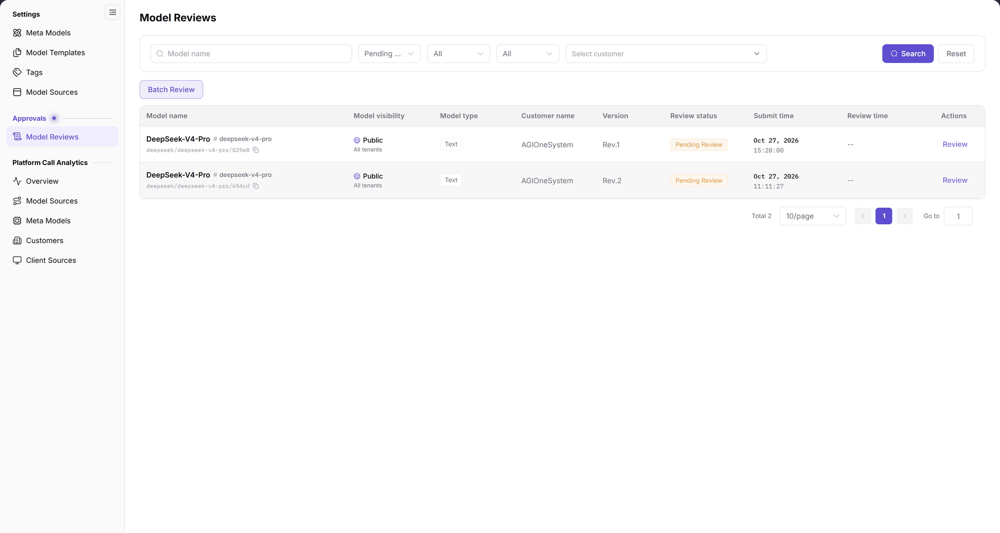
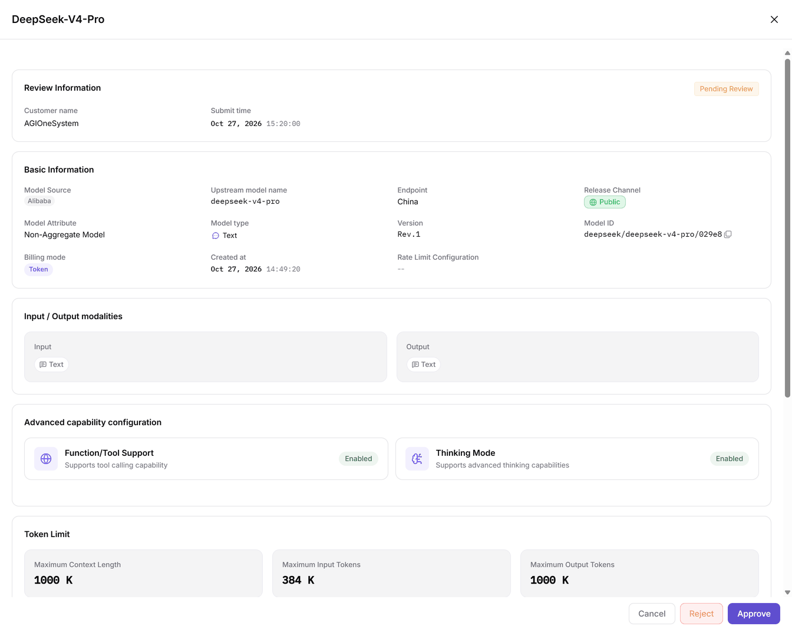

# Model Reviews

::: info Document Information
Version: v2.0
Updated: 2026-11-04
:::

## Feature Overview

| Item | Content |
| --- | --- |
| Applicable role | Operator Admin |
| Navigation path | **Model Services** > **Approvals** > **Model Reviews** |
| Page route | `/modelone/audit/model` |
| Managed objects | Pending model records, model visibility, model type, customer, version, review status, submit time, and review time |

**Beginner explanation**: Model review is the checkpoint before a model becomes visible or callable. The operator checks the model source, capabilities, modalities, token limits, protocols, and billing information in the review drawer, then chooses Approve or Reject.

#### Terms Quick Reference

| Term | Description |
| --- | --- |
| Pending Model | A model version submitted by a provider or tenant for listing or update, awaiting operator review. |
| Model Visibility | The audience scope permitted after approval and publishing, such as public (all tenants) or private to specific customers. |
| Upstream Model | The vendor model identifier targeted by the model source, used for underlying API routing and authentication. |
| Billing Configuration | The token or per-request pricing, cache discount rates, and billing modes verified in the review drawer. |

## Prerequisites

1. The current account can view and process **Approvals > Model Reviews**.
2. Pending records exist. The list contains at least one record in `Pending Review`.
3. The model source, visibility, version, and capability configuration are confirmed before review.

## Page Description

The top area contains filters; the review table sits below:

- Filters: `Model name`, a `Pending Review` status drop-down, two `All` drop-downs, and `Select customer`.
- Actions: **Search**, **Reset**, and **Batch Review**.
- Table columns: `Model name`, `Model visibility`, `Model type`, `Customer name`, `Version`, `Review status`, `Submit time`, `Review time`, `Actions`.
- The action column currently offers **Review**; there is no separate **Details** button.

| Area | Description |
| --- | --- |
| Top Filter Bar | Provides model name, review status drop-down, visibility, model type, customer filters, Search, Reset, and Batch Review |
| Model Review Table | Displays model name and identifier, visibility, type, customer, version, review status, submit/review times, and actions |
| Review Detail Drawer | Slides out from the right on clicking Review, showing review info, basic info, modalities, capabilities, token limits, and billing |
| Bottom Action Bar | Provides Cancel, Reject, and Approve in the drawer, or Cancel, Reject, and Approve Selected in batch mode |

The figure shows the list shows two `Pending Review` records of `DeepSeek-V4-Pro`, Rev.1 and Rev.2. `Model visibility` is `Public / All tenants`, `Customer name` is `AGIOneSystem`, `Review time` shows `--`, and the action column shows `Review`.

## Main Operations

### Filter review records

1. Enter a name keyword in `Model name`.
2. Choose a status such as `Pending Review`.
3. Select visibility, model type, or customer as needed.
4. Click **"Search"** to query, or **"Reset"** to clear the conditions.
5. The footer shows `Total N` and pagination controls.

### Review a single record

1. Click **"Review"** on the target row; the review drawer opens on the right.
2. The drawer title shows the model name, for example `DeepSeek-V4-Pro`. `Review Information` shows the customer, submit time, and `Pending Review` status.
3. Under `Basic Information`, check the model source, upstream model name, Endpoint, release channel, model attribute, model type, version, model ID, billing mode, creation time, and rate limit configuration.
4. Check `Input / Output modalities`, `Advanced capability configuration`, `Token Limit`, `Official Native Protocols and Default Advanced Parameters`, and `Billing Configuration`.
5. The footer provides **"Cancel"**, **"Reject"**, and **"Approve"**. Confirm the model and version before choosing.

The figure shows the drawer shows `Review Information`, `Basic Information`, `Input / Output modalities`, `Advanced capability configuration`, and `Token Limit`. In the example, `Release Channel` is `Public`, `Billing mode` is `Token`, and the footer buttons are `Cancel`, `Reject`, and `Approve`.

### Batch review

1. Select the records to process together.
2. Click **"Batch Review"**; the batch action area appears.
3. The batch area provides **"Cancel"**, **"Reject"**, and **"Approve Selected"**.
4. Before submitting, check the selected count, model names, versions, and visibility.

## Parameter Quick Reference

### List fields

| Field Name | Required | Field Type | Example | Description |
| --- | --- | --- | --- | --- |
| Model name | System-maintained | Text | `DeepSeek-V4-Pro` | Pending model name; the identifier appears below |
| Model visibility | System-maintained | Tag | `Public / All tenants` | Visibility after publishing |
| Model type | System-maintained | Tag | `Text` | Model capability type |
| Customer name | System-maintained | Text | `AGIOneSystem` | Customer that submitted the record |
| Version | System-maintained | Text | `Rev.1` | Version submitted for review |
| Review status | System-maintained | Enumeration | `Pending Review` | Current review status |
| Submit time | System-maintained | Date time | `Oct 27, 2026 15:20:00` | Submission time |
| Review time | System-maintained | Date time | `--` | Shows `--` before review |
| Actions | Permission-based | Button | `Review` | Opens the review drawer |

### Review drawer fields

| Field Name | Required | Field Type | Example | Description |
| --- | --- | --- | --- | --- |
| Customer name | System | Text | `AGIOneSystem` | Customer in Review Information |
| Submit time | System | Date time | `Oct 27, 2026 15:20:00` | Submit time in Review Information |
| Model Source | System | Text | `Alibaba` | Upstream model source |
| Upstream model name | System | Text | `deepseek-v4-pro` | Model name on the source side |
| Endpoint | System | Text | `China` | Source endpoint |
| Release Channel | System | Tag | `Public` | Current release channel |
| Model Attribute | System | Text | `Non-Aggregate Model` | Model attribute |
| Model type | System | Tag | `Text` | Model capability type |
| Version | System | Text | `Rev.1` | Review version |
| Model ID | System | Text | `deepseek/deepseek-v4-pro/029e8` | Unique model identifier |
| Billing mode | System | Tag | `Token` | Current billing mode |
| Created at | System | Date time | `Oct 27, 2026 14:49:20` | Model creation time |
| Rate Limit Configuration | System | Text | `--` | Current rate limit configuration |
| Input / Output | System | Tag | `Text` | Input and output modalities |
| Advanced capability configuration | System | Tag | `Function/Tool Support`, `Thinking Mode` | Enabled advanced capabilities |
| Token Limit | System | Number | `Maximum Context Length 1000 K` | Context, input, and output limits |
| Official Native Protocols and Default Advanced Parameters | System | Protocol list | `OpenAI-ChatCompletions` | Supported protocols |
| Billing Configuration | System | Number | `Input 1152.00 credits/M tokens` | Input, output, and cache prices |

## Pitfalls

- The action column currently offers only **Review**, with no separate **Details** button. Open the review drawer to inspect the configuration.
- `Review time` shows `--` when the record has not been reviewed; processed records show a review time.
- Batch review applies to the selected records. Check the selected count, model names, versions, and visibility before submitting.
- `Model ID`, `Billing Configuration`, and `Token Limit` are key fields for identifying the current version. Do not judge by the model name alone.

## Result Validation

| Check Item | Success Signal | If Abnormal |
| --- | --- | --- |
| Record is pending | `Review status` shows `Pending Review` and `Review time` shows `--` | If the status shows Approved or Rejected, another reviewer has already processed it; refresh the list to see current state |
| Review drawer opened | The drawer title shows the model name and sections such as `Review Information` and `Basic Information` appear | If the drawer fails to slide out, verify network connectivity and click **"Review"** again |
| Single-record actions | The drawer footer shows `Cancel`, `Reject`, and `Approve` buttons | Ensure your account has operator review write permissions; unauthorized accounts may see buttons disabled or missing |
| Batch actions | After clicking `Batch Review`, `Cancel`, `Reject`, and `Approve Selected` appear | Check whether at least one row checkbox is selected in the list before clicking batch actions |
| List total and paging | The footer shows `Total N` and pagination controls allow switching pages | Click **"Reset"** to clear filters and ensure no hidden filtering rules are applied |

## FAQ

#### There is no Details button in the list

**Symptom:**

You want to inspect model configurations, but only `Review` is visible in the action column with no separate details button.

**Possible Causes:**

The platform intentionally unifies read-only configuration verification and approval actions into a single review drawer.

**Resolution:**

Click **"Review"** in the action column to open the right drawer. Inspect the parameters, and click **"Cancel"** at the bottom to close the drawer without altering the record status.

#### The list is empty after filtering

**Symptom:**

After selecting a model name, status, visibility, or customer, no records remain in the table.

**Possible Causes:**

Multiple filter conditions are combined using logical AND, resulting in excessive filtering, or target records were processed by other reviewers.

**Resolution:**

1. Click **"Reset"** to clear all conditions.
2. Keep only `Pending Review` status first, then add the model name, visibility, or customer one at a time.
3. Confirm with the submitter that the model was successfully submitted for approval.

#### Single review or batch review?

**Symptom:**

When facing numerous pending records, it is unclear whether to process records individually or in batch.

**Possible Causes:**

Batch review applies uniform decisions and does not permit per-model price adjustments or custom token override verifications.

**Resolution:**

- Use **"Review"** on a row when you need to inspect individual versions, prices, or capability configurations.
- Use **"Batch Review"** when multiple records share identical vendor sources and pre-verified rules; verify the count before submitting.

## Notes

- Before approving, confirm the model source, visibility, version, billing mode, and token limits; do not rely on the name alone.
- Public visibility expands the audience. Confirm the authorization scope before approving.
- Batch review processes several records at once. Check the selected items before submitting.
- Do not include real credentials, complete request headers, or sensitive customer data in review comments or screenshots.

## Next Steps

1. Verify upstream endpoints, protocol setups, and connectivity in Model Sources.
2. Verify capability tags, token limits, and supported native protocols in Meta Models.
3. Check the published status and tenant visibility in Model Publishing after approval.

Related pages:
- [Model Sources](../../settings/model-source/)
- [Meta Models](../../settings/meta-models/)
- [Model Templates](../../settings/model-templates/)
