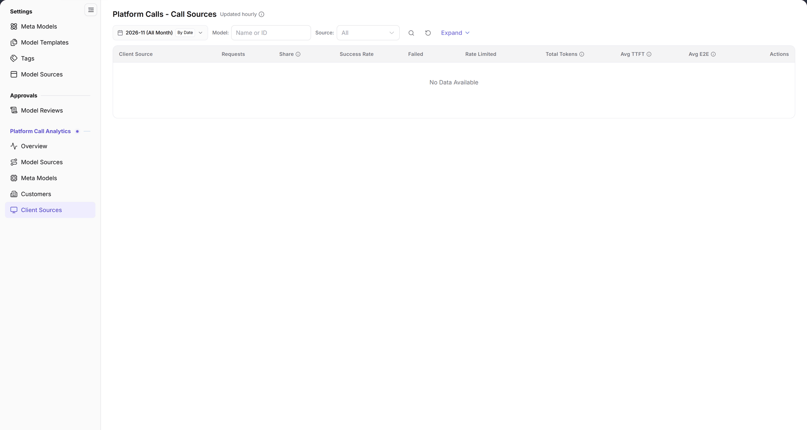

# Client Sources

::: info Document Information
Version: v2.0
Updated: 2026-11-04
:::

## Feature Overview

| Item | Content |
| --- | --- |
| Applicable role | Operator Admin |
| Navigation path | **Model Services** > **Platform Call Analytics** > **Client Sources** |
| Page route | `/modelone/model-observation/operator/apps` |
| Managed objects | Requests, share, success rate, failed calls, rate-limited calls, tokens, and latency by client source |

**Beginner explanation**: This page breaks call statistics down by client source. It answers which client sources call the platform and how their volume and success rate look. The page is read-only and does not configure applications or sources.

#### Terms Quick Reference

| Term | Description |
| --- | --- |
| Client Source | The client application, system service, or API key origin initiating model invocations. |
| Avg TTFT | Time To First Token, measuring average latency between receiving a request and returning the first generated token. |
| Avg E2E | End-to-End latency, covering total elapsed duration from gateway routing, queuing, to final completion. |
| Rate Limited Calls | Requests rejected by the platform gateway when concurrency or QPS exceeds configured rate limits. |

## Prerequisites

1. The current account can view **Platform Call Analytics > Client Sources**.
2. The platform has call data. If the current scope has no data, the list shows `No Data Available`.
3. The month, model, and source filters are confirmed before reading the data.

## Page Description

- Filters: month `2026-11 (All Month)`, `By Date`, `Model: name or ID`, `Source: All`, a search icon, a reset icon, and `Expand`.
- Table columns: `Client Source`, `Requests`, `Share`, `Success Rate`, `Failed`, `Rate Limited`, `Total Tokens`, `Avg TTFT`, `Avg E2E`, `Actions`.
- Unlike Model Sources, Meta Models, and Customers, this page has no `Avg TPOT` column.
- When there is no data, the table shows `No Data Available`.

| Area | Description |
| --- | --- |
| Top Time & Filter Bar | Provides month selection, daily granularity toggle, model name/ID filter, source dropdown, and Expand button |
| Status & Cadence Tag | Displays "Updated hourly" next to the title, indicating aggregation and ingestion freshness |
| Client Source Statistics Table | Displays requests, share, success rate, failed and rate-limited counts, total tokens, and latency metrics per source |

The figure shows the heading is marked `Updated hourly`. The filters contain the month, `By Date`, `Model`, `Source`, and `Expand`. The table starts with `Client Source` and shows requests, share, success rate, failed, rate-limited, total tokens, average TTFT, average E2E, and actions; it currently shows `No Data Available`.

## Main Operations

1. Select the month, for example `2026-11 (All Month)`.
2. Use `By Date` to switch the granularity.
3. Enter a name or ID in `Model`, and select a source in `Source` or keep `All`.
4. Click the **"Search"** icon to query, the **"Reset"** icon to clear, or **"Expand"** for more conditions.
5. Read requests, success rate, failed calls, rate limiting, tokens, and latency for each `Client Source`.

## Parameter Quick Reference

| Field Name | Required | Field Type | Example | Description |
| --- | --- | --- | --- | --- |
| Month | Required | Month picker | `2026-11 (All Month)` | Statistics month |
| By Date | Optional | Toggle | `By Date` | Time granularity |
| Model | Optional | Text | `DeepSeek-V4-Pro` | Filter by name or ID |
| Source | Optional | Drop-down | `All` | Filter by source |
| Client Source | System-maintained | Text | `AGIOne` | Calling client source |
| Requests / Share / Success Rate | System-maintained | Number / percentage | `1,024` / `32%` / `99.5%` | Volume and quality metrics |
| Failed / Rate Limited | System-maintained | Number | `5` / `2` | Failed and rate-limited calls |
| Total Tokens | System-maintained | Number | `1,200,000` | Total tokens |
| Avg TTFT / Avg E2E | System-maintained | Duration | `320 ms` | Latency metrics |

## Pitfalls

- This page has no `Avg TPOT` column. Use [Model Sources](../model-sources/) or [Meta Models](../meta-models/) when you need TPOT.
- The heading is marked `Updated hourly`; the data is not real-time.
- The `Source` and `Model` filters combine. Clear them when the result is empty.
- When the page shows `No Data Available`, the selected range has no call records.

## Result Validation

| Check Item | Success Signal | If Abnormal |
| --- | --- | --- |
| Page loaded | The heading `Platform Calls - Call Sources`, `Updated hourly`, and filters are visible | Refresh the page or check whether the operator account has call analytics permissions |
| Table structure | Headers include `Client Source`, `Requests`, `Share`, `Success Rate`, `Failed`, `Rate Limited`, `Total Tokens`, `Avg TTFT`, `Avg E2E`, and `Actions` | If table columns are missing or misaligned, clear browser cache and reopen |
| Filter responsiveness | Changing month or selecting a source immediately recalculates table metrics | Click **"Reset"** to clear conflicting filters and confirm whether traffic existed in the timeframe |
| Empty state | In months without traffic or matching sources, `No Data Available` is displayed | Switch to a month with historical calls, or check the platform Overview for global volume |

## FAQ

#### The page has no data

**Symptom:**

The client source table shows `No Data Available` with all metrics empty.

**Possible Causes:**

No invocations originated from the selected client source in the chosen month, or source name filtering excluded results.

**Resolution:**

1. Switch to a recent month with recorded call activity.
2. Click the **"Reset"** icon to clear model and source filters.
3. Open [Overview](../overview/) to confirm whether overall platform traffic exists for the period.

#### Why is there no average TPOT column?

**Symptom:**

Other statistics pages display `Avg TPOT`, but the Client Sources page omits this column.

**Possible Causes:**

Client source analysis focuses on gateway initial latency (TTFT) and end-to-end duration (E2E), while throughput is measured at model sources and meta models.

**Resolution:**

If you need model generation throughput (TPOT), navigate to [Model Sources](../model-sources/) or [Meta Models](../meta-models/).

## Notes

- This page is read-only and has no application or source configuration entry.
- Results depend on the month, model, and source filters.
- Read latency together with the sample size.

## Next Steps

1. Check customer call analytics to compare tenant distribution across client sources.
2. Return to the platform overview to observe global traffic patterns and peak hours.
3. For sources with high failure or rate limit rates, verify client call parameters and rate quotas.

Related pages:
- [Customers](../customers/)
- [Model Sources](../model-sources/)
- [Meta Models](../meta-models/)
- [Overview](../overview/)
