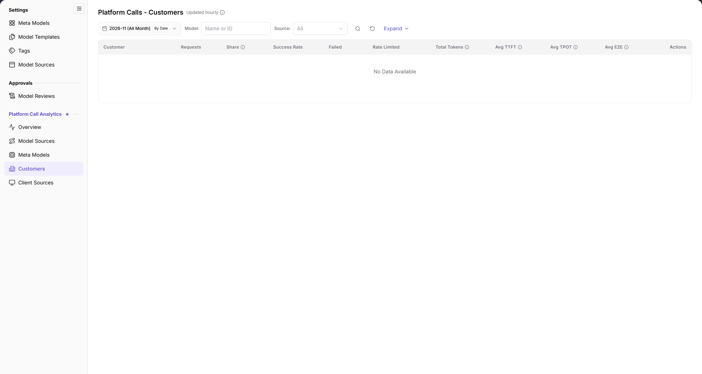

# Customers

::: info Document Information
Version: v2.0
Updated: 2026-11-04
:::

## Feature Overview

| Item | Content |
| --- | --- |
| Applicable role | Operator Admin |
| Navigation path | **Model Services** > **Platform Call Analytics** > **Customers** |
| Page route | `/modelone/model-observation/operator/customers` |
| Managed objects | Requests, share, success rate, failed calls, rate-limited calls, tokens, and latency by customer |

**Beginner explanation**: This page breaks call statistics down by customer. It answers which customers call the platform and how their volume and success rate look. The page is read-only and does not maintain customer records.

#### Terms Quick Reference

| Term | Description |
| --- | --- |
| Customer (Tenant) | An independent enterprise, organization, or tenant entity connected to the platform initiating model calls. |
| Call Share | The percentage of invocations made by this customer relative to total platform call volume over the period. |
| Avg TPOT | Time Per Output Token, measuring average time per generated token during output. |
| Failed Calls | Invocations failing due to bad client parameters (4xx), invalid authentication, or upstream server errors (5xx). |

## Prerequisites

1. The current account can view **Platform Call Analytics > Customers**.
2. The platform has call data. If the current scope has no data, the list shows `No Data Available`.
3. The month, model, and source filters are confirmed before reading the data.

## Page Description

- Filters: month `2026-11 (All Month)`, `By Date`, `Model: name or ID`, `Source: All`, a search icon, a reset icon, and `Expand`.
- Table columns: `Customer`, `Requests`, `Share`, `Success Rate`, `Failed`, `Rate Limited`, `Total Tokens`, `Avg TTFT`, `Avg TPOT`, `Avg E2E`, `Actions`.
- When there is no data, the table shows `No Data Available`.

| Area | Description |
| --- | --- |
| Top Time & Filter Bar | Provides month selection, daily granularity toggle, model name/ID filter, source dropdown, and Expand button |
| Status & Cadence Tag | Displays "Updated hourly" next to the title, indicating aggregation and ingestion freshness |
| Customer Statistics Table | Displays requests, global share, success rate, failed and rate-limited counts, total tokens, and latency/throughput metrics |

The figure shows the heading is marked `Updated hourly`. The filters contain the month, `By Date`, `Model`, `Source`, and `Expand`. The table starts with `Customer` and shows requests, share, success rate, failed, rate-limited, and latency columns; it currently shows `No Data Available`.

## Main Operations

1. Select the month, for example `2026-11 (All Month)`.
2. Use `By Date` to switch the granularity.
3. Enter a name or ID in `Model`, and select a source in `Source` or keep `All`.
4. Click the **"Search"** icon to query, the **"Reset"** icon to clear, or **"Expand"** for more conditions.
5. Read requests, success rate, failed calls, rate limiting, tokens, and latency for each `Customer`.

## Parameter Quick Reference

| Field Name | Required | Field Type | Example | Description |
| --- | --- | --- | --- | --- |
| Month | Required | Month picker | `2026-11 (All Month)` | Statistics month |
| By Date | Optional | Toggle | `By Date` | Time granularity |
| Model | Optional | Text | `DeepSeek-V4-Pro` | Filter by name or ID |
| Source | Optional | Drop-down | `All` | Filter by source |
| Customer | System-maintained | Text | `AGIOneSystem` | Calling customer |
| Requests / Share / Success Rate | System-maintained | Number / percentage | `1,024` / `32%` / `99.5%` | Volume and quality metrics |
| Failed / Rate Limited | System-maintained | Number | `5` / `2` | Failed and rate-limited calls |
| Total Tokens | System-maintained | Number | `1,200,000` | Total tokens |
| Avg TTFT / TPOT / E2E | System-maintained | Duration | `320 ms` | Latency metrics |

## Pitfalls

- This page is read-only and has no customer edit entry.
- The heading is marked `Updated hourly`; the data is not real-time.
- The `Source` and `Model` filters combine. Clear them when the result is empty.
- When the page shows `No Data Available`, the selected range has no call records.

## Result Validation

| Check Item | Success Signal | If Abnormal |
| --- | --- | --- |
| Page loaded | The heading `Platform Calls - Customers`, `Updated hourly`, and filters are visible | Refresh the page or check whether the operator account has customer call analytics permissions |
| Table structure | Headers include `Customer`, `Requests`, `Share`, `Success Rate`, `Failed`, `Rate Limited`, `Total Tokens`, `Avg TTFT`, `Avg TPOT`, `Avg E2E`, and `Actions` | If throughput metrics are missing, verify whether called models support streaming output metrics |
| Filter responsiveness | Changing month or model immediately recalculates customer rankings and quality metrics | Click **"Reset"** to clear conditions and avoid over-filtering |
| Empty state | When no traffic exists in the period, `No Data Available` is displayed centered in the table | Switch to a month with historical calls to verify table rendering |

## FAQ

#### The page has no data

**Symptom:**

The customer statistics table displays `No Data Available` with no tenant rows.

**Possible Causes:**

No invocations occurred across the platform in the chosen month, or model/source filters excluded all customer traffic.

**Resolution:**

1. Switch to a recent month with recorded call activity.
2. Click the **"Reset"** icon to clear model and source filters.
3. Open [Overview](../overview/) to confirm whether overall platform traffic exists for the period.

#### What is the difference between Customers and Client Sources?

**Symptom:**

Both Customers and Client Sources present invocation metrics; it is unclear which page to use for accounting.

**Possible Causes:**

They aggregate metrics along different dimensions: Customers aggregates by tenant organization, while Client Sources aggregates by calling application or service entry.

**Resolution:**

- Use `Customers` for tenant billing reconciliation and multi-tenant resource consumption audits.
- Use [Client Sources](../call-sources/) when investigating client application health, SDK versions, or integration gateways.
- Use [Model Sources](../model-sources/) when examining upstream provider performance and vendor SLA.

## Notes

- This page is read-only and has no customer maintenance entry.
- Results depend on the month, model, and source filters.
- Read latency together with the sample size.

## Next Steps

1. Check Client Sources to inspect traffic breakdown across client applications for a customer.
2. Check Model Sources to audit the health of upstream physical vendors called by the customer.
3. For customers experiencing frequent rate-limiting, review and increase gateway QPS/concurrency quotas.

Related pages:
- [Client Sources](../call-sources/)
- [Model Sources](../model-sources/)
- [Meta Models](../meta-models/)
- [Overview](../overview/)
- Open [Model Sources](../model-sources/) for the upstream model dimension.
