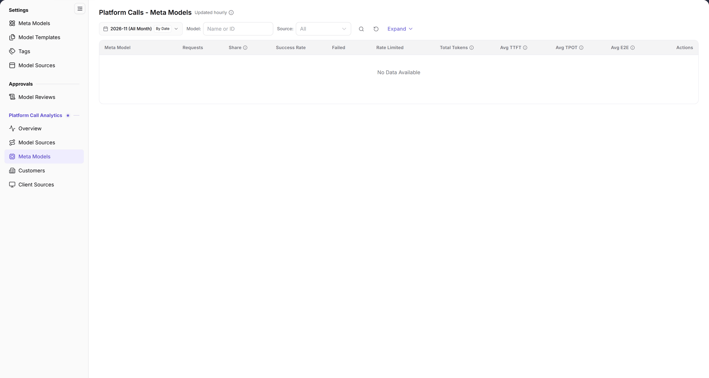

# Meta Models

::: info Document Information
Version: v2.0
Updated: 2026-11-04
:::

## Feature Overview

| Item | Content |
| --- | --- |
| Applicable role | Operator Admin |
| Navigation path | **Model Services** > **Platform Call Analytics** > **Meta Models** |
| Page route | `/modelone/model-observation/operator/meta-models` |
| Managed objects | Requests, share, success rate, failed calls, rate-limited calls, tokens, and latency by meta model |

**Beginner explanation**: This page breaks call statistics down by meta model. It answers which meta model receives the most calls and how its success rate and latency look. The meta model itself is maintained in **Settings > Meta Models**; this page is read-only.

#### Terms Quick Reference

| Term | Description |
| --- | --- |
| Meta Model | An abstract model asset defining capabilities and routing identical inference requests across different endpoints. |
| Call Share | The percentage of requests received by this meta model relative to total platform traffic over the period. |
| Avg TPOT | Time Per Output Token, measuring average duration per generated token during output completion. |
| Avg E2E | Total End-to-End duration from initial network arrival, gateway routing, to final token emission. |

## Prerequisites

1. The current account can view **Platform Call Analytics > Meta Models**.
2. The platform has call data. If the current scope has no data, the list shows `No Data Available`.
3. The month, model, and source filters are confirmed before reading the data.

## Page Description

- Filters: month `2026-11 (All Month)`, `By Date`, `Model: name or ID`, `Source: All`, a search icon, a reset icon, and `Expand`.
- Table columns: `Meta Model`, `Requests`, `Share`, `Success Rate`, `Failed`, `Rate Limited`, `Total Tokens`, `Avg TTFT`, `Avg TPOT`, `Avg E2E`, `Actions`.
- When there is no data, the table shows `No Data Available`.

| Area | Description |
| --- | --- |
| Top Time & Filter Bar | Provides month selection, daily granularity toggle, model name/ID search, source dropdown, and Expand button |
| Status & Cadence Tag | Displays "Updated hourly" next to the title, indicating aggregation and ingestion freshness |
| Meta Model Statistics Table | Displays requests, global share, success rate, failed and rate-limited counts, total tokens, and latency/throughput metrics |

The figure shows the heading is marked `Updated hourly`. The filters contain the month, `By Date`, `Model`, `Source`, and `Expand`. The table starts with `Meta Model` and shows requests, share, success rate, failed, rate-limited, and latency columns; it currently shows `No Data Available`.

## Main Operations

1. Select the month, for example `2026-11 (All Month)`.
2. Use `By Date` to switch the granularity.
3. Enter a name or ID in `Model`, and select a source in `Source` or keep `All`.
4. Click the **"Search"** icon to query, the **"Reset"** icon to clear, or **"Expand"** for more conditions.
5. Read requests, share, success rate, failed calls, rate limiting, tokens, and latency for each `Meta Model`.

## Parameter Quick Reference

| Field Name | Required | Field Type | Example | Description |
| --- | --- | --- | --- | --- |
| Month | Required | Month picker | `2026-11 (All Month)` | Statistics month |
| By Date | Optional | Toggle | `By Date` | Time granularity |
| Model | Optional | Text | `DeepSeek-V4-Pro` | Filter by name or ID |
| Source | Optional | Drop-down | `All` | Filter by source |
| Meta Model | System-maintained | Text | `DeepSeek-V4-Pro` | Meta model that received calls |
| Requests / Share / Success Rate | System-maintained | Number / percentage | `1,024` / `32%` / `99.5%` | Volume and quality metrics |
| Failed / Rate Limited | System-maintained | Number | `5` / `2` | Failed and rate-limited calls |
| Total Tokens | System-maintained | Number | `1,200,000` | Total tokens |
| Avg TTFT / TPOT / E2E | System-maintained | Duration | `320 ms` | Latency metrics |

## Pitfalls

- This page is read-only and has no meta model edit entry; use **Settings > Meta Models** to change capabilities.
- The heading is marked `Updated hourly`; the data is not real-time.
- The `Source` and `Model` filters combine. Clear them when the result is empty.
- When the page shows `No Data Available`, the selected range has no call records.

## Result Validation

| Check Item | Success Signal | If Abnormal |
| --- | --- | --- |
| Page loaded | The heading `Platform Calls - Meta Models`, `Updated hourly`, and filters are visible | Refresh the page or check whether the operator account has platform model analytics permissions |
| Table structure | Headers include `Meta Model`, `Requests`, `Share`, `Success Rate`, `Failed`, `Rate Limited`, `Total Tokens`, `Avg TTFT`, `Avg TPOT`, `Avg E2E`, and `Actions` | If performance columns are missing, verify whether called models report inference metrics |
| Filter responsiveness | Changing month or source immediately recalculates meta model rankings and metrics | Click **"Reset"** to clear conditions and avoid over-filtering |
| Empty state | When no traffic exists for the meta model in the period, `No Data Available` is displayed | Switch to a month with historical calls to verify table rendering |

## FAQ

#### The page has no data

**Symptom:**

The meta model statistics table displays `No Data Available` with no model rows.

**Possible Causes:**

No invocations targeted this meta model across the platform in the chosen month, or search filters excluded all records.

**Resolution:**

1. Switch to a recent month with recorded call activity.
2. Click the **"Reset"** icon to clear model and source filters.
3. Open [Overview](../overview/) to confirm whether overall platform traffic exists for the period.

#### What is the difference from Meta Models under Settings?

**Symptom:**

Two pages are named “Meta Models”; it is unclear which one to use for operations.

**Possible Causes:**

They serve different purposes across operational monitoring and asset management.

**Resolution:**

- **Platform Call Analytics > Meta Models** is a read-only analytics dashboard to observe call volume, success rates, latency, and token consumption.
- **Settings > Meta Models** is used prior to runtime to define base specs, modalities, capability tags, token limits, and protocols.

## Notes

- This page is read-only and has no edit or delete entry.
- Results depend on the month, model, and source filters.
- Read latency together with the sample size.

## Next Steps

1. Check Model Sources to audit how this meta model's traffic is balanced across upstream physical providers.
2. Check Customers to identify top tenants consuming this meta model.
3. If high latency or abnormal failure rates are observed, go to Settings to check endpoint protocols and rate limits.

Related pages:
- [Model Sources](../model-sources/)
- [Customers](../customers/)
- [Client Sources](../call-sources/)
- [Meta Models Settings](../../settings/meta-models/)
