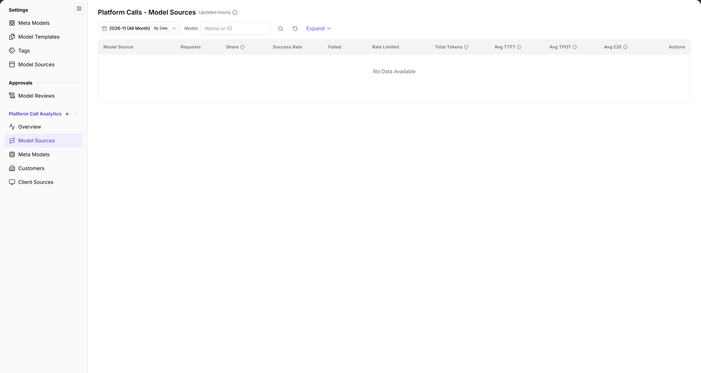

# Model Sources

> This page is labeled **Model Sources** in the left menu. The page heading is **Platform Calls - Model Sources**.

## 1. Feature Overview

| Item | Content |
| --- | --- |
| Applicable role | Operator Admin |
| Navigation path | **Model Services** > **Platform Call Analytics** > **Model Sources** |
| Page route | `/modelone/model-observation/operator/sources` |
| Managed objects | Requests, share, success rate, failed calls, rate-limited calls, tokens, and latency by model source |

**Beginner explanation**: This page breaks call statistics down by model source. It answers which upstream source receives the most calls and how its success rate and latency look. It does not create or edit a source; use **Settings > Model Sources** for configuration.

## 2. Prerequisites

1. The current account can view **Platform Call Analytics > Model Sources**.
2. The platform has call data. The current test environment shows `No Data Available`.
3. The month and model filters are confirmed before reading the data.

## 3. Page Description

The top area contains filters; the model source table sits below:

- Filters: month `2026-11 (All Month)`, `By Date`, `Model: name or ID`, a search icon, a reset icon, and `Expand`.
- Table columns: `Model Source`, `Requests`, `Share`, `Success Rate`, `Failed`, `Rate Limited`, `Total Tokens`, `Avg TTFT`, `Avg TPOT`, `Avg E2E`, `Actions`.
- When there is no data, the table shows `No Data Available`.

**Caption**: The heading is marked `Updated hourly`. The filters contain the month, `By Date`, `Model`, and `Expand`. The table lists `Model Source`, `Requests`, `Share`, `Success Rate`, `Failed`, `Rate Limited`, `Total Tokens`, `Avg TTFT`, `Avg TPOT`, `Avg E2E`, and `Actions`; it currently shows `No Data Available`.

## 4. Main Operations

### 4.1 Choose the statistics range

1. Select the month, for example `2026-11 (All Month)`.
2. Use `By Date` to switch the granularity.
3. Enter a model name or ID in `Model`.
4. Click the search icon to query, the reset icon to clear, or `Expand` to show more filters.

### 4.2 Read model source statistics

1. Check the request count for each `Model Source`.
2. Check `Share`, `Success Rate`, `Failed`, and `Rate Limited`.
3. Check `Total Tokens`, `Avg TTFT`, `Avg TPOT`, and `Avg E2E`.
4. Return to [Overview](../overview/) for the aggregate view.

### 4.3 Distinguish from Settings > Model Sources

- **Platform Call Analytics > Model Sources**: read-only statistics by source.
- **Settings > Model Sources**: maintains the source code, endpoints, Base URL, and protocols.

## 5. Parameter Quick Reference

| Field | Required | Field type | Example | Description |
| --- | --- | --- | --- | --- |
| Month | Required | Month picker | `2026-11 (All Month)` | Statistics month |
| By Date | Optional | Toggle | `By Date` | Time granularity |
| Model | Optional | Text | `DeepSeek-V4-Pro` | Filter by name or ID |
| Expand | Optional | Button | `Expand` | Shows additional filters |
| Model Source | System-maintained | Text | `AGIOne` | Upstream model source |
| Requests | System-maintained | Number | `1,024` | Requests in the range |
| Share | System-maintained | Percentage | `32%` | Share of all requests |
| Success Rate | System-maintained | Percentage | `99.5%` | Share of successful calls |
| Failed | System-maintained | Number | `5` | Failed calls |
| Rate Limited | System-maintained | Number | `2` | Rate-limited calls |
| Total Tokens | System-maintained | Number | `1,200,000` | Input and output tokens |
| Avg TTFT / TPOT / E2E | System-maintained | Duration | `320 ms` | Latency metrics |
| Actions | System-maintained | Column | `--` | No action is shown while the table is empty |

## 6. Pitfalls

- This is a statistics page, not a configuration page. If there is no create button, go to **Settings > Model Sources**.
- The heading is marked `Updated hourly`; the data is not real-time.
- The current test environment shows `No Data Available`, meaning the selected range has no call records to display.
- The filter row contains only `Model` and the month; do not confuse it with the `Source` filter on the overview page.

## 7. Result Validation

| Check | What the interface shows |
| --- | --- |
| Page loaded | The heading `Platform Calls - Model Sources`, `Updated hourly`, and the filters are visible |
| Statistics range | The month and `Model` conditions match the selection |
| Table structure | Headers include `Model Source`, `Requests`, `Share`, `Success Rate`, `Failed`, `Rate Limited`, `Total Tokens`, `Avg TTFT`, `Avg TPOT`, `Avg E2E`, and `Actions` |
| Empty state | The table shows `No Data Available` |

## 8. FAQ

#### The page has no data

**Symptom**: The model source table shows `No Data Available`.

**Resolution**:

1. Switch to a month with call records.
2. Clear the `Model` condition and search again.
3. If it is still empty, check [Overview](../overview/) to confirm whether the month has any total requests.

#### Why can I not create a model source here?

**Symptom**: There is no create or edit entry on the Model Sources statistics page.

**Resolution**: This page only shows call statistics. To create or edit a source, open **Model Services > Settings > Model Sources**.

## 9. Notes

- This page is read-only and has no source configuration entry.
- The result depends on the month and model filters. Confirm them before reporting.
- Read latency together with the sample size; do not rely on a single average.

## 10. Next Steps

- Open [Meta Models](../meta-models/) for call data by meta model.
- Open [Customers](../customers/) or [Client Sources](../call-sources/) for other dimensions.
- To maintain source configuration, go to **Settings > Model Sources**.
