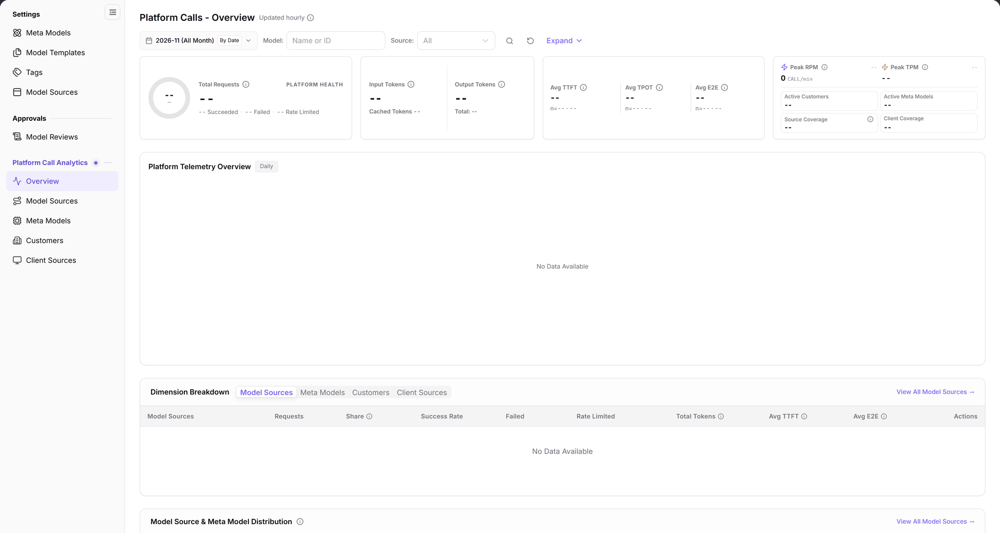

# Platform Calls - Overview

> This page is labeled **Overview** in the left menu. The page heading is **Platform Calls - Overview**.

## Feature Overview

| Item | Content |
| --- | --- |
| Applicable role | Operator Admin |
| Navigation path | **Model Services** > **Platform Call Analytics** > **Overview** |
| Page route | `/modelone/model-observation/operator/overview` |
| Managed objects | Total requests, platform health, tokens, latency, Peak RPM/TPM, active customers, active meta models, source coverage, client coverage, dimension breakdown, and call distribution |

#### Beginner Explanation

This is the dashboard for platform calls. Start with the top-line totals and health, then switch the dimension among model sources, meta models, customers, and client sources to find which object produced the traffic or errors.

#### Terms Quick Reference

| Term | Description |
| --- | --- |
| Platform Health | A high-level operational metric reflecting the proportions of successful, failed, and rate-limited calls across the platform. |
| Source Coverage | The percentage of active model sources generating call traffic relative to total registered model sources. |
| Client Coverage | The proportion of calling client applications (App IDs) actively generating requests relative to all registered clients. |
| Dimension Breakdown | Analytical views segmenting platform call volume across model sources, meta models, tenant customers, and client sources. |

## Prerequisites

1. The current account can view **Platform Call Analytics > Overview**.
2. The platform has call data. The current scope shows `--` for KPI values and `No Data Available` / data-unavailable messages in the charts.
3. The month and the model/source filters are confirmed before reading the metrics.

## Page Description

The page has four areas:

- **Filters**: month `2026-11 (All Month)`, `By Date`, `Model: name or ID`, `Source: All`, and `Expand`.
- **KPI cards**: `Total Requests`, `PLATFORM HEALTH`, `Input Tokens`, `Output Tokens`, `Avg TTFT`, `Avg TPOT`, `Avg E2E`, `Peak RPM`, `Peak TPM`, `Active Customers`, `Active Meta Models`, `Source Coverage`, and `Client Coverage`.
- **Platform Telemetry Overview**: marked `Daily`; when there is no data it shows `No Data Available` or a data-unavailable message.
- **Dimension Breakdown**: tabs `Model Sources`, `Meta Models`, `Customers`, and `Client Sources`, followed by the dimension table and `Model Source & Meta Model Distribution`.

The figure shows the heading is marked `Updated hourly`. The filters contain the month, `By Date`, `Model`, `Source`, and `Expand`. KPI cards show `--`; `Platform Telemetry Overview` shows `No Data Available`; the dimension table columns include `Model Sources`, `Requests`, `Share`, `Success Rate`, `Failed`, `Rate Limited`, `Total Tokens`, `Avg TTFT`, `Avg E2E`, and `Actions`.

| Area | Description |
| --- | --- |
| Filters & Controls | Switches statistics month, enables daily aggregation granularity, and filters by model name/ID or source. |
| Core KPI Cards | Aggregates platform request volume, platform health, token totals, end-to-end latency, and peak rates. |
| Platform Telemetry | Visualizes time-series trends of daily platform traffic fluctuations, success rates, and failure distributions. |
| Dimension Breakdown | Provides four tabs (`Model Sources`, `Meta Models`, `Customers`, `Client Sources`) and detailed distribution tables. |

## Main Operations

### Choose the statistics range

1. Select the month, for example `2026-11 (All Month)`.
2. Use `By Date` to switch the time granularity.
3. Enter a name or ID in `Model`.
4. Select a source in `Source`, or keep `All`.
5. Click `Expand` to show additional filters.

### Read the KPI cards

1. Start with `Total Requests` and `PLATFORM HEALTH` to see whether the range has traffic.
2. Check `Input Tokens`, `Output Tokens`, and the total token value.
3. Check `Avg TTFT`, `Avg TPOT`, and `Avg E2E` for latency.
4. Check `Peak RPM`, `Peak TPM`, `Active Customers`, `Active Meta Models`, `Source Coverage`, and `Client Coverage`.

### Switch dimensions and drill down

1. Switch among `Model Sources`, `Meta Models`, `Customers`, and `Client Sources` under `Dimension Breakdown`.
2. Read requests, share, success rate, failed calls, rate-limited calls, total tokens, and latency for that dimension.
3. Click `View All Model Sources` to open the model source statistics page.
4. Under `Model Source & Meta Model Distribution`, check the source, requested meta model, requests, successful calls, success rate, failed calls, rate-limited calls, and other rejected calls.

## Parameter Quick Reference

### Filters

| Field | Required | Field type | Example | Description |
| --- | --- | --- | --- | --- |
| Month | Required | Month picker | `2026-11 (All Month)` | Statistics month |
| By Date | Optional | Toggle | `By Date` | Time granularity |
| Model | Optional | Text | `DeepSeek-V4-Pro` | Filter by name or ID |
| Source | Optional | Drop-down | `All` | Filter by source |
| Expand | Optional | Button | `Expand` | Shows additional filters |

### KPI and table labels

| Metric / field | Type | Page information |
| --- | --- | --- |
| Total Requests | KPI | Total requests in the current range |
| PLATFORM HEALTH | KPI | Success, failed, and rate-limited counts |
| Input Tokens / Output Tokens | KPI | Token usage; the total token value is also shown |
| Avg TTFT / Avg TPOT / Avg E2E | KPI | Latency metrics with a sample count `n=` |
| Peak RPM / Peak TPM | KPI | Peak request and token rates |
| Active Customers / Active Meta Models | KPI | Active objects in the range |
| Source Coverage / Client Coverage | KPI | Coverage metrics |
| Requests / Share / Success Rate / Failed / Rate Limited / Total Tokens | Table columns | Dimension breakdown table |
| Avg TTFT / Avg E2E | Table columns | Dimension breakdown table |

## Pitfalls

- The heading is marked `Updated hourly`; the metrics are not real-time.
- The filters show `Model` and `Source`, but the current scope has no call data. KPI values show `--` and charts show `No Data Available`.
- `Platform Telemetry Overview` may show a data-unavailable message. This means the chart data is temporarily unavailable; it does not necessarily mean the filter is wrong.
- The dimension breakdown has four tabs. Seeing only `Model Sources` does not mean the other dimensions are unavailable.

## Result Validation

| Check Item | Success Signal | Handling on Failure |
| --- | --- | --- |
| Page loaded | Title displays `Platform Calls - Overview`, `Updated hourly` is marked, and filter controls render normally. | If blank, check Operator Admin permissions and refresh the browser. |
| Filter linkage | Changing month or specifying a model/source updates KPI cards, charts, and tables synchronously. | If unrefreshed, ensure you pressed Enter or clicked the refresh button. |
| Metric values | Displays concrete integers or floating-point values when data exists; health card shows success/failure counts. | If all dashes, check whether the selected billing period actually processed platform traffic. |
| Telemetry chart | Time-series line chart plots all sampling points; hovering shows daily success and failure breakdowns. | If data is unavailable, verify backend metrics collection pipeline or wait and reload. |
| Dimension tabs | Switches seamlessly among `Model Sources`, `Meta Models`, `Customers`, and `Client Sources` with updated tables. | If the table fails to switch, check network status or re-click the tab. |

## FAQ

#### All KPI values show `--`

**Symptom:**

After opening the overview, every KPI card shows `--` and charts show `No Data Available`.

**Possible Causes:**

No calls were generated across the platform during the selected month, or the model/source filter inputs excluded all existing records.

**Resolution:**

1. Confirm that the month dropdown selects a billing cycle with actual business invocations.
2. Clear the `Model` and `Source` input fields to restore the global aggregate view.
3. If the telemetry chart displays `Data temporarily unavailable, please try again later.`, wait for the hourly aggregation task to finish and refresh.

#### How do I see details for one model source?

**Symptom:**

The overview displays aggregate platform statistics, but you need detailed volume and health metrics for a specific upstream source.

**Possible Causes:**

The overview page provides macro-level summaries by default; granular inspection requires dimension drill-down.

**Resolution:**

1. Under `Dimension Breakdown` at the bottom of the page, switch to the `Model Sources` tab.
2. Locate the target source in the table, or click **"View All Model Sources"** to navigate to the Model Sources analytics page.

## Notes

- This is a read-only statistics page. It has no entry for editing models, model sources, or customers.
- The statistics range depends on the month, model, and source filters. Confirm them before reporting numbers.
- Do not judge platform health from a single KPI; read `PLATFORM HEALTH`, failed calls, rate limiting, and latency together.

## Next Steps

1. Analyze call distributions and anomaly metrics by upstream source in [Model Sources](../model-sources/).
2. Audit call scale and token efficiency across foundational baselines in [Meta Models](../meta-models/).
3. Review call rankings and compliance by tenant customer and client application in [Customers](../customers/) and [Client Sources](../call-sources/).
4. Modify upstream model source endpoints or credentials in [Model Sources](../../../operator/settings/model-source/).

Related pages:
- [Model Sources](../model-sources/)
- [Meta Models](../meta-models/)
- [Customers](../customers/)
- [Client Sources](../call-sources/)
- [Model Sources](../../../operator/settings/model-source/)
