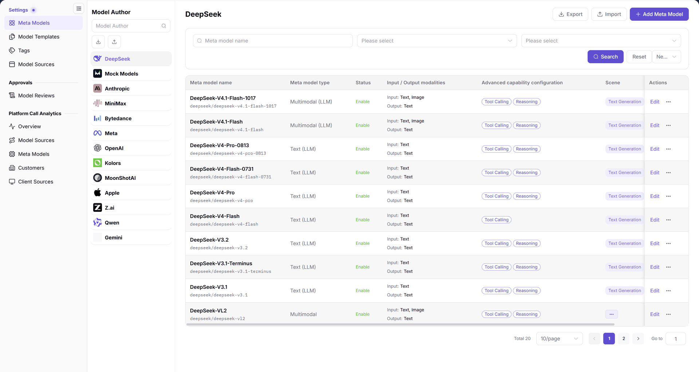
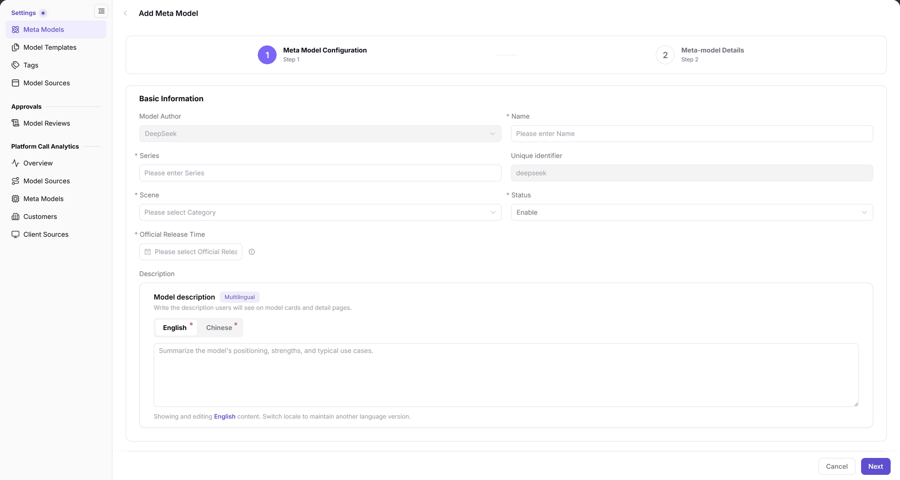

# Meta Models

> This page is labeled **Meta Models** in the left menu. The main heading changes with the selected model author, for example **DeepSeek**.

## Feature Overview

| Item | Content |
| --- | --- |
| Applicable role | Operator Admin |
| Navigation path | **Model Services** > **Settings** > **Meta Models** |
| Page route | `/modelone/settings/meta`; add page `/modelone/settings/meta/addModel` |
| Managed objects | Meta model name, family, unique identifier, scene, status, model type, input/output modalities, advanced capabilities, token limits, and official native protocols |

#### Beginner Explanation

A meta model is the capability profile of a model. It states what the model can process, which protocols it supports, and how long its context is. A model source states where the service is called. Templates and publishing flows can reference a meta model only after it exists.

#### Terms Quick Reference

| Term | Description |
| --- | --- |
| Model Author | The model research institution, vendor, or open-source entity (e.g., DeepSeek, OpenAI, Qwen). |
| Unique Identifier | The globally unique internal string identifier for the meta model across the platform (e.g., `deepseek/deepseek-v4-pro`). |
| Official Native Protocols | The set of underlying network communication protocols supported by this meta model (e.g., `openai/chat_completions`). |
| Advanced Capability Configuration | Extended capability toggles including function/tool calling and thinking mode. |

## Prerequisites

1. The current account can view and maintain **Settings > Meta Models**.
2. The model author already exists in the left list; select it before adding a meta model.
3. The model name, family, unique identifier, scene, official release date, model type and sub-model, input/output modalities, token limits, and protocol information are confirmed.

## Page Description

The page has two parts:

- **Model Author panel (left)**: a `Model Author` search box and the author list, such as DeepSeek, Mock Models, Anthropic, MiniMax, OpenAI, and Qwen. The selected author is highlighted.
- **List area (right)**: the selected author name is shown as the heading. **Export**, **Import**, and **Add Meta Model** sit at the top right. The filter row contains a `Meta model name` input, two `Please select` drop-downs, and **Search**, **Reset**, and a more-actions entry. The table and pagination sit below.

The figure shows With DeepSeek selected, the table shows `Meta model name`, `Meta model type`, `Status`, `Input / Output modalities`, `Advanced capability configuration`, `Scene`, and `Actions`. The footer shows `Total 20`, `10/page`, and pagination controls.

| Area | Description |
| --- | --- |
| Left Author Panel | Displays model developers/vendors; supports searching authors and switching the active context. |
| Top Actions & Filters | Displays selected author name, import/export, Add Meta Model, and keyword/status filters. |
| Meta Model Table | Lists meta model name, unique identifier, type, status, modalities, and advanced capability tags. |
| Row Action Column | Provides direct **Edit** access and a more-actions menu for details, copy, enable/disable, and deletion. |

## Main Operations

### Switch and search model authors

1. Enter a name or keyword in the `Model Author` search box.
2. Click an author in the list; the heading and the meta model table switch to that author.
3. Clear the search box to return to the full author list.

### Add a meta model

1. Select the target model author and click **"Add Meta Model"**.
2. The `Add Meta Model` wizard opens with two steps: `1 Meta Model Configuration` and `2 Meta Model Details`.
3. In step 1, check `Model Author` under `Basic Information`, then fill `Name`, `Family`, `Unique Identifier`, `Scene`, `Status`, and `Official Release Time`.
4. Under `Description`, switch between the `English` and `Chinese` tabs and fill in `Model Description`.
5. Continue with `Model Type and Sub-models`, `Input / Output Modalities`, `Advanced Capability Configuration`, `Token Limit`, and `Official Native Protocols and Default Advanced Parameters`.
6. Click **"Next"** to open `Meta Model Details`, then complete the fields shown on the page. Use **"Cancel"** or the back arrow to leave the flow.

The figure shows Step 1 shows `Basic Information`, `Description`, and the capability sections below. Fields marked with `*`, such as `Name`, `Family`, `Scene`, and `Official Release Time`, must be filled. `Model Author` is carried in from the entry point, shown here as DeepSeek.

### Filter and read the list

1. Enter a name keyword in `Meta model name`.
2. Narrow the list with the two `Please select` drop-downs.
3. Click **"Search"** to run the query, or **"Reset"** to clear the conditions.
4. The table shows `Meta model name`, `Meta model type`, `Status`, `Input / Output modalities`, `Advanced capability configuration`, `Scene`, and `Actions`. The unique identifier appears below the name; the action column offers **"Edit"** and **...**.

### Row actions

Each row provides:

- **"Edit"**: opens the meta model edit form.
- **...**: opens **"Details"**, **"Copy and edit"**, **"Enable"**, **"Disable"**, and **"Delete"**.
- **"Details"**: opens the current configuration.

Before enabling, disabling, or deleting, confirm whether templates or publishing flows reference the meta model.

### Import and export

1. Click **"Export"** to export the current list.
2. Use the **"Export by Filters"** entry next to **"Export"** when available.
3. Click **"Import"** and follow the page prompts to select a file.

Imported and exported files may contain protocol and capability configuration. Keep them in a controlled location and do not commit them to a code repository or send them to unauthorized groups.

## Parameter Quick Reference

| Field | Required | Field type | Example | Description |
| --- | --- | --- | --- | --- |
| Model Author | Carried in | Drop-down / read-only | `DeepSeek` | Author that owns the meta model |
| Name | Required | Text | `DeepSeek-V4-Pro` | Name shown in the list and model cards |
| Family | Required | Text | `DeepSeek-V4` | Family the meta model belongs to |
| Unique Identifier | Required | Text | `deepseek/deepseek-v4-pro` | Unique identifier of the meta model |
| Scene | Required | Drop-down | `Text Generation` | Business scene of the meta model |
| Status | Required | Drop-down | `Enable` | Value shown in the `Status` column |
| Official Release Time | Required | Date | `2026-10-27` | Official release date of the model |
| Model Description | Optional | Multilingual text | `Flagship MoE model` | Description shown on model cards and detail pages |
| Model Type and Sub-models | Select on page | Card / radio | `Multimodal`, `Text` | Capability classification |
| Input / Output Modalities | Select on page | Multi-select | `Text`, `Image` | Supported input and output types |
| Function / Tool Support | Optional | Switch | `Enabled` | Whether tool calling is supported |
| Thinking Mode | Optional | Switch | `Enabled` | Whether deep thinking is supported |
| Token Limit | Fill on page | Number | `Maximum context 1000 K` | Context, input, and output limits |
| Official Native Protocols and Default Advanced Parameters | Select on page | Protocol list | `openai/chat_completions` | Supported protocols and defaults |

## Pitfalls

- The selected model author on the left determines the right-hand list. After adding a record, confirm the same author is still selected before searching for it.
- `Name`, `Family`, `Scene`, and `Official Release Time` carry a `*` required mark. Check them before continuing.
- A meta model describes what a model can do; a model source describes where the service is called. If you need a call address, open **Settings > Model Sources**, not this page.
- Token limits and protocols must match the upstream model's real capabilities. Do not write real credentials into descriptions or protocol fields.

## Result Validation

| Check Item | Success Signal | Handling on Failure |
| --- | --- | --- |
| Author context switch | Clicking an author on the left immediately updates the right-hand title and meta model table. | If unresponsive, check network connectivity or re-click the target author item. |
| Meta model created | Submitting the wizard redirects to the table; searching the name displays the new row with `Enable` status. | If missing, verify whether another author was selected or if required wizard fields were skipped. |
| Search and filtering | Entering a name keyword and clicking **"Search"** accurately isolates matching records. | If no results appear, check keyword spelling and confirm the active model author matches. |
| Wizard step navigation | The creation wizard clearly displays Step 1 and Step 2, navigating forward and back properly. | If stuck on Step 1 when clicking Next, verify all red-asterisk required fields and protocols. |
| Row action feedback | Enabling, disabling, or deleting prompts for confirmation and updates the status tag immediately. | If blocked due to active references, inspect model templates and published models to unbind dependencies. |

## FAQ

#### The new meta model is not in the list

**Symptom:**

After completing the creation flow and returning to the table, the newly created meta model is not visible.

**Possible Causes:**

The currently highlighted model author on the left differs from the author selected during creation, filters are still active, or the record is on a later page.

**Resolution:**

1. Confirm that the highlighted author on the left matches the vendor chosen during creation.
2. Click **"Reset"** next to the `Meta model name` input to clear all filtering parameters.
3. Check the pagination bar at the bottom and switch to the last page or increase the page size.

#### What is the difference between a meta model and a model source?

**Symptom:**

Uncertain whether to configure call addresses and gateway endpoints in Meta Models or Model Sources.

**Possible Causes:**

The two menus operate at different architectural layers: meta models define capability specifications, whereas model sources define physical routing.

**Resolution:**

1. Go to **Settings > Meta Models** to maintain model names, capabilities, modalities, token limits, and official protocols.
2. Go to **Settings > Model Sources** to maintain physical Endpoints, Base URLs, network access points, and documentation links.

## Notes

- Meta models affect template references and publishing flows. Confirm the dependency scope before changing capabilities, modalities, or token limits.
- Deleting, disabling, and bulk importing are high-impact operations. Confirm references and back up the data first.
- Imported and exported files may contain internal configuration. Do not commit them to a repository or share them externally.

## Next Steps

1. Bind the meta model in preset templates to streamline publishing, see [Model Templates](../model-templates/).
2. Associate the meta model with physical network endpoints and service addresses, see [Model Sources](../model-source/).
3. Audit downstream tenant publication requests based on this meta model in [Model Reviews](../../approvals/model-reviews/).

Related pages:
- [Model Templates](../model-templates/)
- [Model Sources](../model-source/)
- [Model Reviews](../../approvals/model-reviews/)
