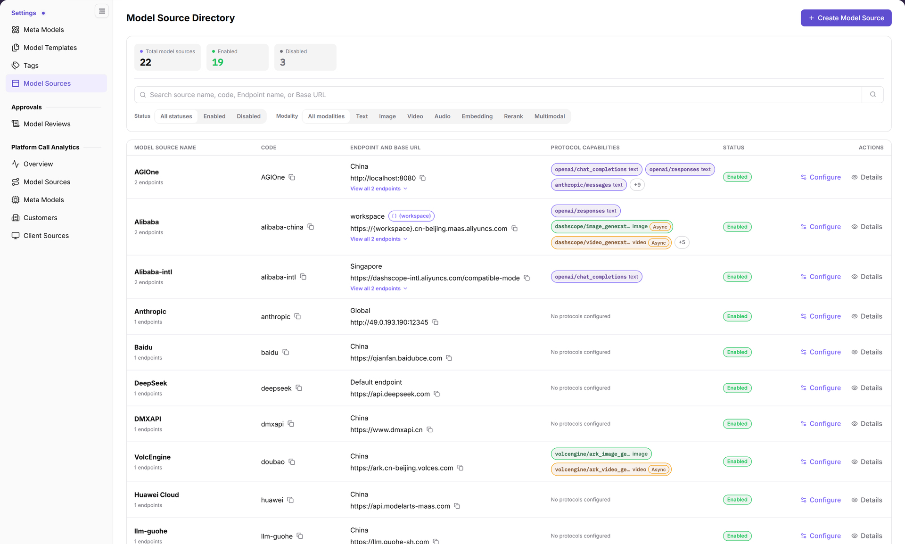
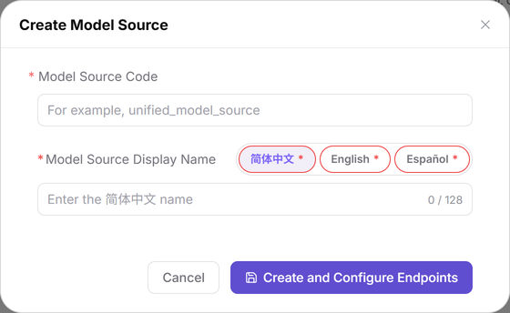
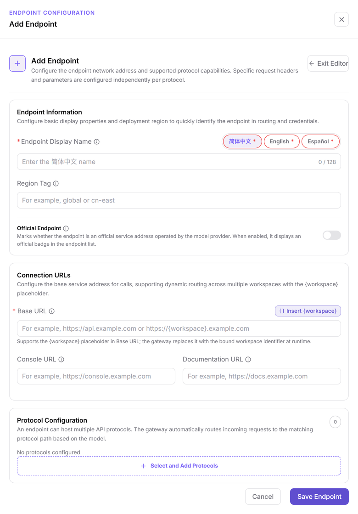
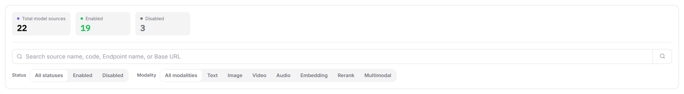
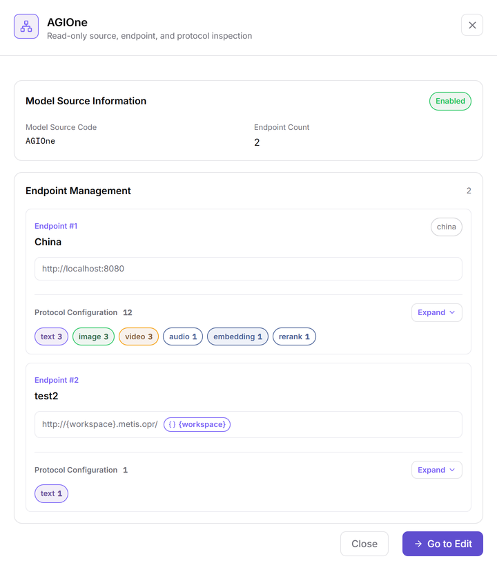
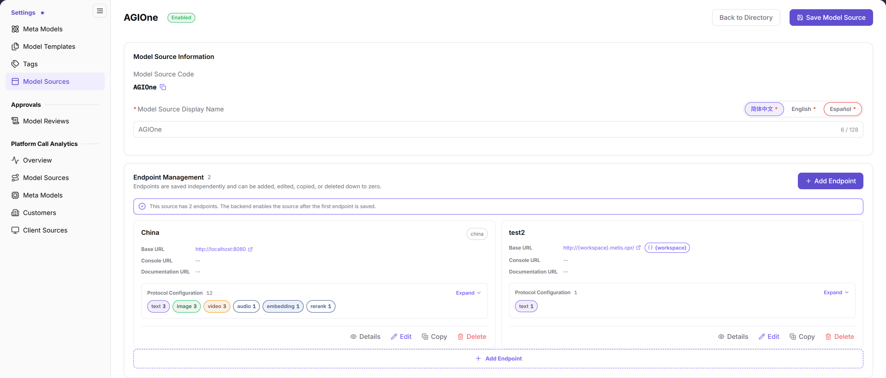

# Model Sources

::: info Document Information
Version: v2.0
Updated: 2026-10-29
:::

## Feature Overview

| Item | Content |
| --- | --- |
| Applicable role | Operator Admin |
| Navigation path | **Model Services** > **Settings** > **Model Sources** |
| Page route | List `/modelone/model-source`; configuration page `/modelone/model-source/{source ID}/edit` |
| Managed objects | **Model Source** (unique code, multilingual display names), **Endpoints** (region tag, Base URL, console URL, documentation URL), protocol configuration |

#### Beginner Explanation

A Model Source answers one question: **where does the platform call the upstream model service?**

One Model Source maps to one upstream provider, such as AGIOne, Alibaba Cloud, or DeepSeek. The source itself holds no call address. Addresses live on the **Endpoints** underneath it, and one source can have several Endpoints for different regions or access points. Each Endpoint carries **protocols** that describe the call styles and modalities it supports.

Short comparison: a Meta-model describes what a model can do; a Model Source describes where the service is called and which protocols it uses.

#### Glossary

| Term | Description |
| --- | --- |
| Model Source | A record of an upstream model service, holding a code, multilingual display names, and a set of Endpoints. |
| Model Source Code | The identifier of a Model Source, entered on creation and read-only afterwards. It identifies one Model Source; it is not a separate object. |
| Endpoint | One access point under a Model Source, with its own region tag and Base URL. |
| Region tag | The region identifier of an Endpoint, such as `china`, `global`, or `cn-east`. |
| Official Endpoint | Marks whether the access point is operated by the model provider. |
| Base URL | The root address of the upstream service. Protocol paths are appended to it. |
| `{workspace}` | A workspace placeholder in the Base URL. The gateway replaces it with the bound workspace identifier. |
| Protocol configuration | The API protocols an Endpoint supports, such as `openai/chat_completions` or `anthropic/messages`. |
| Modality | The content type of a protocol: text, image, video, audio, embedding, rerank, or multimodal. |

#### Beginner Quick Reference

| Case | Do First | Avoid |
| --- | --- | --- |
| First connection to an upstream service | Create the Model Source, then add its first Endpoint | Assuming the source is usable right after creation |
| One upstream with several regions | Add several Endpoints under one source, each with its own region tag and Base URL | Creating one source per region |
| The upstream needs a different host per tenant | Use the `{workspace}` placeholder in the Base URL | Hard-coding one tenant host in the Base URL |
| Only reviewing the configuration | Use **"Details"** for a read-only view | Opening **"Configure"** and saving by accident |
| Cannot find a source | Confirm you are on **Model Services** > **Settings** > **Model Sources** | Confusing it with **Platform Call Statistics** > **Model Sources** |

## Prerequisites

1. Confirm the current account can maintain Model Sources (Operator Admin).
2. Get the region tag, Base URL, console URL, documentation URL, and protocol list from the upstream service owner.
3. Confirm network, certificate, and allowlist requirements.

## Page Description

The page is a two-level structure: a directory and a configuration page.

| Page State | Responsibility | Leave the State After |
| --- | --- | --- |
| Model Source Directory | Read totals, search and filter sources, open configuration or details. | The target row is confirmed. |
| Create Model Source dialog | Enter only the code and the three display names. | All names are filled and the code is unused. |
| Configuration page | Maintain the source name; add, edit, copy, or delete Endpoints and protocols. | Name changes are saved with **"Save Model Source"**; Endpoint changes with **"Save Endpoint"**. |
| Add Endpoint drawer | Enter region tag, Base URL, console URL, documentation URL, and protocols. | Required values and protocols are verified. |
| Details drawer | Read-only view of the source, Endpoints, and protocol configuration. | Saved values are confirmed. |

Model Source Directory:

The header offers **"Create Model Source"**; below it sit three statistic cards and the filter area, and the table lists `Model Source Name`, `CODE`, `ENDPOINT AND BASE URL`, `Protocol Capability`, `Status`, and `Actions`. The action column offers only **"Configure"** and **"Details"**; the list has no delete entry.

### A Similarly Named Page Elsewhere

The left menu also has an entry named "Model Sources" under **Platform Call Statistics**, routed at `/modelone/model-observation/operator/sources`. That is a **call statistics page** for reading traffic by source. You cannot create or edit a Model Source there.

## Main Operations

<!-- main-operation-title-exceptions: Create,Configure,Filter,Edit -->

### Create a Model Source

#### Applicable Scenarios

- Connect an upstream model service for the first time and register it in the directory.
- A source was disabled and you need a new source record.

#### Steps

1. Go to **Model Services** > **Settings** > **Model Sources**.
2. Click **"Create Model Source"** at the top right to open the **"Create Model Source"** dialog.
3. Enter the unique identifier in `Model Source Code`, for example `unified_model_source`. The field is required and cannot be changed later.
4. Enter the Chinese name on the **"简体中文"** tab under `Model Source Display Name`. The limit is 128 characters.
5. Switch to the **"English"** and **"Español"** tabs and enter a name for each language. All three tabs carry a required mark.
6. Click **"Create and Configure Endpoints"**. This button takes you straight to the configuration page of the new source.
7. To close without creating, click **"Cancel"** or the **"×"** at the top right.

The dialog has only `Model Source Code` and `Model Source Display Name`. The primary button reads **"Create and Configure Endpoints"**, not a confirm label.

#### Notes

- The dialog contains only `Model Source Code` and `Model Source Display Name`; both carry a required mark.
- The page states that the backend enables the source after the first Endpoint is saved, not at creation time.
- A Model Source holds no call address. The address belongs to an Endpoint.

### Configure a Model Source Endpoint

#### Applicable Scenarios

- Register a call address and its protocol capabilities so model templates can select the source.
- Add more Endpoints when one source needs several regions or access addresses.

#### Steps

1. Click **"Configure"** on the target row to open the configuration page.
2. Click **"Add Endpoint"** in the `Endpoint Management` section to open the `ENDPOINT CONFIGURATION` drawer.
3. Enter `Endpoint Display Name` under `Endpoint Information`, and switch the **"简体中文"**, **"English"**, and **"Español"** tabs as needed.
4. Enter a region tag in `Region Tag`, for example `china`, `global`, or `cn-east`.
5. Turn on the **"Official Endpoint"** switch when the address is operated by the model provider.
6. Enter the required `Base URL` under `Connection URLs`. Click **"Insert {workspace}"** when calls need dynamic workspace routing.
7. Enter `Console URL` and `Documentation URL` when they apply. Empty values display as `--` on the card.
8. Click **"Select and Add Protocols"** under `Protocol Configuration` and select the protocols this Endpoint supports.
9. Click **"Save Endpoint"**. To discard the input, click **"Cancel"** or **"Exit Editor"**.

The drawer has three sections: `Endpoint Information`, `Connection URLs`, and `Protocol Configuration`. `Base URL` is the only required field, and the **"Insert {workspace}"** button sits to its right.

#### Result Validation

- Each card uses the Endpoint display name as its title, with the region tag at the right of the title row.
- `Base URL` appears as a link; empty `Console URL` and `Documentation URL` display as `--`.
- The number after `Protocol Configuration` matches the number of listed protocols, with modality totals below, such as `text 3` and `image 3`.
- The summary line above the cards reads that the backend enables the source after the first Endpoint is saved.

#### Notes

- Each Endpoint card provides `Details`, `Edit`, `Copy`, and `Delete`.
- The page states that Endpoints save independently and can be added, edited, copied, or deleted down to zero. Saving happens at the Endpoint level, separate from the Model Source level.
- Request headers and other call parameters are configured per protocol, not in this drawer.
- The gateway replaces `{workspace}` with the bound workspace identifier when it makes a call.

### Filter Model Sources

#### Applicable Scenarios

- The directory holds many sources and you need to narrow by status or modality.
- You need to identify which source owns a specific Base URL.

#### Steps

1. Go to **Model Services** > **Settings** > **Model Sources**.
2. Enter a source name, code, Endpoint name, or Base URL in the search box and click the search icon.
3. In the `Status` group, select `All statuses`, `Enabled`, or `Disabled`.
4. In the `Modality` group, select `All modalities`, `Text`, `Image`, `Video`, `Audio`, `Embedding`, `Rerank`, or `Multimodal`.

Three statistic cards show totals for all sources, enabled sources, and disabled sources. The status and modality filter groups sit below them.

#### Result Validation

- The name cell shows `N Endpoints`; rows with more than one Endpoint also offer **"View all N Endpoints"**.
- The `Protocol Capability` column shows protocol chips with modality marks. Asynchronous protocols carry an `Async` tag, an empty configuration reads "No protocols configured", and extra protocols collapse into **"View all N protocols"**.
- The footer shows the total count and pagination controls.

#### Notes

- Search and filters combine. Clear the search box and click the search icon again to reset it.
- The cards count the whole directory, not the current filter result.

### View Model Source Details

#### Applicable Scenarios

- Confirm the code, Endpoint count, and protocol configuration without entering edit mode.
- Verify the target record before maintenance or share the configuration with a reviewer.

#### Steps

1. Click **"Details"** on the target row.
2. The drawer subtitle reads "Read-only view of the Model Source, Endpoints, and protocol configuration".
3. Check the status badge, `Model Source Code`, and `Endpoint Count` under `Model Source Basic Information`.
4. Review each card under `Endpoint Management`, such as `Endpoint #1` and `Endpoint #2`.
5. Each card shows the region name, region tag, Base URL, and `Protocol Configuration` count. Click **"Expand"** to see the protocol count per modality.
6. Click **"Go to Edit"** when a change is needed, or **"Close"** to leave.

The drawer footer holds only **"Close"** and **"Go to Edit"**. No save action exists.

#### Result Validation

- The Base URL is not editable inside the drawer.
- `Endpoint Count` matches the number next to `Endpoint Management`.
- Card numbers are sequential, and `Endpoint #N` follows the saved order.

#### Notes

- Details are read-only. Editing still happens on the configuration page, and source-level and Endpoint-level changes are saved separately.
- Before sharing a screenshot, check whether the Base URL exposes an internal address or tenant information.

### Edit a Model Source

#### Applicable Scenarios

- Change the display name used in each language.
- Maintain the Endpoints and protocols under the source.

#### Steps

1. Click **"Configure"** on the target row.
2. Check the read-only `Model Source Code` under `Model Source Basic Information`. It keeps its value; a **"Copy Code"** button sits next to it.
3. Switch language tabs under `Model Source Display Name` and edit the names.
4. To maintain addresses, add or modify Endpoints as described in "Configure a Model Source Endpoint".
5. Click **"Save Model Source"** to submit the name changes.
6. Click **"Back to Directory"** and confirm the new value in the list.

The header shows the source name and status badge. **"Back to Directory"** and **"Save Model Source"** sit at the top right.

#### Notes

- `Model Source Code` is read-only and copyable on the configuration page. No edit entry exists.
- The header holds two separate buttons, **"Back to Directory"** and **"Save Model Source"**; Endpoints have their own **"Save Endpoint"**.

## Parameter Quick Reference

Model Source and Endpoint are two configuration levels. Their field requirements are listed separately.

### Model Source Level

| Field | Form Requirement | Field Type | Example | Description |
| --- | --- | --- | --- | --- |
| Model Source Code | Required, read-only after creation | Text | `aliyun` | Unique identifier used by the list and search. |
| Simplified Chinese name | Required | Text, up to 128 characters | `阿里巴巴-中国` | Name shown in the Chinese interface. |
| English name | Required | Text, up to 128 characters | `Alibaba Cloud` | Name shown in the English interface. |
| Spanish name | Required | Text, up to 128 characters | `Alibaba Cloud` | Name shown in the Spanish interface. |
| Status | System-maintained | Enumeration | `Enabled` | Shown in the list and header; no direct input in any form. |

### Endpoint Level

| Field | Form Requirement | Field Type | Example | Description |
| --- | --- | --- | --- | --- |
| Endpoint Display Name | Required | Multilingual text, up to 128 characters | `China` | Shown as the card title. |
| Region Tag | Optional | Text | `china` | Shown at the right of the card title to identify the access region. |
| Official Endpoint | Optional | Switch | Off | Marks whether the access point is operated by the model provider. |
| Base URL | Required | URL | `https://dashscope.aliyuncs.com` | Call root address; may contain the `{workspace}` placeholder. |
| Console URL | Optional | URL | `https://dashscope.console.aliyun.com` | Upstream console entry; empty values display as `--`. |
| Documentation URL | Optional | URL | `https://help.aliyun.com/...` | Upstream documentation entry; empty values display as `--`. |
| Protocol Configuration | Optional | Multi-select list | `openai/chat_completions` | Protocols this Endpoint supports; empty values display "No protocols configured". |

## Pitfalls

- A Model Source does not carry a call address by itself. The page states that the backend enables the source after the first Endpoint is saved; addresses belong to Endpoints.
- Model Source level and Endpoint level are two separate saves: **"Save Model Source"** in the header, **"Save Endpoint"** inside the Endpoint drawer.
- When the host varies by workspace, use the **"Insert {workspace}"** button next to `Base URL`. The page states the gateway replaces the placeholder with the bound workspace identifier at runtime.

## Result Validation

| Check | What the interface shows |
| --- | --- |
| Source identifier | The `CODE` column and the `Model Source Code` field in the details drawer show the same value |
| Endpoint count | `N endpoints` under the name in the list matches `Endpoint Count` in the details drawer |
| Protocol capability | The protocol chips in the list correspond to the number after `Protocol Configuration` on the card |
| Read-only details | The drawer footer holds only **"Close"** and **"Go to Edit"**, and `Base URL` is not editable |

## FAQ

#### There is no entry for deleting a Model Source

**Symptom:**

Neither the list nor the configuration page offers a button to delete the whole source.

**Entries visible in the interface:**

- The list action column holds only **"Configure"** and **"Details"**.
- The configuration page header holds only **"Back to Directory"** and **"Save Model Source"**.
- The delete action appears at the bottom of each Endpoint card (`Details`, `Edit`, `Copy`, `Delete`).

**Resolution:**

The current interface provides Endpoint-level deletion only, with no entry for deleting a Model Source.

#### You landed on the statistics page instead

**Symptom:**

The "Model Sources" entry from the left menu shows only call statistics and no create button.

**Cause:**

- You opened **Platform Call Statistics** > **Model Sources** at `/modelone/model-observation/operator/sources`.

**Resolution:**

1. Return to **Model Services** > **Settings** > **Model Sources**.
2. That menu routes to `/modelone/model-source`.

## Notes

- A Model Source Code cannot be changed after creation. Plan the naming with room to grow.
- All three language names carry a required mark.
- Maintain authentication details per protocol. Never put them in the Base URL or in documentation screenshots.
- The details drawer is read-only. All changes happen on the configuration page.

## Next Steps

Once the source is configured, the next step is to reference it in a model template. Field definitions and steps for that page belong to the [Model Templates](../model-templates/) manual and are not repeated here.

After a model is published from the template, run a call validation as described in [Publish a Model](/userguide/scenarios/publish-model/). Call validation is not part of the Model Sources page.
