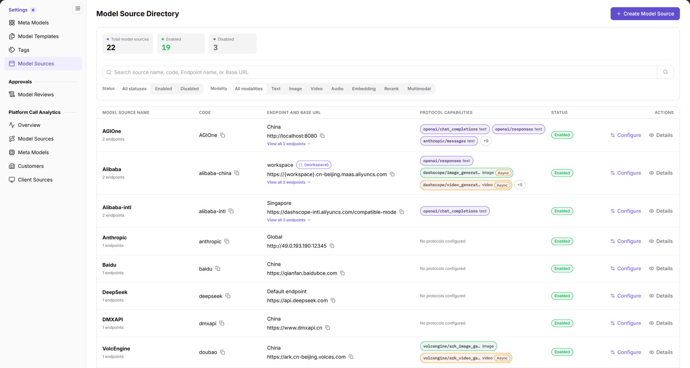
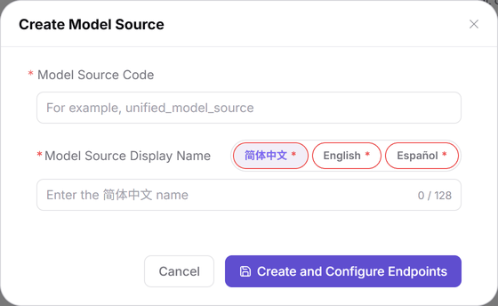

# Model Sources

> This page is labeled **Model Sources** in the left menu. The main heading is **Model Source Directory**.

## Feature Overview

| Item | Content |
| --- | --- |
| Applicable role | Operator Admin |
| Navigation path | **Model Services** > **Settings** > **Model Sources** |
| Page route | List `/modelone/model-source`; configuration page `/modelone/model-source/{source ID}/edit` |
| Managed objects | **Model Source** (unique code and multilingual names), **Endpoint** (region tag, Base URL, console URL, documentation URL), and protocols |

#### Beginner Explanation

A model source answers where the platform calls an upstream model service. One source maps to one upstream provider, such as AGIOne, Alibaba, or DeepSeek. The source itself holds no call address; addresses live on its **Endpoints**. A meta model describes what the model can do; a model source describes where the service is called and which protocols it uses.

#### Terms Quick Reference

| Term | Description |
| --- | --- |
| Model Source Code | The globally unique internal English code identifying the upstream vendor source (e.g., `aliyun`, `openai`), non-duplicable. |
| Endpoint | A physical network access point under a model source, containing the Base URL, region tag, and protocol mappings. |
| Official Endpoint | A flag indicating whether the access point is operated and hosted directly by the model vendor. |
| {workspace} | A dynamic routing placeholder supported in Base URLs, automatically replaced at runtime by the gateway with the target workspace ID. |

## Prerequisites

1. The current account can view and maintain **Settings > Model Sources**.
2. The region tag, Base URL, console URL, documentation URL, and protocol list are available from the upstream service owner.
3. Network, certificate, and allowlist requirements are confirmed.

## Page Description

The top area contains statistic cards and filters; the model source table sits below:

- Statistic cards: `Total model sources`, `Enabled`, `Disabled`.
- Search box: `Search source name, code, Endpoint name, or Base URL`.
- Filter groups: `Status` (`All statuses`, `Enabled`, `Disabled`) and `Modality` (`All modalities`, `Text`, `Image`, `Video`, `Audio`, `Embedding`, `Rerank`, `Multimodal`).
- Table columns: `MODEL SOURCE NAME`, `CODE`, `ENDPOINT AND BASE URL`, `PROTOCOL CAPABILITIES`, `STATUS`, `ACTIONS`.
- Row actions: **Configure** and **Details**; the list has no delete entry.

The figure shows the cards show `Total model sources 22`, `Enabled 19`, and `Disabled 3`. Each row shows the endpoint count, code, endpoint name and Base URL, protocol tags, and status; the action column offers `Configure` and `Details`.

| Area | Description |
| --- | --- |
| Top Metric Cards | Aggregates platform-wide total model sources, enabled sources, and disabled sources. |
| Search & Filters | Supports queries by name, code, endpoint, or URL, plus filtering by status and modality. |
| Directory Table | Lists model source multilingual names, codes, endpoint counts, Base URLs, and supported protocols. |
| Row Actions | Provides **Configure** for Endpoint management and **Details** for read-only inspection. |

### A similarly named statistics page

**Platform Call Analytics > Model Sources** is a statistics page (`/modelone/model-observation/operator/sources`). It shows call data by source and cannot create or edit a model source. Use **Settings > Model Sources** for configuration.

## Main Operations

### Create a model source

1. Go to **"Model Services"** > **"Settings"** > **"Model Sources"**.
2. Click **"Create Model Source"** at the top right to open the `Create Model Source` dialog.
3. Enter the unique identifier in `Model Source Code`, for example `unified_model_source`. The field is required.
4. Enter the Chinese name on the `简体中文` tab under `Model Source Display Name`; the counter shows `0 / 128` characters.
5. Switch to the `English` and `Español` tabs and enter a name for each language. All three tabs carry a `*` required mark.
6. Click **"Create and Configure Endpoints"** to open the configuration page, or **"Cancel"** / the `×` to close.

The figure shows the dialog contains only `Model Source Code` and `Model Source Display Name`. All three language tabs are required; the primary button reads `Create and Configure Endpoints`, not a confirm label.

### Configure an Endpoint

1. Click **"Configure"** on the target row to open the configuration page.
2. Click **"Add Endpoint"** under `Endpoint Management` to open the `ENDPOINT CONFIGURATION` drawer.
3. Enter `Endpoint Display Name` under `Endpoint Information`, and switch the `简体中文`, `English`, and `Español` tabs as needed.
4. Enter a region tag in `Region Tag`, for example `china`, `global`, or `cn-east`.
5. Turn on the **"Official Endpoint"** switch when the address is operated by the model provider.
6. Enter the required `Base URL` under `Connection URLs`. Click **"Insert {workspace}"** for dynamic workspace routing.
7. Enter `Console URL` and `Documentation URL` when they apply; empty values display as `--` on the card.
8. Click **"Select and Add Protocols"** under `Protocol Configuration` and select the protocols the Endpoint supports.
9. Click **"Save Endpoint"**. To discard the input, click **"Cancel"** or **"Exit Editor"**.

The drawer has three sections: `Endpoint Information`, `Connection URLs`, and `Protocol Configuration`. `Base URL` is the only required field.

### Filter model sources

1. Enter a source name, code, Endpoint name, or Base URL in the search box and click the search icon.
2. In `Status`, select `All statuses`, `Enabled`, or `Disabled`.
3. In `Modality`, select `All modalities`, `Text`, `Image`, `Video`, `Audio`, `Embedding`, `Rerank`, or `Multimodal`.

Use the search box or the `Status` and `Modality` filters to narrow the list. The cards show `Total model sources`, `Enabled`, and `Disabled`; read them separately from the filtered rows.

### View details and edit

1. Click **"Details"** on the target row to open the read-only `Model Source Basic Information` and `Endpoint Management` drawer.
2. Check `Model Source Code`, `Endpoint Count`, region, Base URL, and the `Protocol Configuration` count.
3. Click **"Go to Edit"** to change the record, or **"Close"** to leave.
4. The configuration page header provides **"Back to Directory"** and **"Save Model Source"**; each Endpoint has its own **"Save Endpoint"**.

## Parameter Quick Reference

### Model Source level

| Field | Required | Field type | Example | Description |
| --- | --- | --- | --- | --- |
| Model Source Code | Required | Text | `aliyun` | Unique identifier used by the list and search |
| Simplified Chinese name | Required | Text, up to 128 characters | `阿里巴巴-中国` | Name shown in the Chinese interface |
| English name | Required | Text, up to 128 characters | `Alibaba Cloud` | Name shown in the English interface |
| Spanish name | Required | Text, up to 128 characters | `Alibaba Cloud` | Name shown in the Spanish interface |
| Status | System-maintained | Enumeration | `Enabled` | Shown in the list and header; no direct input |

### Endpoint level

| Field | Required | Field type | Example | Description |
| --- | --- | --- | --- | --- |
| Endpoint Display Name | Required | Multilingual text, up to 128 characters | `China` | Shown as the card title |
| Region Tag | Optional | Text | `china` | Shown at the right of the card title |
| Official Endpoint | Optional | Switch | Off | Marks an access point operated by the model provider |
| Base URL | Required | URL | `https://dashscope.aliyuncs.com` | Call root address; may contain `{workspace}` |
| Console URL | Optional | URL | `https://dashscope.console.aliyun.com` | Upstream console entry; empty shows `--` |
| Documentation URL | Optional | URL | `https://help.aliyun.com/...` | Upstream documentation entry; empty shows `--` |
| Protocol Configuration | Optional | Multi-select list | `openai/chat_completions` | Protocols supported by the Endpoint; empty shows `No protocols configured` |

## Pitfalls

- A Model Source does not carry a call address by itself. The page states that the backend enables the source after the first Endpoint is saved; addresses belong to Endpoints.
- Model Source level and Endpoint level are two separate saves: **Save Model Source** in the header, **Save Endpoint** in the Endpoint drawer.
- When the host varies by workspace, use **Insert {workspace}** next to `Base URL`. The page states the gateway replaces the placeholder with the bound workspace identifier at runtime.
- The list action column holds only **Configure** and **Details**. There is no entry for deleting the whole model source.

## Result Validation

| Check Item | Success Signal | Handling on Failure |
| --- | --- | --- |
| Source created | Dialog submission succeeds and redirects to the config page; returning to the list shows the new code. | If creation fails, check whether the Code is globally unique and all three language names are filled. |
| Endpoint bound | Table row displays `N endpoints`; clicking Details shows the newly added regional access point. | If the count did not increase, check if **"Save Endpoint"** was clicked in the drawer. |
| Protocol mapping | Protocol badges displayed in the list match the exact protocols selected in the configuration drawer. | Open the details drawer to review protocols; click **"Go to Edit"** if reselection is needed. |
| Status updated | After saving the first valid Endpoint, the source status automatically transitions to `Enabled`. | Ensure the Endpoint Base URL is valid and at least one native protocol is bound. |
| Filter & search | Entering a Code or Endpoint keyword accurately filters and redraws matching model source records. | If no results appear, check keyword spelling or reset status and modality filters to `All`. |

## FAQ

#### There is no entry for deleting a model source

**Symptom:**

Neither the list nor the configuration page offers a button or menu item to delete the entire model source.

**Possible Causes:**

To prevent accidental deletions that would cascade into published model failures and business outages, the platform restricts source-level physical deletion.

**Resolution:**

1. To decommission obsolete endpoints, delete individual cards within the Endpoint Management section of the configuration page.
2. To stop using the source, disable or delete all of its underlying Endpoints.

#### You landed on the statistics page

**Symptom:**

Clicking “Model Sources” under Platform Call Analytics shows only call telemetry and charts with no creation or configuration buttons.

**Possible Causes:**

You navigated to the monitoring audit page **Platform Call Analytics > Model Sources** (`/modelone/model-observation/operator/sources`).

**Resolution:**

1. Check your current menu path; that page is solely dedicated to call volume and metrics auditing.
2. Use the left navigation to return to **Model Services** > **Settings** > **Model Sources** (`/modelone/model-source`) to perform configurations.

## Notes

- The Model Source Code is used by the list and search. Plan the naming with room to grow.
- All three language names carry a required mark.
- Maintain authentication details per protocol. Never put them in the Base URL or in documentation screenshots.
- The details drawer is read-only. All changes happen on the configuration page.

## Next Steps

1. Bind the model source and its Endpoints into preset templates, see [Model Templates](../model-templates/).
2. Verify capability standards and protocol specifications for the baseline in [Meta Models](../meta-models/).
3. Monitor tenant call volumes and latency metrics for this source in [Model Sources](../../platform-calls/model-sources/).

Related pages:
- [Model Templates](../model-templates/)
- [Meta Models](../meta-models/)
- [Model Sources](../../platform-calls/model-sources/)
