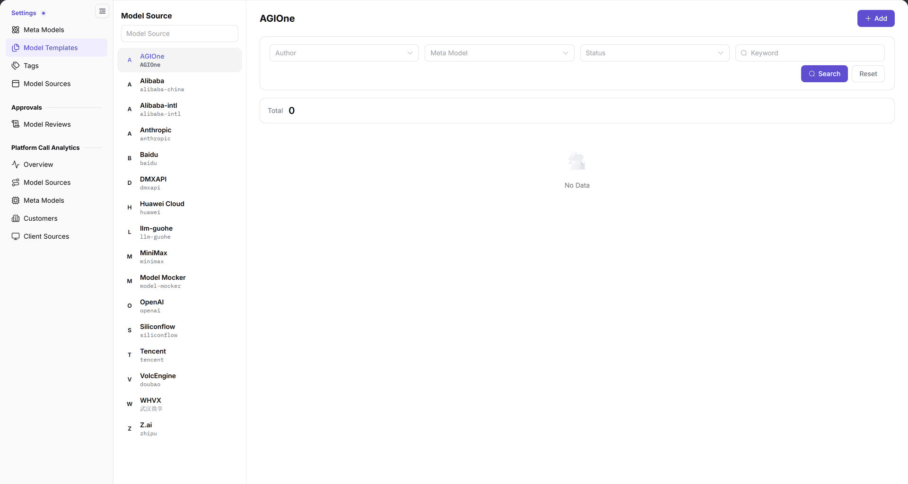
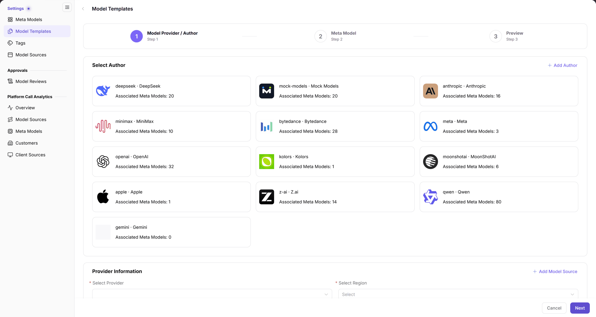

# Model Templates

::: info Document Information
Version: v2.1
Updated: 2026-11-12
:::

## Feature Overview

| Item | Content |
| --- | --- |
| Applicable role | Operator Admin |
| Navigation path | **Model Services** > **Settings** > **Model Templates** |
| Page route | `/modelone/settings/provider-template`; add page `/modelone/settings/provider-template/add` |
| Managed objects | Model source templates, model author, provider, region, meta model, and publishing preview |

**Beginner explanation**: A template is a preset publishing form. It combines the model author, provider, region, and meta model so providers do not repeat the same selections. The author, meta model, and model source must exist before the template can reference them.

#### Terms Quick Reference

| Term | Description |
| --- | --- |
| Model Template | A preset publishing configuration scheme combining default provider, region, author, and meta model options. |
| Model Author | The original organization or vendor developing the model, such as DeepSeek, OpenAI, or Anthropic. |
| Provider | The cloud service vendor or infrastructure host providing physical compute or API hosting. |
| Meta Model | An abstract model asset defining modalities, parameter specs, token limits, and supported native protocols. |

## Prerequisites

1. The current account can view and maintain **Settings > Model Templates**.
2. The model author and meta model exist and can be selected in the add flow.
3. The model source is maintained. If the provider or region is missing, add it in the model source first.

## Page Description

The page has two parts:

- **Model Source panel (left)**: a `Model Source` search box and the source list, such as Alibaba-intl, Alibaba, Baidu, Siliconflow, VolcEngine, Tencent, OpenAI, and Z.ai.
- **List area (right)**: the selected source name is the heading; **Add** sits at the top right. The filters are `Author`, `Meta Model`, and `Status` drop-downs plus a `Keyword` input, followed by **Search** and **Reset**. Above the list is `Total`; when there are no records, the page shows `No Data`.

| Area | Description |
| --- | --- |
| Left Model Source Panel | Allows searching and switching across managed model sources, providers, and regions |
| Right Header Bar | Displays the active model source name and provides the Add template button |
| Filter & Search Area | Contains Author, Meta Model, Status dropdowns, Keyword input, Search, and Reset buttons |
| Template List | Displays template cards or table rows under the current source, with total count at the top |

The figure shows the filters for AGIOne: `Author`, `Meta Model`, `Status`, and `Keyword`. `Total` is 0 and the list shows `No Data`.

## Main Operations

### Select a model source and filter

1. Enter a source name in the `Model Source` search box on the left.
2. Click the target source; the heading and template list switch to it.
3. Choose conditions in `Author`, `Meta Model`, and `Status`, or enter a `Keyword`.
4. Click **"Search"** to query, or **"Reset"** to clear the conditions.

### Add a template

1. Click **"Add"** at the top right to open the add-template wizard.
2. The step bar shows `1 Model Provider / Author`, `2 Meta Model`, and `3 Preview`.
3. In step 1, click a card under `Select Author`; each card shows the author identifier and `Associated Meta Models`.
4. Under `Provider Information`, select `Select Provider` and `Select Region`. Click **"Add Model Source"** when the source is missing.
5. Click **"Next"** to open step 2; select the meta model and check the modalities, capabilities, token limits, and protocols shown on the page.
6. In step 3 `Preview`, review the full configuration and submit.
7. Use **"Cancel"** or the back arrow to leave the flow.

The figure shows the `Select Author` cards and `Provider Information` in Step 1. Each author card shows `Associated Meta Models`; `Provider Information` contains `Select Provider`, `Select Region`, and `Add Model Source`.

### Read the template list

1. Select a model source and narrow the list with the filters.
2. `Total` is shown above the list; when nothing matches, the page shows `No Data`.
3. After adding or editing, search again in the same model source and check whether the template appears.

## Parameter Quick Reference

### Filters

| Field Name | Required | Field Type | Example | Description |
| --- | --- | --- | --- | --- |
| Model Source | Required | Left list selection | `Alibaba-intl` | Determines the right-hand template list |
| Author | Optional | Drop-down | `DeepSeek` | Filters by model author |
| Meta Model | Optional | Drop-down | `DeepSeek-V4-Pro` | Filters by meta model |
| Status | Optional | Drop-down | `Enable` | Filters by template status |
| Keyword | Optional | Text | `deepseek` | Keyword search |

### Add template - step 1

| Field Name | Required | Field Type | Example | Description |
| --- | --- | --- | --- | --- |
| Model Author | Required | Card selection | `deepseek · DeepSeek` | Author the template belongs to |
| Provider | Required | Drop-down | `Alibaba-intl` | Model source provider |
| Region | Required | Drop-down | `China` | Region of the provider |

Fields in steps 2 and 3 follow what the page displays. After selecting a meta model, check the modalities, capabilities, token limits, and protocols shown on the page.

## Pitfalls

- The template list follows the model source selected on the left. If a new template is missing, confirm the same source is selected.
- `Select Provider` and `Select Region` in step 1 must match the target model source. Check **Settings > Model Sources** when unsure.
- The three wizard steps are sequential. Step 2 and step 3 do not show their full fields until step 1 is complete.
- `Total` 0 with `No Data` means the current filter range has no templates; it does not mean the template feature is unavailable.

## Result Validation

| Check Item | Success Signal | If Abnormal |
| --- | --- | --- |
| Correct model source | The heading on the right matches the highlighted source on the left | Check scroll position in the left source list and click the target model source again |
| Wizard position | The step bar shows `1 Model Provider / Author`, `2 Meta Model`, and `3 Preview` | If unable to proceed to next step, check whether all required items (author, provider, region) are selected |
| Author selectable | The `Select Author` area shows author cards with `Associated Meta Models` | If the author list is empty, verify in meta models or system settings that model authors are registered |
| List result and total | `Total` appears above the list; matching rows appear, otherwise `No Data` is shown | Click **"Reset"** to clear conflicting filters and confirm whether templates exist for this source |

## FAQ

#### The template list is empty

**Symptom:**

After selecting a model source, the page shows `No Data` and `Total` is 0.

**Possible Causes:**

No template has been created under this model source yet, or filters (Author, Meta Model, Keyword) excluded existing rows.

**Resolution:**

1. Click **"Reset"** to clear Author, Meta Model, Status, and Keyword filters.
2. Switch to another model source on the left to verify if templates exist elsewhere.
3. Click **"Add"** at the top right and follow the wizard to create the first template for this source.

#### What is the difference between a template and a meta model?

**Symptom:**

During operator configuration, it is unclear whether to maintain meta models or templates first.

**Possible Causes:**

They operate at different lifecycle layers: meta models define abstract capability specs, while templates provide preset publishing forms.

**Resolution:**

1. Go to **Settings > Meta Models** to configure capability types, modalities, token limits, and supported native protocols.
2. Go to **Settings > Model Templates** to assemble the meta model with an author, source provider, and physical region.
3. Always configure meta models before creating publishing templates.

## Notes

- Templates affect the model publishing flow. Confirm the reference scope before changing the provider, region, or meta model.
- Before adding a template, confirm that the model source, author, and meta model already exist.
- Do not write real credentials into template names, keywords, or notes.

## Next Steps

1. Check model capabilities, token limits, and supported protocols in Meta Models.
2. Maintain providers, regions, and endpoint configurations in Model Sources.
3. After templates are prepared, verify that submitted models in Model Reviews match the presets.

Related pages:
- [Meta Models](../meta-models/)
- [Model Sources](../model-source/)
- [Model Reviews](../../approvals/model-reviews/)
- [Tags](../tags/)
