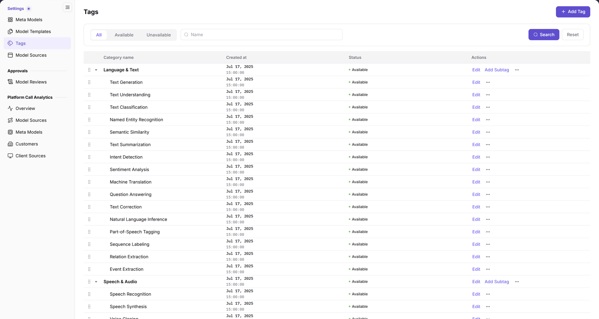
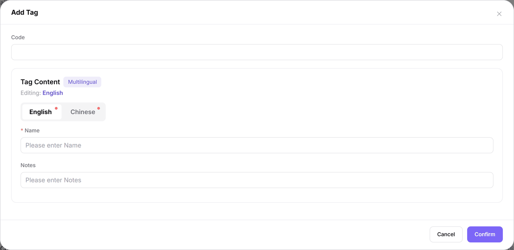

# Tags

::: info Document Information
Version: v2.0
Updated: 2026-11-04
:::

## Feature Overview

| Item | Content |
| --- | --- |
| Applicable role | Operator Admin |
| Navigation path | **Model Services** > **Settings** > **Tags** |
| Page route | `/modelone/settings/tags` |
| Managed objects | Tag categories, subtags, multilingual names, notes, status, and hierarchy |

**Beginner explanation**: Tags are the category shelves of the model marketplace. Create a top-level category first, then add subtags under it. Categories group related capabilities; subtags name the specific capability or scene that users filter by.

#### Terms Quick Reference

| Term | Description |
| --- | --- |
| Tag Category | A top-level parent node in the tag taxonomy used for broad grouping (e.g., Speech & Audio, Language & Text). |
| Subtag | A secondary capability or scenario node mounted under a category, directly bound to model cards and explore filters. |
| Tag Code | A globally unique string identifier across the platform used for underlying indexing, API filtering, and i18n mapping. |
| Multilingual Names | Display text maintained separately in English and Simplified Chinese, adapting to system locale switching. |

## Prerequisites

1. The current account can view and maintain **Settings > Tags**.
2. The category hierarchy, code convention, and English/Chinese names are confirmed.
3. The tag will not be reused for unrelated capabilities or industries.

## Page Description

The top area contains the filter row and **Add Tag**. The table below uses a tree structure:

- Status tabs: `All`, `Available`, `Unavailable`.
- Search box: `Name`, followed by **Search** and **Reset**.
- Table columns: `Category name`, `Created at`, `Status`, `Actions`.
- Top-level categories have an expand arrow. Row actions include **Edit**, **Add Subtag**, and **...**.

| Area | Description |
| --- | --- |
| Status Tabs | Switch across All, Available, and Unavailable tabs to filter active or retired tag nodes |
| Action & Filter Bar | Includes Name keyword input, Search and Reset buttons, and the Add Tag button at the top right |
| Tag Hierarchy Table | Displays top-level categories and subtags with name, created time, status, and row action buttons |
| Edit Dialog Modal | Opened upon clicking Add or Edit, supporting code input, multilingual name tabs, and notes |

The figure shows categories in `Category name`, such as “Language & Text” and “Speech & Audio” with their subtags. `Status` shows `Available`; the action column offers `Edit`, `Add Subtag`, and more actions.

## Main Operations

### Filter tags

1. Switch between `All`, `Available`, and `Unavailable`.
2. Enter a tag name or keyword in `Name`.
3. Click **"Search"** to query, or **"Reset"** to clear the conditions.
4. Use the expand arrow next to a category to view its subtags.

### Add a tag

1. Click **"Add Tag"** at the top right to open the `Add Tag` dialog.
2. Fill in the unique `Code`.
3. Under `Tag Content`, switch between the `English` and `Chinese` tabs and fill in `Name`.
4. Fill in `Notes` when needed.
5. Click **"Confirm"** to save, or **"Cancel"** / the `×` at the top right to close.

The figure shows the dialog contains `Code`, multilingual `Tag Content`, and `Notes`. `Name` carries a `*` required mark; both the `English` and `Chinese` tabs are marked as required. The example shows English as the language currently being edited.

### Add a subtag

1. Click **"Add Subtag"** on the target top-level category.
2. Fill in the subtag `Code`, `Name`, and `Notes` in the dialog.
3. Click **"Confirm"**, then expand the parent category to check the new level.

### Edit and more actions

- Click **"Edit"** in a row to change the code, name, or notes.
- Click **...** to open **"Disable"** and **"Delete"**.
- Before disabling or deleting, confirm whether models or filter entries still use the tag.

## Parameter Quick Reference

| Field Name | Required | Field Type | Example | Description |
| --- | --- | --- | --- | --- |
| Code | Required | Text | `text-generation` | Unique code of the tag or category |
| Tag Content | Required | Multilingual text | `Text Generation` | Name users see in lists and filters |
| Name (English tab) | Required | Text | `Text Generation` | Name shown in the English interface |
| Name (Chinese tab) | Required | Text | `文本生成` | Name shown in the Chinese interface |
| Notes | Optional | Text | `For text generation models` | Purpose or boundary of the tag |
| Status | System-maintained | Enumeration | `Available` / `Unavailable` | Value shown in the `Status` column |
| Created at | System-maintained | Date time | `Jul 17, 2025 15:00:00` | Creation time of the tag |
| Hierarchy | System-maintained | Tree | `Language & Text > Text Generation` | Category and subtag relationship |

## Pitfalls

- Categories and subtags are different levels: a category groups related entries, while a subtag is the specific filter item.
- Both the `English` and `Chinese` name tabs carry a required mark. Check both after switching languages.
- The `All`, `Available`, and `Unavailable` tabs change the result set. If a new tag is missing, switch back to `All` first.
- Before deleting a parent category, expand it and confirm that no required subtags remain.

## Result Validation

| Check Item | Success Signal | If Abnormal |
| --- | --- | --- |
| New tag created | Search by `Name`; the row appears and `Status` shows `Available` | If the record does not appear, switch to the `All` tab and ensure no trailing spaces exist in search input |
| Subtag level correct | Expand the parent category; the new subtag appears indented below it | If improperly nested, click row **"Edit"** or re-add from the correct parent category |
| Multilingual names saved | Reopen the edit dialog; both `English` and `Chinese` tabs contain a name | Ensure names are filled in both language tabs before saving; empty tabs fail required validation |
| Status filter works | Switch to `Available` or `Unavailable`; only matching tags remain | Click **"Reset"** to clear conflicting filters and refresh the page to confirm status changes |

## FAQ

#### The new tag is not visible in the list

**Symptom:**

After saving, the newly added tag or subtag does not appear on the current list page.

**Possible Causes:**

The view is currently filtered by the `Unavailable` tab, or the new subtag is placed under a collapsed parent category.

**Resolution:**

1. Switch to the `All` status tab.
2. Click **"Reset"** to clear any keyword in the search box.
3. Locate the target parent category and click the left arrow to expand its subtags.

#### The English and Chinese names differ

**Symptom:**

The tag name appears as code, placeholder, or contradictory meaning when switching between English and Chinese.

**Possible Causes:**

During creation or editing, only one language tab was maintained, leaving the other tab unaligned or default.

**Resolution:**

1. Locate the tag row in the table and click **"Edit"**.
2. Switch between the `English` and `Chinese` tabs to inspect both localized names.
3. Align both names to the same business meaning and click **"Confirm"** to save.

## Notes

- Tags affect the model marketplace and filter results. Confirm the impact scope before changing them.
- Codes, names, and notes should be understandable to users; avoid internal project codes or temporary campaign names.
- Before deleting or disabling a tag, confirm that no model or filter entry still uses it.

## Next Steps

1. Associate the configured tags with new capabilities in Meta Models.
2. Verify default tag categories in Model Templates to ensure proper listing conventions.
3. Open the user-facing Model Explorer to test tag filtering behavior and tree responsiveness.

Related pages:
- [Meta Models](../meta-models/)
- [Model Templates](../model-templates/)
- [Model Sources](../model-source/)
- [My Models](../../../user/studio/my-models/)
