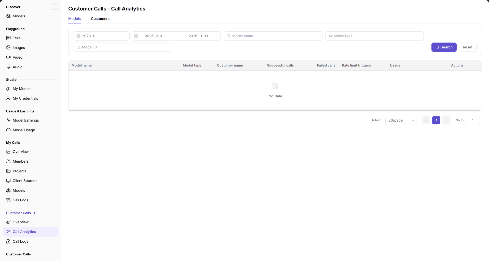

# Call Analytics

> This page appears as **Call Analytics** in the left menu; the page title is **Customer Calls - Call Analytics**.

## 1. Feature Overview

| Item | Content |
| --- | --- |
| Applies to | Model Provider & User |
| Navigation | **Model Services** > **Customer Calls** > **Call Analytics** |
| Route | `/modelone/monitoring/monitor/list` |
| Managed objects | Successful, failed, and rate-limited calls by model or customer |

**New to this page**: Call Analytics groups customer traffic by model list or customer list. Choose the list type, filter by model type, name, or customer, then verify successful, failed, and rate-limited calls.

## 2. Prerequisites

1. Your account can open **Customer Calls > Call Analytics**.
2. Customer calls exist in the current period.
3. The list type and filters are confirmed.

## 3. Page Description

The title is `Customer Calls - Call Analytics`, with two tabs: `Models` and `Customers`.

The top of the filter area provides a month and date range; below are `All Model type`, `Model name`, `Model ID`, **Search**, and **Reset**.

In `Models`, columns are `Model name`, `Model type`, `Customer name`, `Successful calls`, `Failed calls`, `Rate limit triggers`, `Usage`, and `Actions`. Without data, the table shows `No Data` and `Total 0` with pagination.

**Figure note**: The page provides `Models` and `Customers` tabs; filters include `All Model type`, `Model name`, and `Model ID`; columns are `Model name`, `Model type`, `Customer name`, `Successful calls`, `Failed calls`, `Rate limit triggers`, `Usage`, and `Actions`.

## 4. Main Operations

### 4.1 Choose the list type

1. Click the `Models` or `Customers` tab.
2. The headers and grouping change with the tab.

### 4.2 Filter records

1. Choose a model type in `All Model type`.
2. Enter a model name or model ID.
3. Click **Search** or **Reset**.

### 4.3 Read statistics

1. Check `Successful calls`, `Failed calls`, and `Rate limit triggers` per row.
2. Read `Usage` for call or token summary.
3. Use `Actions` to open the record.

## 5. Parameter Quick Reference

| Field | Required | Type | Example | Description |
| --- | --- | --- | --- | --- |
| Month / date range | Yes | Selector / date range | `2026-11`; `2026-11-01` to `2026-11-03` | Statistics period |
| Model type | No | Selector | `All Model type` | Filter by model type |
| Model name | No | Text | `GPT-6.1 Sol` | Filter by model name |
| Model ID | No | Text | `openai/gpt-6.1-sol` | Filter by model ID |
| Model name (column) | System | Text | `GPT-6.1 Sol` | Model in the list |
| Model type (column) | System | Tag | `Text` | Model category |
| Customer name | System | Text | `Customer A` | Calling customer |
| Successful calls | System | Number | `0` | Successful calls |
| Failed calls | System | Number | `0` | Failed calls |
| Rate limit triggers | System | Number | `0` | Times limits were triggered |
| Usage | System | Text | — | Call or token summary |

## 6. Pitfalls

- Headers and dimensions differ between `Models` and `Customers`; do not check old columns after switching.
- When the scope has no data, the table shows `No Data` and `Total 0`.
- Model name and model ID are separate search fields; model ID is more precise.

## 7. Result Validation

| Check | What you can see |
| --- | --- |
| Tabs switch | `Models` and `Customers` switch normally |
| Filters applied | Rows follow model type, name, or ID |
| Metrics complete | Each row shows successful, failed, and rate-limited calls |
| Pagination | Total count and page size are shown |

## 8. FAQ

#### The table is empty

**Symptom**: `No Data` and `Total 0` are shown.

**Resolution**: Confirm customer calls exist in the period and clear model type, name, and ID filters.

#### Search results differ from expectations

**Symptom**: Searching by model name returns no target record.

**Resolution**: Use the model ID for an exact search or relax the model type filter.

## 9. Notes

- The page contains customer names and call data; do not share screenshots externally.
- Results follow the current filters; fix the scope before comparing.

## 10. Next Steps

- Review totals and Top 5 in [Overview](../overview/).
- Review individual calls in [Call Logs](../call-logs/).
- Review revenue in [Model Earnings](../../usage-earnings/model-earnings/).
