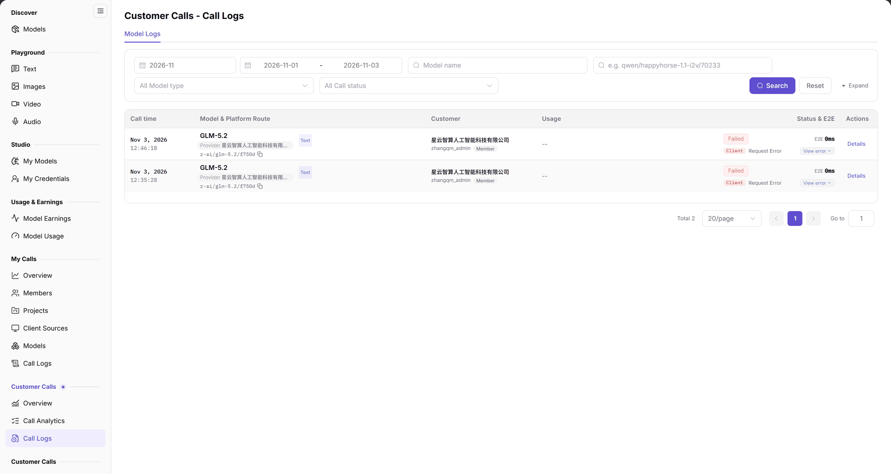

# Call Logs

::: info Document Information
Version: v2.0
Updated: 2026-11-04
:::

## Feature Overview

| Item | Content |
| --- | --- |
| Applies to | Model Provider & User |
| Navigation | **Model Services** > **Customer Calls** > **Call Logs** |
| Route | `/modelone/monitoring/monitor/log` |
| Managed objects | Individual customer calls, customer, usage, and execution status |

**New to this page**: Customer Calls logs list each customer request. Filter by model type and call status, then verify the customer, token usage, and latency in the table.

#### Terms Quick Reference

| Term | Description |
| --- | --- |
| Customer Call Logs (Monitoring) | Inbound API request execution stream recorded for consumer or operations auditing, tracking individual call timing and execution states. |
| Platform Route | The internal dispatch forwarding path where the gateway routes standardized model requests (e.g., `openai/gpt-6.1-sol`) to backend physical model instances. |
| Usage | Breakdown of token consumption for an individual call (including input Prompt Tokens and output Completion Tokens). |
| Status & E2E | Final execution outcome (success, failure, or rate limited) alongside precise millisecond end-to-end network latency. |

## Prerequisites

1. Your account can open **Customer Calls > Call Logs**.
2. Customer call records exist in the current period.
3. Model type and call status filters are confirmed.

## Page Description

The title is `Customer Calls - Call Logs`, with a `Model Logs` tab.

| Area | Description |
| --- | --- |
| Top period & multi-filter bar | Month selector, date range picker, model type/status dropdowns, model name search box, and Search/Reset buttons |
| Detailed single-call log table | Displays call timestamp, model & platform route, calling customer, token usage, execution status, and E2E latency |
| Pagination & item counter bar | Displays total filtered log records (e.g., "Total 0"), page size selector, and pagination jump controls |
| Action & details drawer trigger | Provides buttons to open an inspection drawer showing sanitized request headers, payloads, and error traces |

- The top of the filter area provides a month and date range; below are `All Model type`, `All Call status`, a model name search box, **Search**, **Reset**, and **Expand**.
- Columns are `Call time`, `Model & Platform Route`, `Customer`, `Usage`, `Status & E2E`, and `Actions`. Without data, the table shows `No Data` and `Total 0` with pagination.

The figure shows filters include `All Model type`, `All Call status`, a `Model name` box with the hint `e.g. qwen/happyhorse-1.1-i2v/70233`, and **Expand**; columns are `Call time`, `Model & Platform Route`, `Customer`, `Usage`, `Status & E2E`, and `Actions`.

## Main Operations

### Filter records

1. Choose a model type in `All Model type`.
2. Choose a status in `All Call status`.
3. Enter a model name or route ID.
4. Click **"Search"** or **"Reset"**.

### Review a record

1. Locate the target call in the table.
2. Check `Call time`, `Model & Platform Route`, and `Customer`.
3. Review `Usage` and `Status & E2E`.
4. Use `Actions` to open details.

## Parameter Quick Reference

| Field Name | Required | Field Type | Example | Description |
| --- | --- | --- | --- | --- |
| Month / date range | Yes | Selector / date range | `2026-11`; `2026-11-01` to `2026-11-03` | Statistics period |
| Model type | No | Selector | `All Model type` | Filter by model type |
| Call status | No | Selector | `All Call status` | Filter by execution status |
| Model name | No | Text | `qwen/happyhorse-1.1-i2v/70233` | Filter by model name or route |
| Call time | System | Time | `2026-11-03 10:00:00` | When the call occurred |
| Model & Platform Route | System | Text | `openai/gpt-6.1-sol` | Requested model and route |
| Customer | System | Text | `Customer A` | Calling customer |
| Usage | System | Number | Input/output tokens | Token usage of the call |
| Status & E2E | System | Status | `Succeeded`, `Failed` | Result and latency |

## Pitfalls

- `All Call status` filters status only; model type still applies.
- When the scope has no records, the table shows `No Data` and `Total 0`.
- The model search box accepts route IDs such as `qwen/happyhorse-1.1-i2v/70233`; use that format for precision.

## Result Validation

| Check Item | Success Signal | If Abnormal |
| --- | --- | --- |
| Filter precision | Switching model type or call status and clicking Search immediately narrows records to matched calls | If records do not refresh, verify that the **"Search"** button was clicked |
| Record integrity | Each row clearly shows call timestamp, platform route ID, customer name, token usage, and status | If the customer column is blank or corrupted, check whether API client tokens correctly bind tenant identities |
| Latency visibility | Status column displays success/failure badges accompanied by precise millisecond end-to-end duration | If latency is abnormally large, check backend model instance network latency or customer long-context prompt load |
| Route search | Entering a full route ID (e.g., `qwen/happyhorse-1.1-i2v/70233`) and clicking Search accurately hits target calls | If no records match, try searching with model short names or strip extraneous spaces |
| Details drawer inspection | Clicking the details button in the Actions column successfully pops out the single-call request headers, body, and error stack drawer | Verify the current account possesses permissions to inspect sanitized call logs |

## FAQ

#### Call logs are empty

**Symptom:** The table displays `No Data` and the footer shows `Total 0`.

**Possible Causes:** No calls were initiated within the selected period, or composite filters (model type, status, model name) are too restrictive.

**Resolution:**

1. Click **"Reset"** to restore all filter dropdowns to their default state.
2. Check the top month and date range and switch to dates with known call volume.
3. Verify that the requested model belongs to the active platform catalog.

#### A call cannot be found

**Symptom:** A customer reports a failed request, but searching by model name returns no records.

**Possible Causes:** The request was blocked by the global API gateway before reaching the model routing layer (e.g., invalid API key), or case sensitivity in the search query prevented a match.

**Resolution:**

1. Copy and paste the exact model route identifier from the customer's request payload into the search box.
2. Switch Call Status to `All Call status` to avoid hiding failures under a `Success` filter.
3. Confirm whether the request reached the gateway routing layer.

## Notes

- Logs contain customer names and call data; do not share screenshots externally.
- Record only necessary fields during troubleshooting to avoid exposing request content and keys.

## Next Steps

1. For failed or throttled calls, inspect the Actions drawer to check exact HTTP status codes and gateway rejection reasons.
2. Return to [Overview](../overview/) to observe macro traffic patterns and Top 5 customer distributions.
3. Check billed token settlement for successful calls in [Model Earnings](../../usage-earnings/model-earnings/).

Related pages:
- [Customer Calls Overview](../overview/)
- [Customer Calls - Call Analytics](../call-analytics/)
- [Customer Calls Logs](../../provider-calls/call-logs/)
- [Model Usage](../../usage-earnings/model-usage/)
- [Model Earnings](../../usage-earnings/model-earnings/)
