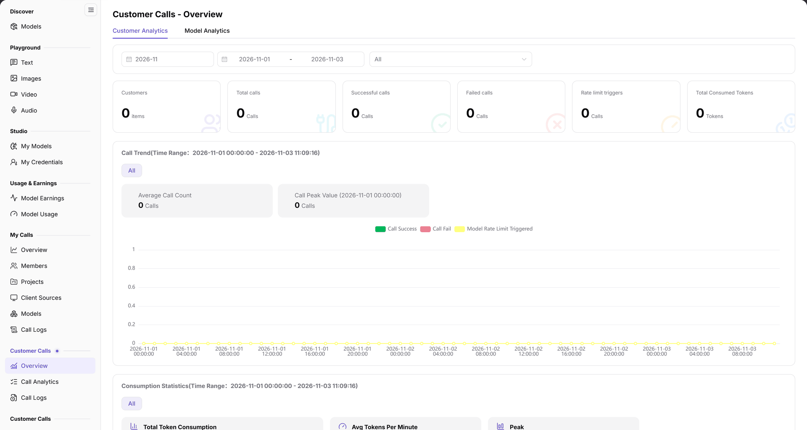

# Overview

::: info Document Information
Version: v2.0
Updated: 2026-11-04
:::

## Feature Overview

| Item | Content |
| --- | --- |
| Applies to | Model Provider & User |
| Navigation | **Model Services** > **Customer Calls** > **Overview** |
| Route | `/modelone/monitoring/monitor/overview` |
| Managed objects | Customer call volume, success rate, token consumption, trends, and Top 5 rankings |

**New to this page**: Customer Calls Overview summarizes traffic from the customer perspective. Read customer count, total calls, and success rate, then review trends and consumption, and use Top 5 to find customers with the highest volume or rate-limit triggers.

#### Terms Quick Reference

| Term | Description |
| --- | --- |
| Customer-Dimension Monitoring | An aggregated operational view summarizing inbound API traffic, token consumption, and SLA performance grouped by customer tenant entities. |
| Rate Limit Triggers | Cumulative count of customer requests blocked with HTTP 429 status codes when exceeding gateway QPS or TPM thresholds. |
| Peak Input/Output Tokens | The maximum input or output token throughput reached at any individual sampling point within the statistical window. |
| Top 5 Customers by Volume | Ranking of the top 5 customer tenants sorted in descending order of total inbound request volume. |

## Prerequisites

1. Your account can open **Customer Calls > Overview**.
2. Customer calls exist in the current period.
3. The time range and dimension are confirmed.

## Page Description

The title is `Customer Calls - Overview`, with two tabs: `Customer Analytics` and `Model Analytics`.

| Area | Description |
| --- | --- |
| Top tab & filter bar | Customer Analytics / Model Analytics switcher tabs, time range picker, dropdown filters, and "More" expand button |
| Core KPI overview cards | Displays Customers count, Total calls, Successful/Failed calls, Rate limit triggers, and Total Consumed Tokens |
| Call trends & token consumption | Chronological line charts for call requests alongside input/output/peak token breakdown visual metrics |
| Dual Top 5 ranking tables | Focuses on Top 5 Customers by Call Volume and Top 5 Rate Limit Triggers to rapidly identify heavy and abnormal users |

`Customer Analytics` contains:

- Time and scope: a time range selector, an `All` filter, and **More**.
- KPI cards: `Customers`, `Total calls`, `Successful calls`, `Failed calls`, `Rate limit triggers`, and `Total Consumed Tokens`.
- `Call Trend`: shows the time range and an `All` filter, with **More**.
- `Consumption Statistics`: `Total Token Consumption` (`Total`, `Input`, `Output`), `Avg Tokens Per Minute` (`Input Tokens`, `Output Tokens`), and `Peak` (`Peak Input Tokens`, `Peak Output Tokens`).
- `Top 5 Customers by Call Volume`: columns `No.`, `Username`, `Total calls`, `Successful calls`, `Failed calls`, `Actions`.
- `Top 5 Rate Limit Triggers`: columns `No.`, `Username`, `Model rate limit triggers`, `Rate limit triggers`, `Actions`.

The figure shows the page provides `Customer Analytics` and `Model Analytics` tabs; KPI cards show `Customers`, `Total calls`, `Successful calls`, `Failed calls`, `Rate limit triggers`, and `Total Consumed Tokens`; below are `Call Trend`, `Consumption Statistics`, `Top 5 Customers by Call Volume`, and `Top 5 Rate Limit Triggers`.

## Main Operations

### Review customer analytics

1. Open **Customer Calls > Overview**; `Customer Analytics` is selected by default.
2. Choose the time range and `All` filter.
3. Read `Customers`, `Total calls`, successful/failed calls, `Rate limit triggers`, and `Total Consumed Tokens`.
4. Review `Call Trend` and `Consumption Statistics`.
5. Use `Top 5 Customers by Call Volume` and `Top 5 Rate Limit Triggers` to locate key customers.

### Switch to model analytics

1. Click the `Model Analytics` tab.
2. Review the model-dimension statistics.

### Open more details

1. Click **"More"** in the KPI or trend area.
2. Use the expanded options to view additional information or details.

## Parameter Quick Reference

| Field Name | Required | Field Type | Example | Description |
| --- | --- | --- | --- | --- |
| Time range | Yes | Date range | `2026-11-01` to `2026-11-03` | Statistics period |
| Customers | System | Number | `0` | Customers that made calls |
| Total calls | System | Number | `0` | Total customer calls |
| Successful calls | System | Number | `0` | Successful calls |
| Failed calls | System | Number | `0` | Failed calls |
| Rate limit triggers | System | Number | `0` | Times rate limits were triggered |
| Total Consumed Tokens | System | Number | `0` | Customer token consumption |
| Total Token Consumption | System | Number | `0 Tokens` | Total, input, and output |
| Avg Tokens Per Minute | System | Number | `0 Tokens` | Input and output averages |
| Peak | System | Number | `0 Tokens` | Input and output peaks |
| Username | System | Text | `Customer A` | Customer in the Top 5 |
| Model rate limit triggers | System | Number | `0` | Models that triggered limits |
| Rate limit triggers | System | Number | `0` | Times limits were triggered |

## Pitfalls

- `Customer Analytics` and `Model Analytics` use different aggregation scopes; do not compare same-named metrics directly.
- `Total Consumed Tokens` is a token count, not an amount; revenue is on Model Earnings.
- When the scope has no data, Top 5 tables show `No Data` and charts may be empty.
- The time range is based on the current date; confirm it when crossing days.

## Result Validation

| Check Item | Success Signal | If Abnormal |
| --- | --- | --- |
| Seamless tab switching | Clicking between Customer Analytics and Model Analytics tabs swiftly reloads charts and metric cards with intact structure | If switching stalls or errors, refresh the page and verify monitoring permissions for the current account |
| Metric card display | KPI cards fully display customer count, total calls, success/failure counts, and token consumption metrics | If all numbers show 0, verify whether active calls occurred in the time window or widen the date range |
| Chart continuity | Call trend and consumption chart curves render smoothly with interactive tooltips showing timestamped requests and tokens | If charts render blank, clear specific top dropdown filters |
| Top 5 table interactivity | Top 5 Customers by Call Volume and Top 5 Rate Limit Triggers display up to 5 detailed rows or compliant empty states | If usernames appear blank, check platform tenant naming service connectivity |
| Expansion & drill-down | Clicking "More" in the KPI or trend area successfully opens or navigates to [Call Analytics](../call-analytics/) | Check if the browser blocked modal popups or page redirection |

## FAQ

#### Metrics and rankings are 0 or empty

**Symptom:** Customer count and total calls display 0, and both Top 5 ranking tables show `No Data`.

**Possible Causes:** No valid calls were generated in the selected time range, or statistics are still calculating in the quasi-realtime hourly aggregation pipeline.

**Resolution:**

1. Check the top time picker and widen the statistical window to the past 7 days or last month.
2. Wait for the next hourly aggregation batch and refresh the page.
3. Verify that the customer API gateway correctly forwarded monitoring telemetry.

#### Customer and model analytics differ

**Symptom:** Total calls show minor discrepancies between Customer Analytics and Model Analytics tabs.

**Possible Causes:** Customer analytics aggregates based on tenant authentication records, while model analytics aggregates based on resolved backend model instances; requests authenticated at the gateway but failing to match a valid model route cause divergence between the two views.

**Resolution:**

1. Rely on Customer Analytics for tenant billing reconciliation and concurrency quota auditing.
2. Rely on Model Analytics for model capacity scheduling and backend inference load evaluation.

## Notes

- The page contains customer names and call data; do not share screenshots externally.
- Statistics are aggregated by time range; fix the range before comparing.

## Next Steps

1. Drill down into [Call Analytics](../call-analytics/) to inspect detailed chronological metrics by customer or model.
2. Search [Call Logs](../call-logs/) to examine single-call request payloads and rate-limiting rules for frequently throttled customers.
3. Verify commercial revenue sharing for high-volume customers in [Model Earnings](../../usage-earnings/model-earnings/).

Related pages:
- [Customer Calls - Call Analytics](../call-analytics/)
- [Customer Calls - Call Logs](../call-logs/)
- [Customer Calls - Overview](../../provider-calls/overview/)
- [Model Usage](../../usage-earnings/model-usage/)
- [Model Earnings](../../usage-earnings/model-earnings/)
