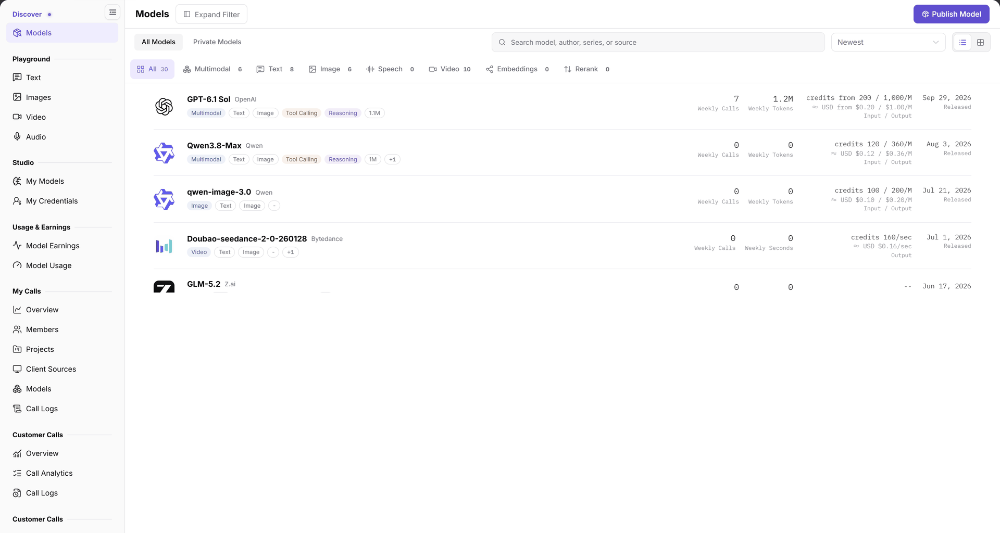

# Models

## 1. Feature Overview

| Item | Content |
| --- | --- |
| Applies to | Model Provider & User |
| Navigation | **Model Services** > **Discover** > **Models** |
| Routes | List `/modelone/store/model`; details `/modelone/store/model/{model ID}` |
| Managed objects | Published models, model authors, provider instances, pricing, and access information |

**New to this page**: The Models page is the catalog of callable models. Narrow the list by capability, author, or source, open a model to compare providers and prices, then try it in Playground or copy the Quick Start details into your application.

## 2. Prerequisites

1. Your account can open **Discover > Models**.
2. The target model is published and visible to your account or tenant.
3. Balance, price, context limit, and protocol are confirmed before calling.

## 3. Page Description

The page contains a filter area, a title area, and a model list:

- Filters: search box, `Input Capability`, `Output Capability`, `Model Series`, `Context`, `Billing`, `Model Author`, `Model Source`, `Scene`; use **Expand Filter** when space is limited.
- Title area: `Models`, **Publish Model** (visible to model providers), `All Models` / `Private Models` tabs, `Newest` sorting, and list/card view toggles.
- Capability counters: `All`, `Multimodal`, `Text`, `Image`, `Speech`, `Video`, `Embeddings`, `Rerank`, each with the current count.
- Model row: model name, author, type and capability tags, context length, `Weekly Calls`, `Weekly Tokens`, price in `credits ... / 1M` or per image/second, `≈ USD ...`, release date, and `Released` status.

**Figure note**: The search box reads `Search model, author, series, or source`; the capability counters show `All 30`, `Multimodal 6`, `Text 8`, `Image 6`, `Video 10`. Each row shows weekly calls, weekly tokens, input/output price, and release date.

### 3.1 Model details

The details page shows the model name, author, release date, model ID, price, context, max input/output, modality, capability tags, and protocols. The page provides five tabs: `Providers`, `Quick Start`, `Performance`, `Overview`, and `Best Practices`.

On `Providers`, filter by `All`, `Public`, `Private`, or `Aggregate`, and group by `All`, `By Provider`, or `By Model Source`. Each provider card shows the route ID, provider, price, context, `TTFT`, `Throughput`, `Success Rate`, `Weekly Calls`, `Weekly Tokens`, and `Uptime`, with **Playground** and **Quick Start** buttons.

## 4. Main Operations

### 4.1 Filter models

1. Enter a model name, author, series, or source in the search box.
2. Expand `Input Capability`, `Output Capability`, and other filters as needed.
3. Switch between `All Models` and `Private Models`.
4. Choose `Newest` in the sort list, or switch the list/card view.

### 4.2 Open model details

1. Click a model name to open its details.
2. Check the model ID, price, context, and protocols at the top.
3. On `Providers`, compare price, latency, success rate, and weekly calls.
4. Switch to `Quick Start`, `Performance`, `Overview`, or `Best Practices` as needed.

### 4.3 Try or integrate a model

1. Click **Playground** on a provider card to open the matching Playground.
2. Or click **Quick Start** on the provider card to view access details.
3. Replace addresses, model IDs, and keys in the sample with placeholders; never save real credentials.

### 4.4 Publish a model

Model providers can click **Publish Model** in the upper right. Publishing scope and steps are described in [My Models](../../studio/my-models/).

## 5. Parameter Quick Reference

| Field | Required | Type | Example | Description |
| --- | --- | --- | --- | --- |
| Search | No | Text | `GPT-6.1` | Search by model name, author, series, or source |
| Input / Output Capability | No | Multi-select | `Text`, `Image` | Filter by supported modality |
| Model Series | No | Single select | `Qwen3.8` | Filter by model series |
| Context | No | Single select | `≥128K` | Filter by context window |
| Billing | No | Single select | `Free`, `Paid` | Filter by billing type |
| Model Author | No | Single select | `OpenAI` | Filter by author |
| Model Source | No | Single select | `AGIOne` | Filter by source |
| Scene | No | Single select | `Text Generation` | Filter by scenario |
| Model scope | No | Tab | `All Models` / `Private Models` | Switch visible scope |
| Sort | No | Dropdown | `Newest` | Control list order |
| Weekly Calls | System | Number | `7` | Calls in the last week |
| Weekly Tokens | System | Number | `1.2M` | Tokens in the last week |
| Price | System | Text | `credits 200 / 1,000/M` | Token price or per-image/second price |
| Status | System | Tag | `Released` | Current publication status |

## 6. Pitfalls

- Confirm the current filters and tab before reading counts; do not treat a category count as the total.
- One model can have multiple providers. Price, latency, and success rate come from each provider card, not the model row.
- Billing units differ by modality: tokens for text, images for images, seconds for video. Align units before comparing prices.
- `All Models` and `Private Models` are separate scope tabs; confirm the active tab before reading counts.

## 7. Result Validation

| Check | What you can see |
| --- | --- |
| Filters applied | Model rows and capability counters change with the filters |
| Details match | Details title and model ID match the selected model |
| Provider details | Provider card shows price, context, `TTFT`, `Throughput`, `Success Rate` |
| Access entry | Provider card provides **Playground** and **Quick Start** |
| Empty result | No match shows an empty list; clearing filters restores results |

## 8. FAQ

#### The target model is not found

**Symptom**: Searching by name returns no target model.

**Resolution**:

1. Clear `Input Capability`, `Output Capability`, and other filters, then search again.
2. Switch to `All Models` and check whether the model is private.
3. Confirm the model is published and visible to your tenant.

#### Price shows `--`

**Symptom**: The model row or provider card shows `--` for price.

**Resolution**: Price is maintained by the provider. If it is missing, use the provider card's current display and defer integration with that provider.

#### The same model shows different prices

**Symptom**: Provider cards for the same model show different prices.

**Resolution**: Confirm the provider and billing unit, then compare within the same provider.

## 9. Notes

- Trying or calling a model creates records and consumes quota. Confirm the model, provider, and price first.
- Replace model IDs, addresses, and keys in Quick Start with environment-specific values; never write real credentials into documents or screenshots.
- Model capability, price, context, and protocols are defined by the current details page.

## 10. Next Steps

- Try models in [Text](../../playground/text/), [Images](../../playground/images/), [Video](../../playground/video/), or [Audio](../../playground/audio/).
- Review usage and tokens in [My Calls](../../my-calls/overview/).
- Model providers can publish or aggregate models in [My Models](../../studio/my-models/).
