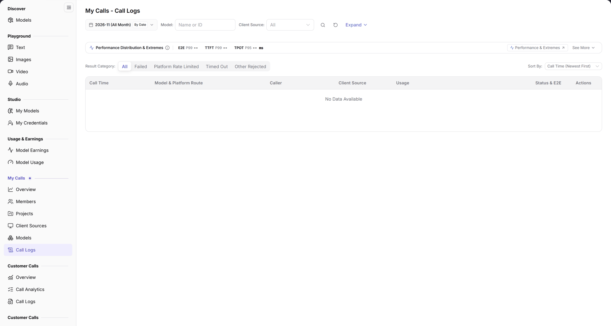

# My Calls - Call Logs

> This page appears as **Call Logs** in the left menu.

> Statistics scope: the month selector defines the period; `By Date` switches the aggregation to daily, and the date range is the start and end shown in the selector.

## 1. Feature Overview

| Item | Content |
| --- | --- |
| Applies to | Model Provider & User |
| Navigation | **Model Services** > **My Calls** > **Call Logs** |
| Route | `/modelone/model-observation/eu/calls` |
| Managed objects | Individual calls, caller, client source, status, and latency |

**New to this page**: Call Logs is the record of individual calls. Check performance distribution and extremes first, filter or sort by outcome, then verify the model, source, tokens, and latency of each call in the table.

## 2. Prerequisites

1. Your account can open **My Calls > Call Logs**.
2. Calls exist in the current period.
3. The month, model, and client source filters are confirmed.

## 3. Page Description

The title is `My Calls - Call Logs`. The page contains:

- Filters: month, `By Date`, `Model`, `Client Source`, **Expand**, and a `Name or ID` search box.
- `Performance Distribution & Extremes`: shows `E2E P99`, `TTFT P99`, and `TPOT P95`, with **See More**.
- `Performance & Extremes`: entries for P99/P95 sorting, minimum latency, and longest call.
- Category and sorting: `Result Category` (`All`, `Failed`, `Platform Rate Limited`, `Timed Out`, `Other Rejected`) and `Sort By` (default `Call Time (Newest First)`).
- Table: `Call Time`, `Model & Platform Route`, `Caller`, `Client Source`, `Usage`, `Status & E2E`, `Actions`.

**Figure note**: The page shows `Performance Distribution & Extremes` with `E2E P99`, `TTFT P99`, and `TPOT P95`; `Result Category` provides `All`, `Failed`, `Platform Rate Limited`, `Timed Out`, and `Other Rejected`; columns are `Call Time`, `Model & Platform Route`, `Caller`, `Client Source`, `Usage`, `Status & E2E`, and `Actions`.

## 4. Main Operations

### 4.1 Filter calls

1. Select a month.
2. Use `By Date` to change granularity.
3. Limit scope with `Model` and `Client Source`.
4. Search by `Name or ID`.

### 4.2 Review performance

1. Read `E2E P99`, `TTFT P99`, and `TPOT P95` under `Performance Distribution & Extremes`.
2. Click **See More** to expand `Performance & Extremes` sorting entries.

### 4.3 Filter and sort by outcome

1. Choose `All`, `Failed`, `Platform Rate Limited`, `Timed Out`, or `Other Rejected` in `Result Category`.
2. Choose a rule in `Sort By`; the default is `Call Time (Newest First)`.

### 4.4 Inspect a call

1. Locate the target record in the table.
2. Check `Model & Platform Route`, `Caller`, `Client Source`, `Usage`, and `Status & E2E`.
3. Use `Actions` to open the record details.

## 5. Parameter Quick Reference

| Field | Required | Field type | Example | Description |
| --- | --- | --- | --- | --- |
| Month | Yes | Selector | `2026-11` | Statistics month |
| By Date | No | Toggle | On | Aggregation granularity |
| Model | No | Text | `Name or ID` | Filter by model |
| Client Source | No | Selector | `All` | Filter by source |
| E2E P99 / TTFT P99 | System | Duration | `--` | End-to-end and first-token latency P99 |
| TPOT P95 | System | Duration | `-- ms` | Time per output token P95 |
| Result Category | No | Single select | `All` | Filter by call result |
| Sort By | No | Dropdown | `Call Time (Newest First)` | Control record order |
| Call Time | System | Time | `2026-11-03 10:00:00` | When the call occurred |
| Model & Platform Route | System | Text | `openai/gpt-6.1-sol` | Requested model and route |
| Caller | System | Text | Member or project | Call attribution |
| Client Source | System | Text | App name | Call source |
| Usage | System | Number | Input/output tokens | Token usage of the call |
| Status & E2E | System | Status | `Succeeded`, `Failed` | Result and latency |

## 6. Pitfalls

- `Performance Distribution & Extremes` shows `--` when there is no data; it does not mean latency is zero.
- `Result Category` filters records only and does not change the month.
- `Caller` and `Client Source` are different dimensions: member/project versus application source.
- The table is sorted by `Call Time (Newest First)` by default; verify the order after changing `Sort By`.

## 7. Result Validation

| Check | What you can see |
| --- | --- |
| Filters applied | Records follow month, model, and source |
| Performance metrics | `E2E P99`, `TTFT P99`, `TPOT P95` are shown |
| Category applied | Selecting `Failed`, `Platform Rate Limited`, `Timed Out`, or `Other Rejected` narrows records |
| Sort applied | Table order follows `Sort By` |
| Empty state | `No Data Available` when no records exist |

## 8. FAQ

#### Call logs are empty

**Symptom**: The table shows `No Data Available`.

**Resolution**: Confirm calls exist in the month, clear model, source, and category filters, and retry.

#### Performance metrics show `--`

**Symptom**: `E2E P99`, `TTFT P99`, and `TPOT P95` are all `--`.

**Resolution**: There are not enough samples in scope; widen the period or clear filters.

## 9. Notes

- Logs contain member, project, and source information; do not share screenshots externally.
- Record only the necessary fields during troubleshooting to avoid exposing request content.
- Statistics refresh hourly; new calls may be delayed.

## 10. Next Steps

- Review overall trends in [Overview](../overview/).
- Aggregate by [Members](../members/), [Projects](../projects/), or [Models](../models/).
- For publisher-side customer calls, use [Customer Calls](../../customer-calls/overview/).
