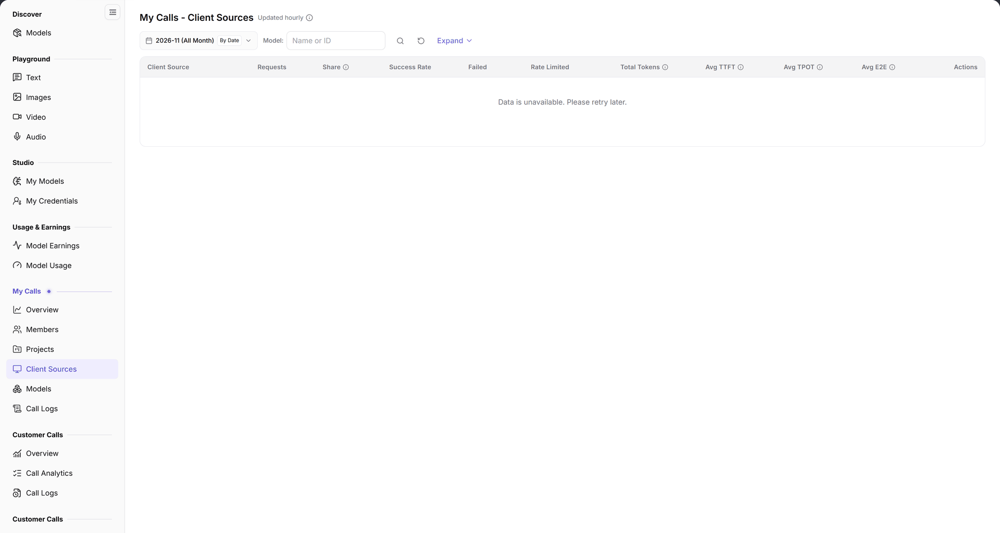

# My Calls - Client Sources

::: info Document Information
Version: v2.0
Updated: 2026-11-04
:::

## Feature Overview

| Item | Content |
| --- | --- |
| Applies to | Model Provider & User |
| Navigation | **Model Services** > **My Calls** > **Client Sources** |
| Route | `/modelone/model-observation/eu/apps` |
| Managed objects | Call count, share, success rate, tokens, and latency aggregated by client source |

**New to this page**: Client Sources answers "which application or source sent the calls". Select a month and model, then compare sources by volume, success rate, and latency.

#### Terms Quick Reference

| Term | Description |
| --- | --- |
| Client Source | Upstream client entity initiating large model API requests, such as a designated app name, SDK identifier, or business subsystem. |
| Call Share | The percentage of requests initiated by a specific client source relative to the tenant's total model call volume during the period. |
| Rate-Limited Calls | The count of calls rejected by gateway flow control quotas or QPS/TPM threshold limits. |
| Avg TPOT | Average Time Per Output Token per output token, reflecting the streaming decoding smoothness perceived by individual applications. |

## Prerequisites

1. Your account can open **My Calls > Client Sources**.
2. Calls with a source identifier exist in the current period.
3. The month and filters are confirmed.

## Page Description

The title is `My Calls - Client Sources`, marked `Updated hourly`.

| Area | Description |
| --- | --- |
| Top time & filter bar | Month selector, By Date granularity toggle, Model dropdown, Expand button, and Name/ID search box |
| Update interval badge | Displays "Updated hourly" indicating statistical metrics are quasi-realtime aggregated hourly results |
| Client sources summary table | Presents source name, requests, share, success rate, failed/rate-limited counts, total tokens, and TTFT/TPOT/E2E latency |
| Actions & drill-down column | Provides direct navigation to inspect detailed call logs associated with each client source |

- Filters include month, `By Date`, `Model`, **Expand**, and a `Name or ID` search box.
- Columns are `Client Source`, `Requests`, `Share`, `Success Rate`, `Failed`, `Rate Limited`, `Total Tokens`, `Avg TTFT`, `Avg TPOT`, `Avg E2E`, and `Actions`. Without data, the table shows `No Data Available`.

The figure shows filters are month, `By Date`, `Model`, **Expand**, and `Name or ID`; headers are `Client Source`, `Requests`, `Share`, `Success Rate`, `Failed`, `Rate Limited`, `Total Tokens`, `Avg TTFT`, `Avg TPOT`, `Avg E2E`, and `Actions`.

## Main Operations

1. Select a month.
2. Use `By Date` to change granularity.
3. Limit the model scope and use **"Expand"** for extended filters.
4. Search by source name or ID.
5. Compare volume, share, success rate, and latency.

## Parameter Quick Reference

| Field Name | Required | Field Type | Example | Description |
| --- | --- | --- | --- | --- |
| Month | Yes | Selector | `2026-11` | Statistics month |
| By Date | No | Toggle | On | Aggregation granularity |
| Model | No | Text | `Name or ID` | Filter by model |
| Client Source | System | Text | `App A` | Client source name |
| Requests | System | Number | `0` | Source call total |
| Share | System | Percentage | `0%` | Share of total calls |
| Success Rate | System | Percentage | `--` | Successful call share |
| Failed / Rate Limited | System | Number | `0` | Failed and rate-limited calls |
| Total Tokens | System | Number | `0` | Source token total |
| Avg TTFT / TPOT / E2E | System | Duration | `--` | Source average latency |

## Pitfalls

- Calls without a source identifier do not appear here; the Overview total may exceed the source sum.
- `No Data Available` does not mean the source is unavailable.
- `By Date` changes granularity; fix it before comparing.

## Result Validation

| Check Item | Success Signal | If Abnormal |
| --- | --- | --- |
| Filter synchronization | Switching months or specifying models immediately updates the rows and metrics displayed in the table | If the table becomes empty, click reset to clear filters and check whether calls occurred in the period |
| Metrics precision | When requests exceed 0, share, success rate, and total tokens display concrete values | If success rate is `--` or 0%, inspect failed and rate-limited counts to diagnose client authentication errors |
| Latency indicators | Average TTFT, TPOT, and E2E display millisecond or second duration values | If `--` appears, the number of successful streaming requests for this source is insufficient |
| Targeted search | Typing an application name or ID in the search box isolates the corresponding client source | Clear invisible whitespace or try searching directly by numeric source ID |
| Empty prompt handling | Displays `No Data Available` cleanly when no matches are found | Confirm whether client applications inject standard source identifier headers into requests |

## FAQ

#### The source list is empty

**Symptom:** The table displays `No Data Available`, and no application call statistics appear.

**Possible Causes:** No API calls were generated in the selected month; or client applications omit source headers in HTTP requests, classifying all calls as anonymous.

**Resolution:**

1. Switch to a month with established business application traffic.
2. Standardize client request headers to include designated source identifiers.
3. Clear model and keyword filters to reset the view.

#### Source total differs from Overview

**Symptom:** The sum of call requests across all client sources is lower than the total requests in [My Calls Overview](../overview/).

**Possible Causes:** Calls from direct scripts or scaffoldings lacked source identifiers; Overview aggregates all traffic, while this page lists identified sources only.

**Resolution:**

1. Verify API caller configurations and ensure all production pipelines specify client source parameters.
2. Use the Overview total for accounting and billing baselines, while using this page to analyze known application distributions.

## Notes

- Source names may contain internal application information; do not share screenshots externally.
- Statistics refresh hourly; new calls may be delayed.

## Next Steps

1. Drill down into individual call logs to inspect request payloads, headers, and error codes for high-load sources.
2. Cross-reference call distributions across member and project views.
3. Review rate-limiting thresholds and evaluate capacity upgrades for applications experiencing high throttle counts.

Related pages:
- [My Calls Overview](../overview/)
- [Call Logs](../call-logs/)
- [Calls by Member](../members/)
- [Calls by Project](../projects/)
- [Calls by Model](../models/)
