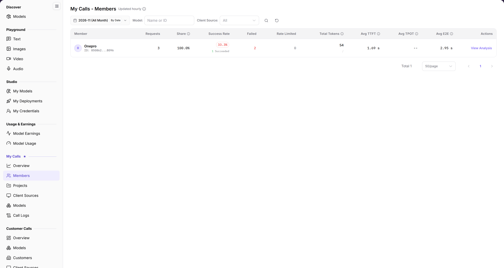

# My Calls - Members

> This page appears as **Members** in the left menu.

> Statistics scope: the month selector defines the period; `By Date` switches the aggregation to daily, and the date range is the start and end shown in the selector.

## 1. Feature Overview

| Item | Content |
| --- | --- |
| Applies to | Model Provider & User |
| Navigation | **Model Services** > **My Calls** > **Members** |
| Route | `/modelone/model-observation/eu/members` |
| Managed objects | Call count, share, success rate, tokens, and latency aggregated by member |

**New to this page**: Members answers "who is using the models". Select a month, filter by model or source, then compare members by volume, success rate, and latency.

## 2. Prerequisites

1. Your account can open **My Calls > Members**.
2. Calls attributable to members exist in the current period.
3. The month and filters are confirmed.

## 3. Page Description

The title is `My Calls - Members`, marked `Updated hourly`. Filters include month, `By Date`, `Model`, `Client Source`, and a `Name or ID` search box.

Columns are `Member`, `Requests`, `Share`, `Success Rate`, `Failed`, `Rate Limited`, `Total Tokens`, `Avg TTFT`, `Avg TPOT`, `Avg E2E`, and `Actions`. Without data, the table shows `No Data Available`.

**Figure note**: Filters are month, `By Date`, `Model`, `Client Source`, and `Name or ID`; headers are `Member`, `Requests`, `Share`, `Success Rate`, `Failed`, `Rate Limited`, `Total Tokens`, `Avg TTFT`, `Avg TPOT`, `Avg E2E`, and `Actions`.

## 4. Main Operations

1. Select a month.
2. Use `By Date` to change granularity.
3. Limit scope with `Model` and `Client Source`.
4. Search by member name or ID.
5. Compare volume, share, success rate, and latency.

## 5. Parameter Quick Reference

| Field | Required | Field type | Example | Description |
| --- | --- | --- | --- | --- |
| Month | Yes | Selector | `2026-11` | Statistics month |
| By Date | No | Toggle | On | Aggregation granularity |
| Model | No | Text | `Name or ID` | Filter by model |
| Client Source | No | Selector | `All` | Filter by source |
| Member | System | Text | `provider_admin` | Calling member |
| Requests | System | Number | `0` | Member call total |
| Share | System | Percentage | `0%` | Share of total calls |
| Success Rate | System | Percentage | `--` | Successful call share |
| Failed / Rate Limited | System | Number | `0` | Failed and rate-limited calls |
| Total Tokens | System | Number | `0` | Member token total |
| Avg TTFT / TPOT / E2E | System | Duration | `--` | Member average latency |

## 6. Pitfalls

- Member rankings cover attributable calls only; `Project Key` calls are excluded.
- `No Data Available` does not mean the member lacks permission.
- `By Date` changes granularity; fix it before comparing.

## 7. Result Validation

| Check | What you can see |
| --- | --- |
| Filters applied | Rows follow month, model, and source |
| Metrics complete | Each row shows requests, share, success rate, and tokens |
| Latency shown | Avg TTFT, TPOT, and E2E are visible |
| Empty state | `No Data Available` when no data exists |

## 8. FAQ

#### The member list is empty

**Symptom**: The table shows `No Data Available`.

**Resolution**: Confirm attributable calls exist in the month, clear model and source filters, and retry.

#### Member total differs from Overview

**Symptom**: The member total differs from the Overview total.

**Resolution**: Overview includes non-attributable `Project Key` calls; Members covers attributable calls only.

## 9. Notes

- Member names are account information; do not share screenshots externally.
- Statistics refresh hourly; new calls may be delayed.

## 10. Next Steps

- Review calls by project in [Projects](../projects/).
- Review calls by model in [Models](../models/).
- Review individual calls in [Call Logs](../call-logs/).
