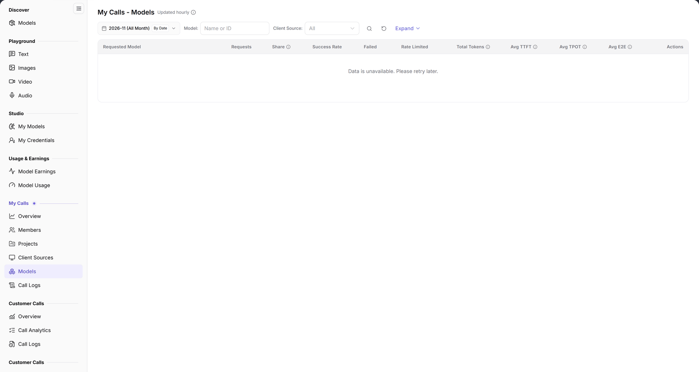

# Models

> This page appears as **Models** in the left menu; the page title is **My Calls - Models**.

## 1. Feature Overview

| Item | Content |
| --- | --- |
| Applies to | Model Provider & User |
| Navigation | **Model Services** > **My Calls** > **Models** |
| Route | `/modelone/model-observation/eu/models` |
| Managed objects | Call count, share, success rate, tokens, and latency aggregated by requested model ID |

**New to this page**: Models answers "which models were called". Select a month, filter by source, then compare models by volume, success rate, and latency.

## 2. Prerequisites

1. Your account can open **My Calls > Models**.
2. Model calls exist in the current period.
3. The month and filters are confirmed.

## 3. Page Description

The title is `My Calls - Models`, marked `Updated hourly`. Filters include month, `By Date`, `Model`, `Client Source`, **Expand**, and a `Name or ID` search box.

The first column is `Requested Model`; the remaining columns are `Requests`, `Share`, `Success Rate`, `Failed`, `Rate Limited`, `Total Tokens`, `Avg TTFT`, `Avg TPOT`, `Avg E2E`, and `Actions`. Without data, the table shows `No Data Available`.

**Figure note**: Filters are month, `By Date`, `Model`, `Client Source`, **Expand**, and `Name or ID`; the first column is `Requested Model`, followed by `Requests`, `Share`, `Success Rate`, `Failed`, `Rate Limited`, `Total Tokens`, `Avg TTFT`, `Avg TPOT`, `Avg E2E`, and `Actions`.

## 4. Main Operations

1. Select a month.
2. Use `By Date` to change granularity.
3. Limit scope with `Model` and `Client Source`; use **Expand** as needed.
4. Search by model name or ID.
5. Compare volume, share, success rate, and latency.

## 5. Parameter Quick Reference

| Field | Required | Type | Example | Description |
| --- | --- | --- | --- | --- |
| Month | Yes | Selector | `2026-11` | Statistics month |
| By Date | No | Toggle | On | Aggregation granularity |
| Model | No | Text | `Name or ID` | Filter by model |
| Client Source | No | Selector | `All` | Filter by source |
| Requested Model | System | Text | `openai/gpt-6.1-sol` | Model ID carried by requests |
| Requests | System | Number | `0` | Model call total |
| Share | System | Percentage | `0%` | Share of total calls |
| Success Rate | System | Percentage | `--` | Successful call share |
| Failed / Rate Limited | System | Number | `0` | Failed and rate-limited calls |
| Total Tokens | System | Number | `0` | Model token total |
| Avg TTFT / TPOT / E2E | System | Duration | `--` | Model average latency |

## 6. Pitfalls

- `Requested Model` is the ID in the request and may differ from the display name in your application.
- One model can be called under multiple IDs; this page counts each ID separately.
- `No Data Available` does not mean the model is unavailable.

## 7. Result Validation

| Check | What you can see |
| --- | --- |
| Filters applied | Rows follow month, model, and source |
| Metrics complete | Each row shows requests, share, success rate, and tokens |
| Latency shown | Avg TTFT, TPOT, and E2E are visible |
| Empty state | `No Data Available` when no data exists |

## 8. FAQ

#### The model list is empty

**Symptom**: The table shows `No Data Available`.

**Resolution**: Confirm model calls exist in the month, clear filters, and retry.

#### Requested model differs from the application name

**Symptom**: The model name in the application differs from `Requested Model`.

**Resolution**: Use the model ID actually sent in requests and check application configuration and routing.

## 9. Notes

- Model IDs may contain internal routing information; do not share screenshots externally.
- Statistics refresh hourly; new calls may be delayed.

## 10. Next Steps

- Review source distribution in [Client Sources](../client-sources/).
- Review individual calls in [Call Logs](../call-logs/).
- Check model information in [Models](../../discover/models/).
