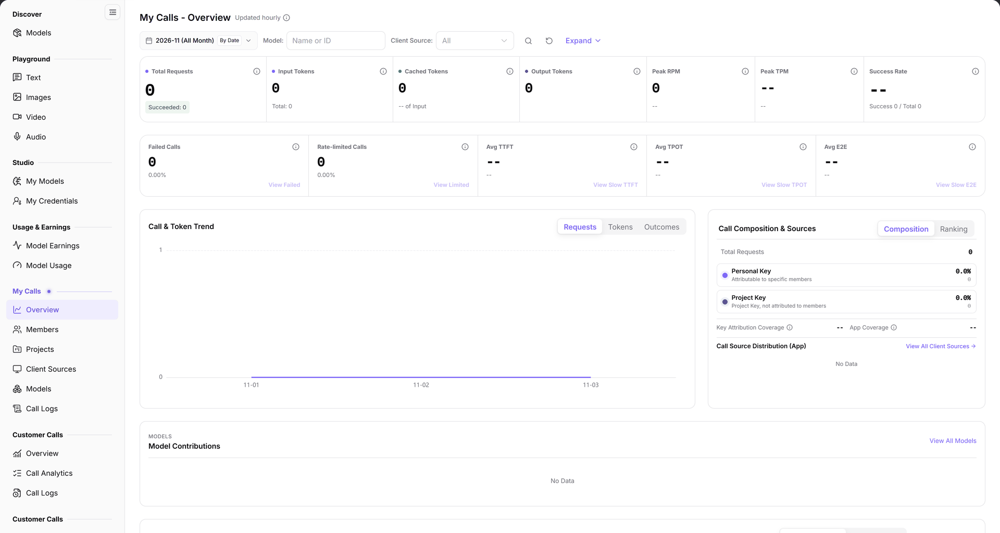

# My Calls - Overview

> This page appears as **Overview** in the left menu.

> Statistics scope: the month selector defines the period; `By Date` switches the aggregation to daily, and the date range is the start and end shown in the selector.

## Feature Overview

| Item | Content |
| --- | --- |
| Applies to | Model Provider & User |
| Navigation | **Model Services** > **My Calls** > **Overview** |
| Route | `/modelone/model-observation/eu/overview` |
| Managed objects | Your call volume, token consumption, success rate, latency, call composition, and member/project rankings |

#### Beginner Explanation

Overview is the dashboard for your own calls. Select a month and filters, read volume, tokens, success rate, and latency, then use trends and rankings to see where calls concentrate.

#### Terms Quick Reference

| Term | Description |
| --- | --- |
| Personal Key | An invocation credential attributable to a specific member, whose usage is counted toward member rankings. |
| Project Key | An invocation credential bound to an engineering project, whose usage is tracked by project rather than individual members. |
| TTFT / TPOT | TTFT measures Time to First Token latency; TPOT measures Time Per Output Token. |
| Peak RPM / TPM | The peak request volume (Requests Per Minute) and peak token throughput (Tokens Per Minute) in the observation window. |

### Statistics Scope Comparison

| Entry | Applies to | Scope | Route prefix |
| --- | --- | --- | --- |
| Platform Call Analytics | Operator | Platform-wide calls and model source coverage | `/modelone/model-observation/operator/*` |
| My Calls | Model Provider & User | Current account plus attributable members, projects, sources, and models | `/modelone/model-observation/eu/*` |
| Customer Calls (Monitoring) | Model Provider & User | Customer-dimension call monitoring | `/modelone/monitoring/monitor/*` |
| Customer Calls (Provider) | Model Provider | Publisher-side customer calls | `/modelone/model-observation/provider/*` |

## Prerequisites

1. Your account can open **My Calls > Overview**.
2. Calls exist in the current period; without data, metrics show `--` or `0`.
3. The month, model, and client source filters are confirmed.

## Page Description

The title is `My Calls - Overview`, marked `Updated hourly`. The page is organized into filters, KPI cards, a trend area, and composition/ranking areas:

- Filters: month `2026-11 (All Month)`, `By Date`, `Model` (`Name or ID`), `Client Source` (`All`), and **Expand**.
- KPI cards: `Total Requests`, `Input Tokens`, `Cached Tokens`, `Output Tokens`, `Peak RPM`, `Peak TPM`, `Success Rate`, `Failed Calls`, `Rate-limited Calls`, `Avg TTFT`, `Avg TPOT`, and `Avg E2E`.
- Trend: `Call & Token Trend`, switchable between `Requests`, `Tokens`, and `Outcomes`.
- Composition: `Call Composition & Sources`, switchable between `Composition` and `Ranking`; shows `Personal Key`, `Project Key`, `Key Attribution Coverage`, `App Coverage`, and `Call Source Distribution (App)`.
- Models: `Model Contributions`, with **View All Models**.
- Ranking: `Member & Project Usage Ranking`, switchable between `Member Top 10` and `Project Top 10`.

The figure shows filters include month, `By Date`, `Model`, and `Client Source`; KPI cards show requests, tokens, success rate, failures/limits, and average latency; below are trends and composition.

| Area | Description |
| --- | --- |
| Filter Bar | Filters aggregation scope by month, daily granularity, model name/ID, and client source. |
| Key Metrics | Displays total requests, token breakdowns, peak rates (RPM/TPM), success rates, and latency metrics. |
| Trend Charts | Switches time-series trends across call volume, token consumption, and call outcomes (success/failed/rate-limited). |
| Composition & Distribution | Shows proportions of Personal Key vs Project Key, key attribution, and client app distribution. |
| Usage Rankings | Switches usage ranking tables between Member Top 10 and Project Top 10. |

### Choose a Dimension

| Question | Page |
| --- | --- |
| Are volume, success rate, latency, and trends normal? | [Overview](./) |
| Which member is calling and how much? | [Members](../members/) |
| Which project is calling and how much? | [Projects](../projects/) |
| Which application or source is calling? | [Client Sources](../client-sources/) |
| Which models are called? | [Models](../models/) |
| What happened in a single call? | [Call Logs](../call-logs/) |

## Main Operations

### Set the statistics scope

1. Select a month, such as `2026-11 (All Month)`.
2. Use `By Date` to change the aggregation granularity.
3. Enter a `Name or ID` in `Model` and choose a `Client Source`.
4. Click **"Expand"** to view extended filters.

### Read metrics

1. Read `Total Requests` and the succeeded count below it.
2. Read `Input Tokens`, `Cached Tokens`, `Output Tokens`, `Peak RPM`, and `Peak TPM`.
3. Read `Success Rate`, `Failed Calls`, and `Rate-limited Calls`.
4. Read `Avg TTFT`, `Avg TPOT`, and `Avg E2E`.

### Locate anomalies and sources

1. Use **"View Failed"** and **"View Limited"** under the corresponding cards.
2. Use **"View Slow TTFT"**, **"View Slow TPOT"**, and **"View Slow E2E"**.
3. In `Call Composition & Sources`, compare `Personal Key` and `Project Key` shares.
4. Use **"View All Client Sources"**, **"View All Models"**, and **"View All Members"** to drill down.

## Parameter Quick Reference

| Field | Required | Field type | Example | Description |
| --- | --- | --- | --- | --- |
| Month | Yes | Selector | `2026-11 (All Month)` | Statistics month |
| By Date | No | Toggle | On | Aggregation granularity |
| Model | No | Text | `Name or ID` | Filter by model |
| Client Source | No | Selector | `All` | Filter by client source |
| Total Requests | System | Number | `--` | Total calls in scope |
| Input Tokens | System | Number | `--` | Total input tokens |
| Cached Tokens | System | Number | `--` | Cached tokens and share of input |
| Output Tokens | System | Number | `--` | Total output tokens |
| Peak RPM | System | Number | `0` | Peak requests per minute |
| Peak TPM | System | Number | `--` | Peak tokens per minute |
| Success Rate | System | Percentage | `--` | Share of successful calls |
| Failed Calls | System | Number | `--` | Failed calls and share |
| Rate-limited Calls | System | Number | `--` | Rate-limited calls and share |
| Avg TTFT | System | Duration | `--` | Average time to first token |
| Avg TPOT | System | Duration | `--` | Average time per output token |
| Avg E2E | System | Duration | `--` | Average end-to-end latency |
| Personal Key | System | Share | `0.0%` | Calls attributable to members |
| Project Key | System | Share | `0.0%` | Project key calls, not attributed to members |
| Key Attribution Coverage | System | Percentage | `--` | Share of attributable key calls |
| App Coverage | System | Percentage | `--` | Share of identified client sources |

## Pitfalls

- `Updated hourly` means data refreshes hourly; new calls may not appear immediately.
- `Personal Key` calls are attributable to members; `Project Key` calls are not. Member rankings cover only the attributable part.
- When filters are too narrow, `Member & Project Usage Ranking` shows `No Ranking Data in Current Scope`.
- A `--` metric means there is no calculable data in scope, not that calls failed.

## Result Validation

| Check Item | Success Signal | Handling on Failure |
| --- | --- | --- |
| Filters applied | Metric cards and trend charts recalculate immediately based on selected month, model, or client source. | If data does not update, click outside the dropdown to remove focus or click the refresh button. |
| Trend switching | Seamlessly switches between `Requests`, `Tokens`, and `Outcomes` line/bar views. | Refresh the page to reload chart components and inspect the browser console for rendering errors. |
| Composition switching | Pie charts (`Composition`) and bar graphs (`Ranking`) render normally with expected attribution ratios. | If empty, verify whether invocations lacked keys and therefore could not be attributed. |
| Ranking switching | Switches freely between `Member Top 10` and `Project Top 10`, sorted from highest to lowest usage. | If "No Ranking Data", widen the date range or clear granular filters. |
| Drill-down links | Clicking **"View Failed"**, **"View Limited"**, or **"View Slow Calls"** opens filtered call logs properly. | Verify whether the account has log inspection permissions or whether anomalies actually occurred. |

## FAQ

#### All metrics show `--`

**Symptom:**

Total requests, token consumption, and all latency indicators display as `--`.

**Possible Causes:**

No model invocations occurred within the selected month or filter criteria, or recent calls are still within the hourly aggregation window.

**Resolution:**

1. Check that the month selector is set correctly, or select a previous billing period with known call activity.
2. If calls were just made, wait for the next hourly aggregation cycle to refresh.

#### Ranking area is empty

**Symptom:**

Member and project usage rankings display `No Ranking Data in Current Scope`.

**Possible Causes:**

Filters (such as a specific model or client source) are too restrictive, or all calls were initiated with non-attributable credentials.

**Resolution:**

1. Click Expand to open filters and clear model name and client source inputs.
2. Switch the statistics scope to the full month to check for attributable usage.

## Notes

- The page shows calls within your account scope, not platform-wide traffic.
- Volume, token, and latency metrics change with filters; fix the scope before comparing.
- Do not screenshot or share member names, project names, or call details.

## Next Steps

1. Analyze call volume and token usage by member in [Members](../members/).
2. Aggregate usage costs across engineering projects in [Projects](../projects/).
3. Check connection health across client applications in [Client Sources](../client-sources/).
4. Inspect request prompts, completions, and trace spans in [Call Logs](../call-logs/).

Related pages:
- [Members](../members/)
- [Projects](../projects/)
- [Client Sources](../client-sources/)
- [Call Logs](../call-logs/)
