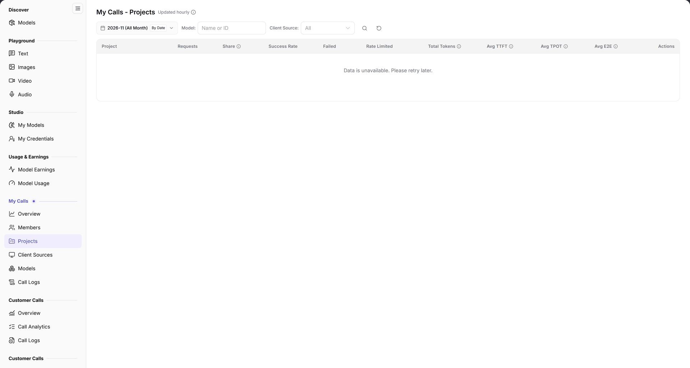

# My Calls - Projects

> This page appears as **Projects** in the left menu.

> Statistics scope: the month selector defines the period; `By Date` switches the aggregation to daily, and the date range is the start and end shown in the selector.

## Feature Overview

| Item | Content |
| --- | --- |
| Applies to | Model Provider & User |
| Navigation | **Model Services** > **My Calls** > **Projects** |
| Route | `/modelone/model-observation/eu/projects` |
| Managed objects | Call count, share, success rate, tokens, and latency aggregated by project |

**New to this page**: Projects answers "which project is calling the models". Select a month and model, then compare projects by volume, success rate, and token consumption.

#### Terms Quick Reference

| Term | Description |
| --- | --- |
| Project Calls | Model API requests bound to a specific Project Space or initiated using a project-level Project Key. |
| Call Share | The percentage of requests initiated by a specific project relative to all project-scoped calls during the period. |
| Total Tokens | Total accumulated prompt and completion tokens consumed across all model calls in the project. |
| Avg E2E | Average End-to-End Latency for requests initiated by the project, measuring total round-trip response duration. |

## Prerequisites

1. Your account can open **My Calls > Projects**.
2. Project-scoped calls exist in the current period.
3. The month and filters are confirmed.

## Page Description

The title is `My Calls - Projects`, marked `Updated hourly`.

| Area | Description |
| --- | --- |
| Top time & filter bar | Month selector, By Date granularity toggle, Model/Client Source dropdowns, and Project Name/ID search box |
| Update interval badge | Displays "Updated hourly" indicating statistical metrics are quasi-realtime aggregated hourly results |
| Project calls summary table | Presents project name, requests, share, success rate, failed/rate-limited counts, total tokens, and TTFT/TPOT/E2E latency |
| Actions & drill-down column | Provides direct navigation to inspect detailed call logs associated with each project |

- Filters include month, `By Date`, `Model`, `Client Source`, and a `Name or ID` search box.
- Columns are `Project`, `Requests`, `Share`, `Success Rate`, `Failed`, `Rate Limited`, `Total Tokens`, `Avg TTFT`, `Avg TPOT`, `Avg E2E`, and `Actions`. Without data, the table shows `No Data Available`.

The figure shows filters are month, `By Date`, `Model`, `Client Source`, and `Name or ID`; headers are `Project`, `Requests`, `Share`, `Success Rate`, `Failed`, `Rate Limited`, `Total Tokens`, `Avg TTFT`, `Avg TPOT`, `Avg E2E`, and `Actions`.

## Main Operations

1. Select a month.
2. Use `By Date` to change granularity.
3. Limit scope with `Model` and `Client Source`.
4. Search by project name or ID.
5. Compare volume, share, success rate, and latency.

## Parameter Quick Reference

| Field | Required | Field type | Example | Description |
| --- | --- | --- | --- | --- |
| Month | Yes | Selector | `2026-11` | Statistics month |
| By Date | No | Toggle | On | Aggregation granularity |
| Model | No | Text | `Name or ID` | Filter by model |
| Client Source | No | Selector | `All` | Filter by source |
| Project | System | Text | `Project A` | Calling project |
| Requests | System | Number | `0` | Project call total |
| Share | System | Percentage | `0%` | Share of total calls |
| Success Rate | System | Percentage | `--` | Successful call share |
| Failed / Rate Limited | System | Number | `0` | Failed and rate-limited calls |
| Total Tokens | System | Number | `0` | Project token total |
| Avg TTFT / TPOT / E2E | System | Duration | `--` | Project average latency |

## Pitfalls

- Only calls with a project attribution appear here; unattributed calls are excluded.
- `No Data Available` does not mean the project does not exist.
- `By Date` changes granularity; fix it before comparing.

## Result Validation

| Check Item | Success Signal | Handling on Failure |
| --- | --- | --- |
| Project rows complete | All business projects with active traffic in the month are listed in the table, sorted by request volume descending | If the table shows `No Data Available`, click reset to clear filters and check whether calls occurred in the month |
| Metrics precision | Request counts, share percentages, success rates, and total tokens display concrete values | If success rate is `--` or low, inspect failed/rate-limited counts to diagnose project quota overages |
| Latency indicators | Table displays millisecond or second values for Avg TTFT, TPOT, and E2E | If `--` appears, the number of valid streaming calls for this project is insufficient |
| Targeted search | Typing a project name or Project ID in the search box accurately filters down to the target project row | Clear extra characters in the search box and retry |
| Drill-down navigation | Clicking details in Actions navigates to [Call Logs](../call-logs/) with the project filter pre-applied | Confirm whether your account has authorization to inspect cross-project audit logs |

## FAQ

#### The project list is empty

**Symptom:** The table shows `No Data Available`.

**Possible Causes:** No project-scoped model calls occurred in the selected month; or all requests were initiated via unassigned global credentials.

**Resolution:**

1. Switch to a month with established project business traffic.
2. Standardize developer workflows and configure applications to use project-specific Project Keys.
3. Clear model and client source filters, then retry.

#### A project is missing

**Symptom:** Searching does not return the target project.

**Possible Causes:** The project generated 0 model calls in the selected month (zero-call projects are omitted from statistics); or the project name was misspelled.

**Resolution:**

1. Verify when the project last made an API call and switch to the corresponding month.
2. Ensure the Project ID configured in your application matches the Project ID in the user console.

## Notes

- Project names and member data are account information; do not share screenshots externally.
- Statistics refresh hourly; new calls may be delayed.

## Next Steps

1. Drill down into call logs to inspect request payloads, headers, and error logs for high-volume projects.
2. Switch to the Members view to inspect call distributions across individual engineers within the project.
3. Cross-reference project token consumption in the Billing module to evaluate departmental budget and cost allocations.

Related pages:
- [My Calls Overview](../overview/)
- [Call Logs](../call-logs/)
- [Calls by Member](../members/)
- [Calls by Model](../models/)
- [Calls by Client Source](../client-sources/)
