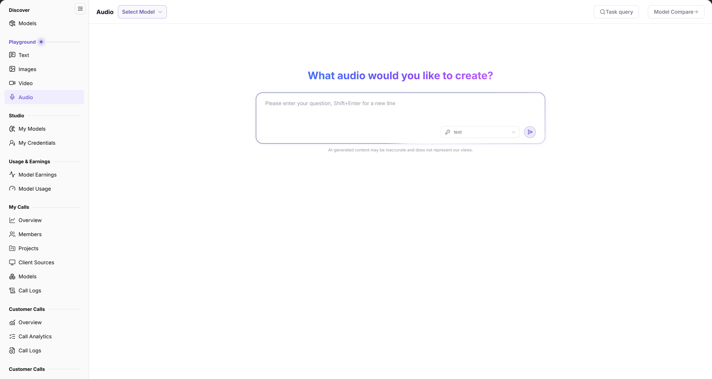

# Audio

## 1. Feature Overview

| Item | Content |
| --- | --- |
| Applies to | Model Provider & User |
| Navigation | **Model Services** > **Playground** > **Audio** |
| Route | `/modelone/exploration/audio` |
| Managed objects | Audio model, input text, and generation tasks |

**New to this page**: Audio converts text into speech. Choose an audio model, enter the text to read, and review the generated audio in **Task query**.

## 2. Prerequisites

1. Your account can open **Playground > Audio**.
2. The account has available credits or a free quota for the model.
3. The input limit and billing unit of the audio model are confirmed.

## 3. Page Description

The page contains a model area, an action area, and an input area:

- Model area: **Select Model** opens the model list.
- Actions: **Task query** opens past tasks; **Model Compare** opens comparison.
- Input: multi-line box with `Please enter your question, Shift+Enter for a new line`; the heading reads `What audio would you like to create?`.

**Figure note**: The top provides **Select Model**, **Task query**, and **Model Compare**; the input prompt is `Please enter your question, Shift+Enter for a new line`, with the disclaimer `AI-generated content may be inaccurate and does not represent our views.`.

## 4. Main Operations

### 4.1 Select an audio model

1. Click **Select Model**.
2. Choose an audio model and verify its provider.

### 4.2 Generate audio

1. Enter the text to read.
2. Use `Shift+Enter` for new lines, then submit.
3. Review the generated audio in the result area.

### 4.3 Query tasks

1. Click **Task query**.
2. Locate the current or previous tasks.

### 4.4 Compare models

1. Click **Model Compare**.
2. Select audio models and generate from the same text.

## 5. Parameter Quick Reference

| Field | Required | Field type | Example | Description |
| --- | --- | --- | --- | --- |
| Model | Yes | Selector | `Mock MiniMax Speech T2A` | Current audio model |
| Text | Yes | Multi-line text | `Welcome to AGIOne` | Text to convert to speech |
| Task query | No | Button | — | View previous generation tasks |
| Model Compare | No | Button | — | Open multi-model comparison |

## 6. Pitfalls

- Audio models differ in text length and voice support; test long text in segments.
- Billing may be per character, second, or request; confirm the unit before submitting.
- Output depends on model capability; listen to important announcements before publishing.

## 7. Result Validation

| Check | What you can see |
| --- | --- |
| Model selected | The model area shows the current model |
| Text accepted | The input box accepts multiple lines |
| Task created | A task or audio appears in the result area |
| History available | **Task query** opens the task list |

## 8. FAQ

#### No audio model is available

**Symptom**: The model list is empty or lacks the target model.

**Resolution**: Confirm the model is published and visible to your tenant, or check audio models in [Models](../../discover/models/).

#### Generation fails

**Symptom**: The task status is abnormal after submission.

**Resolution**:

1. Check whether the text is empty or exceeds the model limit.
2. Check the task status in **Task query** and retry.

## 9. Notes

- Do not enter other people's private or unauthorized text.
- Audio generation is billed by the model; confirm quota before batch conversion.
- Verify copyright and compliance before commercial use.

## 10. Next Steps

- Review audio call volume in [My Calls](../../my-calls/overview/).
- Check deductions in [Model Usage](../../usage-earnings/model-usage/).
- Compare audio models in [Models](../../discover/models/).
