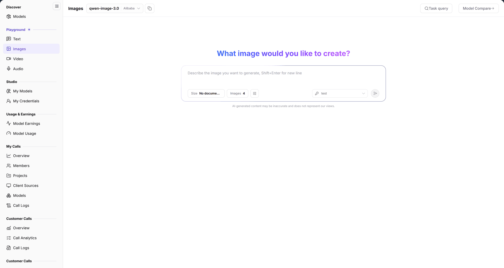

# Images

## Feature Overview

| Item | Content |
| --- | --- |
| Applies to | Model Provider & User |
| Navigation | **Model Services** > **Playground** > **Images** |
| Route | `/modelone/exploration/image` |
| Managed objects | Image model, size, image count, and generation tasks |

**New to this page**: Images turns a text prompt into pictures. Choose an image model, set size and count, enter a description, and review results in **Task query**.

#### Terms Quick Reference

| Term | Description |
| --- | --- |
| Text-to-Image | AI generation technique synthesizing static visual scenes from natural language prompt descriptions using diffusion or autoregressive architectures. |
| Task Query | Asynchronous execution monitoring board for tracking image rendering progress, task status, and generated asset URLs. |
| Resolution / Size | Width and height specifications (e.g., 1024x1024, 768x1024) supported by model weights and GPU VRAM constraints. |
| Batch Size (Images) | Total number of image samples generated concurrently or sequentially per request, scaling cost proportionally. |

## Prerequisites

1. Your account can open **Playground > Images**.
2. The account has available credits or a free quota for the model.
3. The billing unit and image-count limit are confirmed.

## Page Description

The page contains a model area, a parameter area, and an input area:

| Area | Description |
| --- | --- |
| Top model & action bar | Displays selected image model name and provider, with Task query and Model Compare buttons |
| Parameter settings panel | Provides resolution size dropdown and batch generation image count input |
| Bottom prompt input console | Multi-line text box for scene subjects, styles, and details, supporting Shift+Enter line breaks and submission |
| Result & canvas gallery | Asynchronously renders generated image preview cards in a grid layout with zoom and download actions |

- Model area: current model `qwen-image-3.0` and provider `Alibaba`; **Task query** and **Model Compare** are on the right.
- Parameters: `Size` (currently `No documented default`) and `Images` (currently `4`).
- Input: multi-line box with `Describe the image you want to generate, Shift+Enter for new line`.
- Reset: **Reset all** restores model and parameter defaults.

The figure shows the current model is `qwen-image-3.0` from `Alibaba`; parameters show `Size` and `Images 4`, with **Task query** and **Model Compare** at the top.

## Main Operations

### Select an image model

1. Click the model area and select an image model.
2. Verify the provider and model status.

### Set generation parameters

1. Open `Size` and choose a supported size; keep `No documented default` to let the model decide.
2. Set the number of images in `Images`.

### Generate images

1. Enter a description in the input box.
2. Use `Shift+Enter` for new lines, then submit.
3. Review the generated images in the result area.

### Query past tasks

1. Click **"Task query"**.
2. Locate previous generation tasks in the list.

### Compare models

1. Click **"Model Compare"**.
2. Select image models and generate from the same description.

## Parameter Quick Reference

| Field | Required | Field type | Example | Description |
| --- | --- | --- | --- | --- |
| Model | Yes | Selector | `qwen-image-3.0` | Current image model |
| Provider | System | Text | `Alibaba` | Provider of the current model |
| Size | No | Dropdown | `No documented default` | Output size; default is decided by the API |
| Images | Yes | Number | `4` | Number of images per request |
| Prompt | Yes | Multi-line text | `An orange cat on a windowsill` | Description used to generate the image |

## Pitfalls

- When `Size` shows `No documented default`, the actual size is decided by the model API and can differ between models.
- More images multiply generation time and cost; verify the count before submitting.
- Image models are billed per image or request, not by text tokens.

## Result Validation

| Check Item | Success Signal | Handling on Failure |
| --- | --- | --- |
| Model selected | The top bar accurately displays the model ID (e.g., `qwen-image-3.0`) and full provider name | If the dropdown is empty, open [Models](../../discover/models/) to check model authorization and availability |
| Parameter adjustments | Selecting a new size or image count immediately updates the values displayed in the settings panel | If a size exceeds supported dimensions, the interface automatically falls back to the recommended default |
| Task submission & output | Clicking submit queues the task and outputs high-resolution image cards in the result area | If a timeout or deduction failure occurs, check credit balance and locate the error code in **Task query** |
| Task query & history | Clicking **"Task query"** opens a drawer or modal containing past image tasks and rendering latencies | If the list is empty, verify the selected time range and filter status at the top |
| Model Compare grid | Opening **"Model Compare"** renders parallel image outputs from multiple models for the same prompt | Verify that all selected models have active quota and compute instances |

## FAQ

#### Results differ from the description

**Symptom:** Generated images deviate significantly from the subject, art style, or details specified in the prompt.

**Possible Causes:** The prompt is too abstract or ambiguous; the model's base training biases toward specific styles; or negative prompts are omitted.

**Resolution:**

1. Enrich the prompt structure by explicitly detailing subject, art medium (e.g., photorealistic, illustration, cyberpunk), lighting, and camera angle.
2. Keep the prompt unchanged and switch to another leading image model for comparative evaluation.
3. Adjust aspect ratio and resolution to match the subject composition (e.g., portrait vs. landscape).

#### Past tasks are missing

**Symptom:** Clicking **"Task query"** fails to display recently submitted image generation tasks.

**Possible Causes:** The task is still queued in backend GPU scheduling and has not persisted to the database; or active filters restrict the time range or model ID.

**Resolution:**

1. Wait several seconds and click the refresh button in the task list.
2. Clear model filters and reset the time span to "Today" or "Last 1 hour".
3. Check whether the prompt was silently blocked by automated content moderation or sensitive keyword filters.

## Notes

- Do not generate infringing, illegal, or privacy-invasive content.
- Generation is billed by the model; confirm quota before batch generation.
- Output is for reference; verify copyright and compliance before commercial use.

## Next Steps

1. Verify call counts, unit prices, and deduction logs in usage reports and call logs.
2. Transfer validated prompts and parameters into production configurations or copy Quick Start SDK snippets.
3. Explore the text chat or video generation playgrounds to connect multimodal workflows.

Related pages:
- [Models Marketplace](../../discover/models/)
- [Text Playground](../text/)
- [Video Playground](../video/)
- [Model Usage](../../usage-earnings/model-usage/)
- [My Calls Overview](../../my-calls/overview/)
