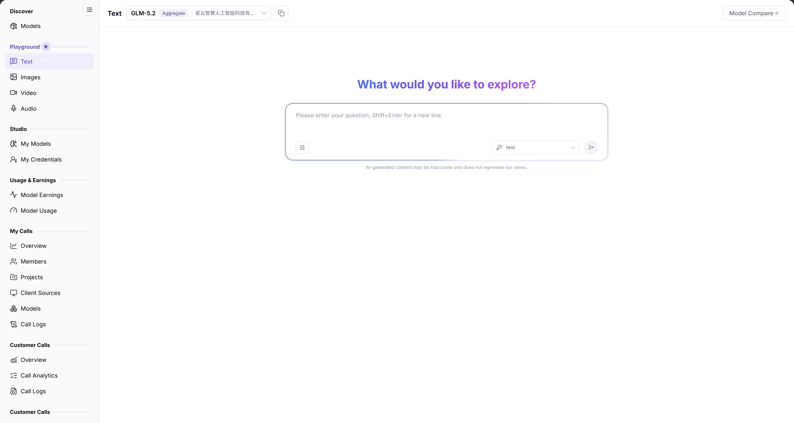

# Text

## Feature Overview

| Item | Content |
| --- | --- |
| Applies to | Model Provider & User |
| Navigation | **Model Services** > **Playground** > **Text** |
| Route | `/modelone/exploration/chat` |
| Managed objects | Selected model or aggregate model, conversation input, and comparison results |

**New to this page**: Text is the online trial entry for catalog models. Choose a model, ask a question, and read the response; turn on **Model Compare** when you need side-by-side results.

#### Terms Quick Reference

| Term | Description |
| --- | --- |
| Text Chat | The built-in interactive conversation console that simulates client requests to large language models with real-time streaming output. |
| Aggregate Model | A virtual model dynamically routed by the platform layer across multiple infrastructure backends or providers to optimize throughput and uptime. |
| Model Compare | Parallel evaluation feature sending identical prompts simultaneously to two or more models to benchmark quality, latency, and preferences. |
| Context Limit | The maximum combined token threshold that a model can process across input (prompt) and output (completion) in a single turn. |

## Prerequisites

1. Your account can open **Playground > Text**.
2. The account has available credits or a free quota for the model.
3. The target model, context limit, and billing method are confirmed.

## Page Description

The page contains a model area, a welcome area, and an input area:

| Area | Description |
| --- | --- |
| Top model & config bar | Displays selected model name, provider, capability tags, model dropdown selector, and Model Compare button |
| Central chat stream | Presents welcome greeting, multi-turn Q&A bubble history, with streaming Markdown and text rendering |
| Bottom input console | Multi-line text input box, Shift+Enter line-break hint, send button, and Reset all action |
| Footer disclaimer | AI-generated content accuracy disclaimer advising manual verification of critical answers |

- Model area: current model name, tags, and provider, such as `GLM-5.2`, `Aggregate`, and `星云智算人工智能科技有限公司`; **Model Compare** is on the right.
- Welcome area: shows `What would you like to explore?` on first entry.
- Input area: a multi-line box with `Please enter your question, Shift+Enter for a new line`; the footer reads `AI-generated content may be inaccurate and does not represent our views.`.
- Reset: **Reset all** clears the current configuration.

The figure shows the current model is `GLM-5.2` with the `Aggregate` tag; the input prompt is `Please enter your question, Shift+Enter for a new line`, and **Model Compare** is available on the right.

## Main Operations

### Select a model

1. Click the model area to open the model list.
2. Select a model or aggregate model and verify its tag and provider.

### Start a conversation

1. Enter a question in the input box.
2. Use `Shift+Enter` for a new line, or submit.
3. Read the response in the output area.

### Compare models

1. Click **"Model Compare"**.
2. Select the models to compare.
3. Submit the same input and compare the responses.

### Reset the session

1. Click **"Reset all"**.
2. Confirm the model selection and input are cleared.

## Parameter Quick Reference

| Field | Required | Field type | Example | Description |
| --- | --- | --- | --- | --- |
| Model | Yes | Selector | `GLM-5.2` | Model or aggregate model used for the conversation |
| Model tag | System | Tag | `Aggregate` | Model type or composition |
| Provider | System | Text | `星云智算人工智能科技有限公司` | Provider of the current model |
| Input | Yes | Multi-line text | `Hello` | Prompt submitted to the model |
| Model Compare | No | Button | — | Opens multi-model comparison |

## Pitfalls

- Verify the model tag before submitting; an `Aggregate` model routes across multiple backends, so responses may come from different nodes.
- `Shift+Enter` inserts a new line, it does not submit.
- Playground calls create usage records and consume tokens; long conversations cost more.

## Result Validation

| Check Item | Success Signal | Handling on Failure |
| --- | --- | --- |
| Model selected | The top bar accurately displays the target model name, aggregate tag, and full provider name | If the dropdown is missing the model, check [Models](../../discover/models/) to confirm publication and tenant visibility |
| Message submitted | Pressing Enter or clicking send clears the input box and creates a user question bubble | If sending fails, check network connectivity or verify account quota and balance |
| Streaming response | The dialogue area renders generated tokens progressively with a moving cursor until completion | If latency exceeds dozens of seconds or cuts off, check context length limits or provider status |
| Model Compare active | When enabled, side-by-side columns display simultaneous model responses for comparative benchmarking | If a column fails to load, verify that each selected model instance is operational |
| Reset all executed | Clicking **"Reset all"** immediately clears dialogue history and restores the initial welcome screen | Refresh the browser tab to re-establish a clean session context |

## FAQ

#### No response after submitting

**Symptom:** The dialogue area remains blank or indicates generation failure after submitting a prompt.

**Possible Causes:** Account quota is exhausted; the backend provider instance is overloaded or temporarily offline; or prompt length exceeds the context limit.

**Resolution:**

1. Check account balance and credit status to ensure the tenant is not locked.
2. Shorten the prompt or clear long conversation history before retrying.
3. Switch to another available model or retry later.

#### The target model is missing

**Symptom:** The model selection dropdown does not contain the desired model.

**Possible Causes:** The model has not been approved and released; it is restricted to private tenant scopes; or the model belongs to a non-chat modality (e.g., image or video).

**Resolution:**

1. Open [Models](../../discover/models/) and filter by modality to verify whether the model supports text generation.
2. Confirm current tenant account permissions and role assignments.
3. Contact the platform administrator or model provider to verify visibility grants.

## Notes

- Do not enter keys, customer privacy, or unmasked business data.
- Playground calls are billed at the model price; long or frequent calls consume quota quickly.
- Model output is for reference only; review important conclusions manually.

## Next Steps

1. Check token consumption breakdowns and latency percentiles in call logs and reports.
2. Copy Quick Start integration code into your client applications once benchmark results meet expectations.
3. Navigate to other modality playgrounds to explore image, audio, or video capabilities.

Related pages:
- [Models Marketplace](../../discover/models/)
- [My Calls Overview](../../my-calls/overview/)
- [Image Playground](../images/)
- [Audio Playground](../audio/)
- [Video Playground](../video/)
