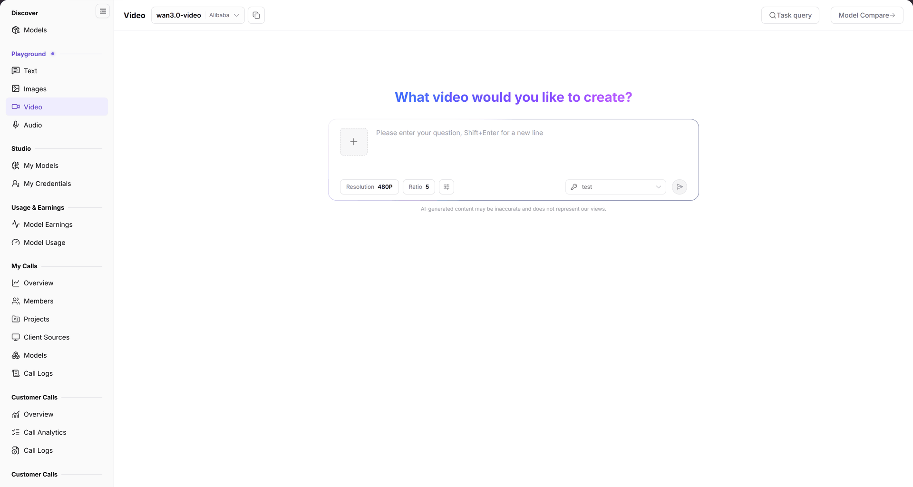

# Video

## 1. Feature Overview

| Item | Content |
| --- | --- |
| Applies to | Model Provider & User |
| Navigation | **Model Services** > **Playground** > **Video** |
| Route | `/modelone/exploration/video` |
| Managed objects | Video model, resolution, ratio, and generation tasks |

**New to this page**: Video turns a text prompt into a short video. Choose a video model and resolution, enter a scene description, and track the task in **Task query**.

## 2. Prerequisites

1. Your account can open **Playground > Video**.
2. The account has available credits or a free quota for the model.
3. Duration, resolution, and billing unit are confirmed.

## 3. Page Description

The page contains a model area, a parameter area, and an input area:

- Model area: current model `wan3.0-video` and provider `Alibaba`; **Task query** and **Model Compare** are on the right.
- Parameters: `Resolution` (currently `480P`) and `Ratio` (currently `5`).
- Input: multi-line box with `Please enter your question, Shift+Enter for a new line`.
- Reset: **Reset all** restores model and parameter defaults.

**Figure note**: The current model is `wan3.0-video` from `Alibaba`; parameters show `Resolution 480P` and `Ratio 5`, with **Task query** and **Model Compare** at the top.

## 4. Main Operations

### 4.1 Select a video model

1. Click the model area and select a video model.
2. Verify the provider and supported input types.

### 4.2 Set generation parameters

1. Choose a `Resolution`.
2. Choose a `Ratio`.

### 4.3 Generate a video

1. Enter a scene description.
2. Use `Shift+Enter` for new lines, then submit.
3. Check the task status in the result area.

### 4.4 Query tasks

1. Click **Task query**.
2. Locate the current or previous tasks in the list.

### 4.5 Compare models

1. Click **Model Compare**.
2. Select video models and generate from the same description.

## 5. Parameter Quick Reference

| Field | Required | Field type | Example | Description |
| --- | --- | --- | --- | --- |
| Model | Yes | Selector | `wan3.0-video` | Current video model |
| Provider | System | Text | `Alibaba` | Provider of the current model |
| Resolution | Yes | Dropdown | `480P` | Output resolution |
| Ratio | Yes | Dropdown | `5` | Aspect ratio option |
| Prompt | Yes | Multi-line text | `Seaside sunset, slow push-in` | Scene description |

## 6. Pitfalls

- Video generation usually takes longer than text or images; use **Task query** to track progress.
- Resolution and ratio affect generation time and price.
- A video model may support only specific input types; check the modality on the model details page.

## 7. Result Validation

| Check | What you can see |
| --- | --- |
| Model selected | The top shows the model name and provider |
| Parameters set | `Resolution` and `Ratio` show current values |
| Task created | A task appears in the result area or **Task query** |
| Task traceable | **Task query** opens the task list |

## 8. FAQ

#### No result for a long time

**Symptom**: The video does not appear after submission.

**Resolution**:

1. Open **Task query** and check the task status.
2. Verify that the resolution, ratio, and model support the current parameters.

#### The model rejects the input

**Symptom**: The task cannot be submitted or reports unsupported parameters.

**Resolution**: Check the supported input/output modalities in [Models](../../discover/models/) and switch models if needed.

## 9. Notes

- Do not generate infringing, illegal, or privacy-invasive content.
- Video is billed by duration, resolution, or seconds; confirm quota before batch generation.
- Verify copyright and compliance before commercial use.

## 10. Next Steps

- Review video call volume in [My Calls](../../my-calls/overview/).
- Check deductions in [Model Usage](../../usage-earnings/model-usage/).
- Compare video models in [Models](../../discover/models/).
