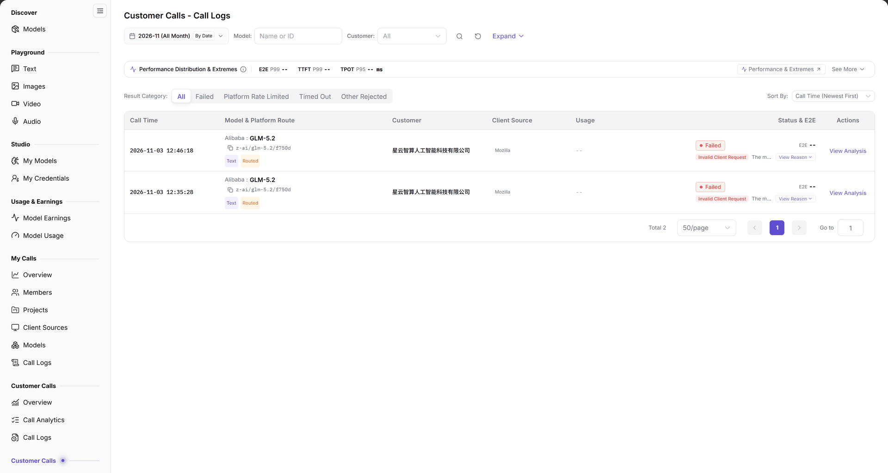

# Call Logs

::: info Document Information
Version: v2.0
Updated: 2026-11-04
:::

## Feature Overview

| Item | Content |
| --- | --- |
| Applies to | Model Provider |
| Navigation | **Model Services** > **Customer Calls** > **Call Logs** |
| Route | `/modelone/model-observation/provider/calls` |
| Managed objects | Individual customer calls, customer, client source, status, and latency |

**New to this page**: This log lists each customer request from the publisher perspective. Check performance distribution first, filter or sort by outcome, then verify the customer, source, tokens, and latency of each call.

#### Terms Quick Reference

| Term | Description |
| --- | --- |
| Customer Call Logs | Detailed inbound audit stream from the model provider's perspective, capturing full-lifecycle execution snapshots for every client call. |
| Platform Rate Limited | Calls rejected with HTTP 429 when a customer's request frequency exceeds the assigned concurrency quota or rate limit rules. |
| TTFT P99 | The 99th percentile of time to first token for streaming calls, reflecting queuing latency and instance cold-start performance. |
| TPOT P95 | The 95th percentile of time per output token during streaming generation, measuring the GPU compute cluster's throughput stability. |

## Prerequisites

1. Your account has the publisher-side **Customer Calls > Call Logs** permission.
2. Customer call records exist in the current period.
3. The month, model, and customer filters are confirmed.

## Page Description

The title is `Customer Calls - Call Logs`. The page contains:

| Area | Description |
| --- | --- |
| Top time & customer filter bar | Month selector, By Date granularity toggle, Model/Customer dropdowns, Expand button, and Name/ID search box |
| Performance percentiles & extremes cards | Displays E2E P99, TTFT P99, and TPOT P95 latencies, with See More links for extreme latency cases |
| Result category & sort toolbar | Filters by All, Failed, Platform Rate Limited, Timed Out, Other Rejected, with customizable ascending/descending order |
| Customer call records audit table | Displays call timestamp, model & route, customer name, client source, token usage, status, and latency timeline |

- Filters: month, `By Date`, `Model`, `Customer` (`All`), **Expand**, and a `Name or ID` search box.
- `Performance Distribution & Extremes`: shows `E2E P99`, `TTFT P99`, and `TPOT P95`, with **See More**.
- `Performance & Extremes`: entries for P99/P95 sorting, minimum latency, and longest call.
- Category and sorting: `Result Category` (`All`, `Failed`, `Platform Rate Limited`, `Timed Out`, `Other Rejected`) and `Sort By` (default `Call Time (Newest First)`).
- Table: `Call Time`, `Model & Platform Route`, `Customer`, `Client Source`, `Usage`, `Status & E2E`, `Actions`.

The figure shows filters include month, `By Date`, `Model`, `Customer`, **Expand**, and `Name or ID`; the page shows `Performance Distribution & Extremes`; `Result Category` provides `All`, `Failed`, `Platform Rate Limited`, `Timed Out`, and `Other Rejected`; columns are `Call Time`, `Model & Platform Route`, `Customer`, `Client Source`, `Usage`, `Status & E2E`, and `Actions`.

## Main Operations

### Filter records

1. Select a month.
2. Use `By Date` to change granularity.
3. Limit scope with `Model` and `Customer`.
4. Search by `Name or ID`.

### Review performance

1. Read `E2E P99`, `TTFT P99`, and `TPOT P95`.
2. Click **"See More"** to expand `Performance & Extremes` sorting entries.

### Filter and sort by outcome

1. Choose a value in `Result Category`.
2. Choose a rule in `Sort By`; the default is `Call Time (Newest First)`.

### Inspect a call

1. Locate the target record.
2. Check `Model & Platform Route`, `Customer`, `Client Source`, `Usage`, and `Status & E2E`.
3. Use `Actions` to open details.

## Parameter Quick Reference

| Field Name | Required | Field Type | Example | Description |
| --- | --- | --- | --- | --- |
| Month | Yes | Selector | `2026-11` | Statistics month |
| By Date | No | Toggle | On | Aggregation granularity |
| Model | No | Text | `Name or ID` | Filter by model |
| Customer | No | Selector | `All` | Filter by customer |
| E2E P99 / TTFT P99 | System | Duration | `--` | End-to-end and first-token latency P99 |
| TPOT P95 | System | Duration | `-- ms` | Time per output token P95 |
| Result Category | No | Single select | `All` | Filter by call result |
| Sort By | No | Dropdown | `Call Time (Newest First)` | Control record order |
| Call Time | System | Time | `2026-11-03 10:00:00` | When the call occurred |
| Model & Platform Route | System | Text | `openai/gpt-6.1-sol` | Requested model and route |
| Customer | System | Text | `Customer A` | Calling customer |
| Client Source | System | Text | `App A` | Call source |
| Usage | System | Number | Input/output tokens | Token usage of the call |
| Status & E2E | System | Status | `Succeeded`, `Failed` | Result and latency |

## Pitfalls

- This is the publisher view; the other **Customer Calls** group has a different scope.
- `Performance Distribution & Extremes` shows `--` without data; it does not mean latency is zero.
- `Result Category` filters records only and does not change the month or customer scope.
- `Customer` and `Client Source` are different dimensions.

## Result Validation

| Check Item | Success Signal | If Abnormal |
| --- | --- | --- |
| Filters applied | Changing month, model, or customer dynamically refreshes table records and top percentile metrics | If the table is empty, click reset to clear filters and verify whether customer calls occurred in the month |
| Percentile cards populated | Metric cards display millisecond (ms) or second (s) P99/P95 latencies | If `--` appears, the sample count in the filtered range is insufficient to compute statistical percentiles |
| Abnormal category filtering | Selecting `Platform Rate Limited` or `Failed` isolates and displays only records matching that abnormal status | If no records appear, no incidents of that category occurred in the current scope |
| Details drawer accessible | Clicking the action button opens a drawer revealing request headers, client IP, response status codes, and phase timings | If details cannot be opened, verify that your account has provider-level audit inspection permissions |
| Sorting rules applied | Changing sort order immediately sorts the table by duration, timestamp, or token usage | Confirm whether table column headers have locked default sorting active |

## FAQ

#### Call logs are empty

**Symptom:** The table displays `No Data Available`, and top performance metrics all show `--`.

**Possible Causes:** No customer calls were made in the selected month; or active filter parameters are overly restrictive.

**Resolution:**

1. Switch to a month with confirmed external customer traffic.
2. Clear model, customer, and search inputs, and set the result category back to `All`.
3. Open [Customer Calls Overview](../overview/) to verify the baseline customer request volume.

#### Performance metrics show `--`

**Symptom:** The table displays several customer calls, but E2E P99, TTFT P99, and TPOT P95 cards remain `--`.

**Possible Causes:** The statistical algorithm requires a minimum sample threshold (e.g., dozens of requests) to compute percentiles; or hourly aggregation has not finished.

**Resolution:**

1. Expand the date range or clear granular model filters.
2. Hourly aggregation jobs run periodically; wait for the next hourly update cycle and refresh.

## Notes

- Logs contain customer names and call data; do not share screenshots externally.
- Record only necessary fields during troubleshooting to avoid exposing request content and keys.
- Statistics refresh hourly; new calls may be delayed.

## Next Steps

1. Examine high-level volume trends and active customer distributions in the overview dashboard.
2. Switch to customer or model views to identify enterprise accounts generating abnormal volume.
3. Cross-reference token usage in the Model Earnings module to verify monthly settlement revenue.

Related pages:
- [Customer Calls Overview](../overview/)
- [Customer Calls - Customers](../customers/)
- [Customer Calls - Models](../models/)
- [Customer Calls - Client Sources](../client-sources/)
- [Model Earnings](../../usage-earnings/model-earnings/)
