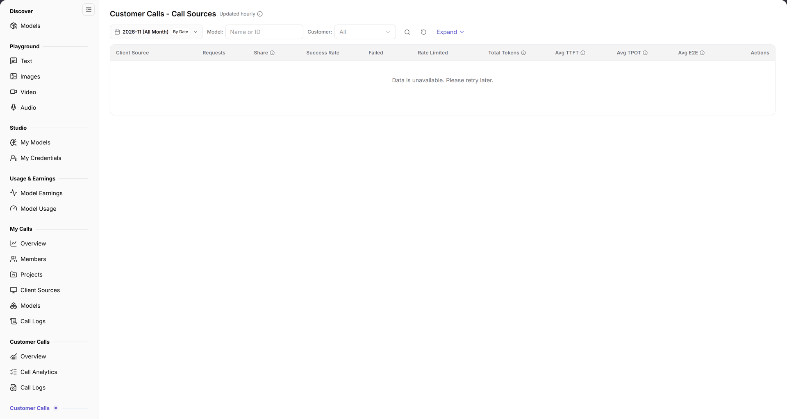

# Client Sources

> This page appears as **Client Sources** in the second **Customer Calls** group; the page title is **Customer Calls - Client Sources**.

## 1. Feature Overview

| Item | Content |
| --- | --- |
| Applies to | Model Provider |
| Navigation | **Model Services** > **Customer Calls** (second group) > **Client Sources** |
| Route | `/modelone/model-observation/provider/apps` |
| Managed objects | Customer call count, share, success rate, tokens, and latency aggregated by client source |

**New to this page**: Client Sources answers "which applications customers use to call my models". Select a month and customer, then compare sources by volume, success rate, and latency.

## 2. Prerequisites

1. Your account has the publisher-side **Customer Calls > Client Sources** permission.
2. Customer calls with source identifiers exist in the current period.
3. The month, model, and customer filters are confirmed.

## 3. Page Description

The title is `Customer Calls - Client Sources`, marked `Updated hourly`. Filters include month, `By Date`, `Model`, `Customer` (`All`), **Expand**, and a `Name or ID` search box.

The first column is `Client Source`; the remaining columns are `Requests`, `Share`, `Success Rate`, `Failed`, `Rate Limited`, `Total Tokens`, `Avg TTFT`, `Avg TPOT`, `Avg E2E`, and `Actions`. Without data, the table shows `No Data Available`.

**Figure note**: Filters include month, `By Date`, `Model`, `Customer`, **Expand**, and `Name or ID`; the first column is `Client Source`, followed by `Requests`, `Share`, `Success Rate`, `Failed`, `Rate Limited`, `Total Tokens`, `Avg TTFT`, `Avg TPOT`, `Avg E2E`, and `Actions`.

## 4. Main Operations

1. Select a month.
2. Use `By Date` to change granularity.
3. Limit scope with `Model` and `Customer`.
4. Search by source name or ID.
5. Compare volume, share, success rate, and latency.

## 5. Parameter Quick Reference

| Field | Required | Type | Example | Description |
| --- | --- | --- | --- | --- |
| Month | Yes | Selector | `2026-11` | Statistics month |
| By Date | No | Toggle | On | Aggregation granularity |
| Model | No | Text | `Name or ID` | Filter by model |
| Customer | No | Selector | `All` | Filter by customer |
| Client Source | System | Text | `App A` | Client source name |
| Requests | System | Number | `0` | Source call total |
| Share | System | Percentage | `0%` | Share of total calls |
| Success Rate | System | Percentage | `--` | Successful call share |
| Failed / Rate Limited | System | Number | `0` | Failed and rate-limited calls |
| Total Tokens | System | Number | `0` | Source token total |
| Avg TTFT / TPOT / E2E | System | Duration | `--` | Source average latency |

## 6. Pitfalls

- Customer calls without a source ID do not appear here; the Overview total may exceed the source sum.
- `No Data Available` does not mean the source is unavailable.
- This is the publisher view; the other **Customer Calls** group has a different scope.

## 7. Result Validation

| Check | What you can see |
| --- | --- |
| Filters applied | Rows follow month, model, and customer |
| Metrics complete | Each row shows requests, share, success rate, and tokens |
| Latency shown | Avg TTFT, TPOT, and E2E are visible |
| Empty state | `No Data Available` when no data exists |

## 8. FAQ

#### The source list is empty

**Symptom**: The table shows `No Data Available`.

**Resolution**: Confirm calls with source IDs exist in the month and clear model and customer filters.

#### Source total differs from Overview

**Symptom**: The source sum is lower than the Overview total.

**Resolution**: Overview includes calls without a source ID; this page covers identified sources only.

## 9. Notes

- Source names may contain internal application information; do not share screenshots externally.
- Statistics refresh hourly; new calls may be delayed.

## 10. Next Steps

- Review calls by customer in [Customers](../customers/).
- Review calls by model in [Models](../models/).
- Review individual calls in [Call Logs](../call-logs/).
