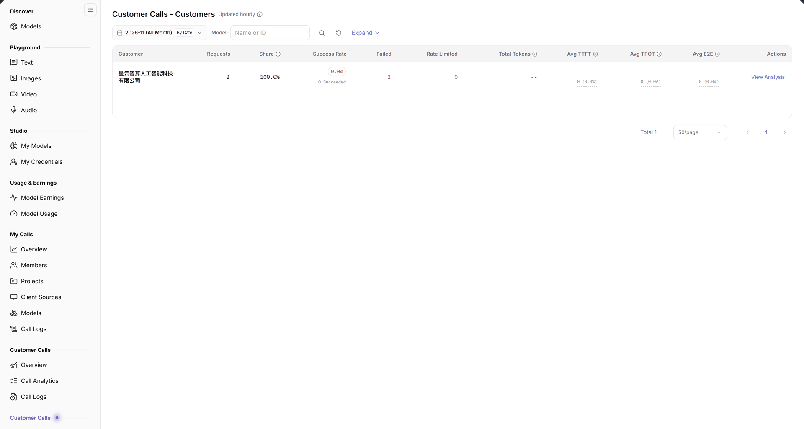

# Customers

::: info Document Information
Version: v2.0
Updated: 2026-11-04
:::

## Feature Overview

| Item | Content |
| --- | --- |
| Applies to | Model Provider |
| Navigation | **Model Services** > **Customer Calls** > **Customers** |
| Route | `/modelone/model-observation/provider/customers` |
| Managed objects | Call count, share, success rate, tokens, and latency aggregated by customer |

**New to this page**: Customers answers "which customers are calling my models". Select a month and model, then compare customers by volume, success rate, and token consumption.

#### Terms Quick Reference

| Term | Description |
| --- | --- |
| Customer | Enterprise tenant or project entity subscribed to or authorized to invoke models published by your organization. |
| Call Share | The percentage of requests initiated by a specific customer relative to total customer requests directed at your models during the period. |
| Failed Calls | Requests that returned 4xx/5xx HTTP error codes due to invalid customer request parameters, authentication failures, or model execution issues. |
| Avg E2E Latency | The average end-to-end duration from when the customer dispatches a request until the final complete response is received. |

## Prerequisites

1. Your account has the publisher-side **Customer Calls > Customers** permission.
2. Customer calls exist in the current period.
3. The month and filters are confirmed.

## Page Description

The title is `Customer Calls - Customers`, marked `Updated hourly`.

| Area | Description |
| --- | --- |
| Top time & model filter bar | Month selector, By Date toggle, Model dropdown selector, Expand button, and Customer Name/ID search box |
| Update interval badge | Displays "Updated hourly" indicating statistical metrics are quasi-realtime aggregated hourly results |
| Customers summary table | Presents customer name, requests, share, success rate, failed/rate-limited counts, total tokens, and TTFT/TPOT/E2E latency |
| Actions & audit drill-down column | Provides direct navigation to inspect detailed single-call records associated with each customer |

- Filters include month, `By Date`, `Model`, **Expand**, and a `Name or ID` search box.
- The first column is `Customer`; the remaining columns are `Requests`, `Share`, `Success Rate`, `Failed`, `Rate Limited`, `Total Tokens`, `Avg TTFT`, `Avg TPOT`, `Avg E2E`, and `Actions`. Without data, the table shows `No Data Available`.

The figure shows filters include month, `By Date`, `Model`, **Expand**, and `Name or ID`; the first column is `Customer`, followed by `Requests`, `Share`, `Success Rate`, `Failed`, `Rate Limited`, `Total Tokens`, `Avg TTFT`, `Avg TPOT`, `Avg E2E`, and `Actions`.

## Main Operations

1. Select a month.
2. Use `By Date` to change granularity.
3. Limit the model scope and use **"Expand"** as needed.
4. Search by customer name or ID.
5. Compare volume, share, success rate, and latency.

## Parameter Quick Reference

| Field Name | Required | Field Type | Example | Description |
| --- | --- | --- | --- | --- |
| Month | Yes | Selector | `2026-11` | Statistics month |
| By Date | No | Toggle | On | Aggregation granularity |
| Model | No | Text | `Name or ID` | Filter by model |
| Customer | System | Text | `Customer A` | Calling customer |
| Requests | System | Number | `0` | Customer call total |
| Share | System | Percentage | `0%` | Share of total calls |
| Success Rate | System | Percentage | `--` | Successful call share |
| Failed / Rate Limited | System | Number | `0` | Failed and rate-limited calls |
| Total Tokens | System | Number | `0` | Customer token total |
| Avg TTFT / TPOT / E2E | System | Duration | `--` | Customer average latency |

## Pitfalls

- Only calls with an identified customer appear here; unattributed calls are excluded.
- `No Data Available` does not mean the customer made no calls.
- `By Date` changes granularity; fix it before comparing.

## Result Validation

| Check Item | Success Signal | If Abnormal |
| --- | --- | --- |
| Filter synchronization | Switching months or selecting a specific model synchronously updates customer rows, requests, and share percentages | If the table becomes empty, click reset to clear filters and verify customer calls exist in the period |
| Metric accuracy | Customer rows accurately display requests, share, success rate, and total tokens | If success rate is abnormally low, check Failed / Rate Limited counts and contact the customer to verify API parameter syntax and concurrency rates |
| Latency indicators | Average TTFT, TPOT, and E2E duration values are clearly displayed | If `--` is shown, there are insufficient samples or the customer exclusively uses non-streaming calls preventing TPOT calculation |
| Customer search | Entering a customer name or ID in the search box filters the table in real time | Clear extra spaces from the search box and retry |
| Cross-dimensional drill-down | Clicking the details button in the Actions column navigates to [Call Logs](../call-logs/) with pre-applied customer filters | Verify the current account has cross-tenant model provider audit permissions |

## FAQ

#### The customer list is empty

**Symptom:** Switching to the current month shows `No Data Available` in the table.

**Possible Causes:** No named customer calls were initiated in the selected period, or the filtered model has not been called by any subscribed customer.

**Resolution:**

1. Switch to a statistical month with active customer business traffic.
2. Clear the model dropdown filter to view aggregated customer calls across all models.
3. Check whether the model has been properly authorized and published to target customers.

#### Customer total differs from Overview

**Symptom:** The sum of customer requests is lower than the total requests shown in [Overview](../overview/).

**Possible Causes:** Overview accounts for all inbound requests (including anonymous test or platform system calls), whereas this page aggregates authenticated, identified enterprise customer entities only.

**Resolution:**

1. Rely on Overview and Billing pages for macro capacity planning, billing, and settlement.
2. Use this page for customer profiling, key account SLA assurance, and commercial reconciliation.

## Notes

- Customer names and call data are sensitive; do not share screenshots externally.
- Statistics refresh hourly; new calls may be delayed.

## Next Steps

1. Drill down into [Call Logs](../call-logs/) to inspect single-call timings and error details for high-volume or failing customer calls.
2. Switch to [Models](../models/) to analyze which specific model services this customer consumes most.
3. Correlate with token consumption to verify revenue sharing and settlement in [Model Earnings](../../usage-earnings/model-earnings/).

Related pages:
- [Customer Calls Overview](../overview/)
- [Customer Calls Logs](../call-logs/)
- [Customer Calls - Client Sources](../client-sources/)
- [Customer Calls - Models](../models/)
- [Model Earnings](../../usage-earnings/model-earnings/)
