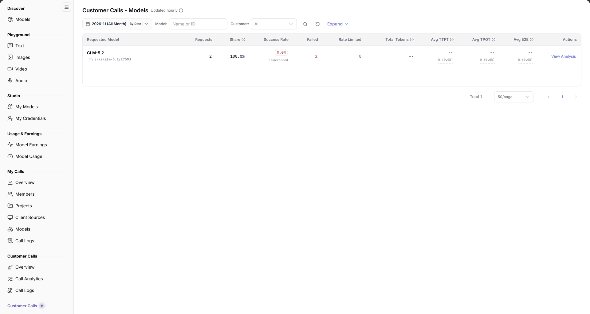

# Models

::: info Document Information
Version: v2.0
Updated: 2026-11-04
:::

## Feature Overview

| Item | Content |
| --- | --- |
| Applies to | Model Provider |
| Navigation | **Model Services** > **Customer Calls** > **Models** |
| Route | `/modelone/model-observation/provider/models` |
| Managed objects | Customer call count, success rate, tokens, and latency aggregated by requested model |

**New to this page**: Models answers "which models are customers calling". Select a month and customer, then compare models by volume, success rate, and latency.

#### Terms Quick Reference

| Term | Description |
| --- | --- |
| Requested Model Identifier | The explicit model routing identifier specified by external customers in API request bodies or request URLs (e.g., `openai/gpt-6.1-sol`). |
| Call Share | The percentage of requests for a specific model relative to total customer calls across all models published by your organization. |
| Cached Tokens | Input tokens that hit model context prompt cache, eliminating full recomputation overhead. |
| Avg TTFT | Average Time to First Token from when the customer request is received until the initial token is generated. |

## Prerequisites

1. Your account has the publisher-side **Customer Calls > Models** permission.
2. Customer calls exist in the current period.
3. The month, model, and customer filters are confirmed.

## Page Description

The title is `Customer Calls - Models`, marked `Updated hourly`.

| Area | Description |
| --- | --- |
| Top time & customer filter bar | Month selector, By Date toggle, Model/Customer dropdown filters, Expand button, and Name/ID search box |
| Update interval badge | Displays "Updated hourly" indicating statistical metrics are quasi-realtime aggregated hourly results |
| Models summary table | Presents requested model ID, requests, share, success rate, failed/rate-limited counts, total tokens, and TTFT/TPOT/E2E latency |
| Actions & audit drill-down column | Provides direct navigation to inspect detailed single-call records associated with each model |

- Filters include month, `By Date`, `Model`, `Customer` (`All`), **Expand**, and a `Name or ID` search box.
- The first column is `Requested Model`; the remaining columns are `Requests`, `Share`, `Success Rate`, `Failed`, `Rate Limited`, `Total Tokens`, `Avg TTFT`, `Avg TPOT`, `Avg E2E`, and `Actions`. Without data, the table shows `No Data Available`.

The figure shows filters include month, `By Date`, `Model`, `Customer`, **Expand**, and `Name or ID`; the first column is `Requested Model`, followed by `Requests`, `Share`, `Success Rate`, `Failed`, `Rate Limited`, `Total Tokens`, `Avg TTFT`, `Avg TPOT`, `Avg E2E`, and `Actions`.

## Main Operations

1. Select a month.
2. Use `By Date` to change granularity.
3. Limit scope with `Model` and `Customer`.
4. Search by model name or ID.
5. Compare volume, share, success rate, and latency.

## Parameter Quick Reference

| Field Name | Required | Field Type | Example | Description |
| --- | --- | --- | --- | --- |
| Month | Yes | Selector | `2026-11` | Statistics month |
| By Date | No | Toggle | On | Aggregation granularity |
| Model | No | Text | `Name or ID` | Filter by model |
| Customer | No | Selector | `All` | Filter by customer |
| Requested Model | System | Text | `openai/gpt-6.1-sol` | Model ID carried by requests |
| Requests | System | Number | `0` | Customer call total |
| Share | System | Percentage | `0%` | Share of total calls |
| Success Rate | System | Percentage | `--` | Successful call share |
| Failed / Rate Limited | System | Number | `0` | Failed and rate-limited calls |
| Total Tokens | System | Number | `0` | Model token total |
| Avg TTFT / TPOT / E2E | System | Duration | `--` | Model average latency |

## Pitfalls

- This is the publisher view; the other **Customer Calls** group has a different scope.
- `Requested Model` may differ from the display name in an application; use the ID for verification.
- `No Data Available` does not mean the model is unavailable.

## Result Validation

| Check Item | Success Signal | If Abnormal |
| --- | --- | --- |
| Filter synchronization | Switching months or specifying a customer synchronously refreshes rows, requests, and share percentages | If the table becomes empty, click reset to clear filters and verify customer calls exist for published models in the period |
| Metric accuracy | Model rows accurately display requests, share, success rate, and total tokens | If success rate is low, check Failed / Rate Limited counts and drill down to call logs to verify backend model instance health |
| Latency indicators | Average TTFT, TPOT, and E2E duration values are clearly displayed | If `--` is shown, sample volume is insufficient or calls are non-streaming preventing TPOT calculation |
| Model search | Entering a model name or route identifier in the search box filters the table in real time | Clear extra characters from the search input and retry |
| Cross-dimensional drill-down | Clicking the details button in the Actions column navigates to [Call Logs](../call-logs/) with pre-applied model filters | Verify the current account has cross-customer audit permissions for model providers |

## FAQ

#### The model list is empty

**Symptom:** Switching to the current month shows `No Data Available` in the table.

**Possible Causes:** No customer requests were directed at models published by your organization in the period, or the filtered customer made no calls.

**Resolution:**

1. Switch to a statistical month with active customer business traffic.
2. Clear customer dropdown filters to view aggregated calls across all customers.
3. Check whether model access and publishing status are online and healthy.

#### Totals differ from Overview

**Symptom:** The sum of model requests is lower than the total requests shown in [Overview](../overview/).

**Possible Causes:** Overview accounts for all inbound requests (including invalid requests blocked at the gateway before matching a valid model identifier), whereas this page aggregates valid resolved model routes only.

**Resolution:**

1. Rely on Overview for overall gateway load and traffic pressure assessment.
2. Use this page to analyze customer adoption, inference capacity load, and revenue allocation per model.

## Notes

- Model IDs and customer data are sensitive; do not share screenshots externally.
- Statistics refresh hourly; new calls may be delayed.

## Next Steps

1. Drill down into [Call Logs](../call-logs/) to inspect single-call inference timings and network roundtrip details for error-prone or slow models.
2. Switch to [Customers](../customers/) to analyze the distribution of enterprise customers invoking this model.
3. Check actual settlement earnings and consumption share for each model in [Model Earnings](../../usage-earnings/model-earnings/).

Related pages:
- [Customer Calls Overview](../overview/)
- [Customer Calls Logs](../call-logs/)
- [Customer Calls - Customers](../customers/)
- [Customer Calls - Client Sources](../client-sources/)
- [Model Earnings](../../usage-earnings/model-earnings/)
