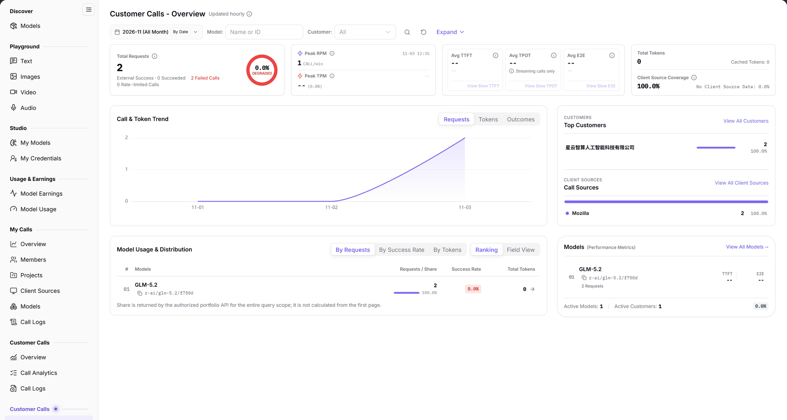

# Customer Calls (Provider) - Overview

> This page appears as **Overview** in the **Customer Calls (Provider)** group.

> Statistics scope: the month and date range define the period; `By Date` switches the aggregation to daily, and the date range is the start and end shown in the control.

## 1. Feature Overview

| Item | Content |
| --- | --- |
| Applies to | Model Provider |
| Navigation | **Model Services** > **Customer Calls** (second group) > **Overview** |
| Route | `/modelone/model-observation/provider/overview` |
| Managed objects | Publisher-side customer requests, tokens, latency, top customers, client sources, and model distribution |

**New to this page**: This is the publisher-side dashboard for customer traffic. Select a month and model, read requests, success/failure, latency, and tokens, then use top customers, client sources, and model distribution to see where traffic comes from.

## 2. Prerequisites

1. Your account has the publisher-side **Customer Calls > Overview** permission.
2. Customer calls exist in the current period.
3. The month, model, and customer filters are confirmed.

## 3. Page Description

The left menu contains two **Customer Calls** groups. This page is in the second group with the `/modelone/model-observation/provider` route prefix; the other group uses `/modelone/monitoring/monitor`.

The title is `Customer Calls - Overview`, marked `Updated hourly`. The page contains:

- Filters: month, `By Date`, `Model`, `Customer` (`All`), **Expand**, and a `Name or ID` search box.
- KPI cards: `Total Requests` (with `External Success`, `Failed Calls`, `Rate-limited Calls`), `Peak RPM`, `Peak TPM`, `Avg TTFT`, `Avg TPOT` (`Streaming calls only`), `Avg E2E`, `Total Tokens` (with `Cached Tokens`), and `Client Source Coverage`.
- `Call & Token Trend`: switchable between `Requests`, `Tokens`, and `Outcomes`.
- `Top Customers`: with **View All Customers**.
- `Call Sources`: `Call Sources` composition with **View All Client Sources**.
- `Model Usage & Distribution`: switchable between `By Requests`, `By Success Rate`, `By Tokens` and `Ranking`, `Field View`; shows `Active Models`, `Active Customers`, and **View All Models**.

**Figure note**: Filters include month, model, and customer; KPI cards show requests, failures/limits, peaks, latency, tokens, and source coverage; below are customers, sources, and model distribution.

## 4. Main Operations

### 4.1 Set the statistics scope

1. Select a month.
2. Use `By Date` to change granularity.
3. Limit scope with `Model` and `Customer`.
4. Click **Expand** to view extended filters.

### 4.2 Read metrics

1. Read `Total Requests`, `External Success`, `Failed Calls`, and `Rate-limited Calls`.
2. Read `Peak RPM` and `Peak TPM`.
3. Read `Avg TTFT`, `Avg TPOT`, and `Avg E2E`.
4. Read `Total Tokens`, `Cached Tokens`, and `Client Source Coverage`.

### 4.3 Locate customers and models

1. Review `Top Customers` or click **View All Customers**.
2. Review `Call Sources` or click **View All Client Sources**.
3. In `Model Usage & Distribution`, switch `By Requests`, `By Success Rate`, `By Tokens` and `Ranking`, `Field View`.
4. Click **View All Models** to drill down.

## 5. Parameter Quick Reference

| Field | Required | Field type | Example | Description |
| --- | --- | --- | --- | --- |
| Month | Yes | Selector | `2026-11` | Statistics month |
| By Date | No | Toggle | On | Aggregation granularity |
| Model | No | Text | `Name or ID` | Filter by model |
| Customer | No | Selector | `All` | Filter by customer |
| Total Requests | System | Number | `--` | Customer request total |
| External Success | System | Number | `--` | Successful external calls |
| Failed / Rate-limited Calls | System | Number | `--` | Failed and rate-limited calls |
| Peak RPM / TPM | System | Number | `--` | Peak requests and tokens per minute |
| Avg TTFT / TPOT / E2E | System | Duration | `--` | Average latency; TPOT covers streaming calls only |
| Total Tokens | System | Number | `--` | Customer token total |
| Cached Tokens | System | Number | `--` | Cached tokens |
| Client Source Coverage | System | Percentage | `--` | Share of calls with a source ID |
| Top Customers | System | List | — | Customers with the highest volume |
| Call Sources | System | Chart | — | Call share by source |
| Active Models / Active Customers | System | Number | `0` | Models and customers with calls |

## 6. Pitfalls

- Two **Customer Calls** groups exist. This page is the publisher view and differs from the customer-dimension monitoring group.
- `Avg TPOT` covers streaming calls only; non-streaming calls are excluded.
- Without data, model distribution shows `Data is unavailable. Please retry later.` and active counts are `0`.
- `Client Source Coverage` reports source-ID coverage; it does not imply the number of customers.

## 7. Result Validation

| Check | What you can see |
| --- | --- |
| Filters applied | KPI cards and charts follow month, model, and customer |
| Trend switchable | `Requests`, `Tokens`, and `Outcomes` switch |
| Distribution switchable | `By Requests`, `By Success Rate`, `By Tokens` and `Ranking`, `Field View` switch |
| Drill-down entries | **View All Customers**, **View All Client Sources**, **View All Models** are visible |
| Empty state | `Data is unavailable. Please retry later.` when no data exists |

## 8. FAQ

#### Metrics show `--`

**Symptom**: Requests, tokens, and latency metrics are all `--`.

**Resolution**: Confirm customer calls exist in the month and scope; wait for the next hourly refresh.

#### Active models and customers are 0

**Symptom**: `Active Models: 0` and `Active Customers: 0`.

**Resolution**: Widen the period or clear model and customer filters, then retry.

## 9. Notes

- The page contains customer names, volumes, and sources; do not share screenshots externally.
- The two **Customer Calls** groups use different routes; confirm the current route when troubleshooting.
- Metrics follow filters; fix the scope before comparing.

## 10. Next Steps

- Review calls by model in [Models](../models/).
- Review calls by customer in [Customers](../customers/).
- Review source distribution in [Client Sources](../client-sources/).
- Review individual calls in [Call Logs](../call-logs/).
