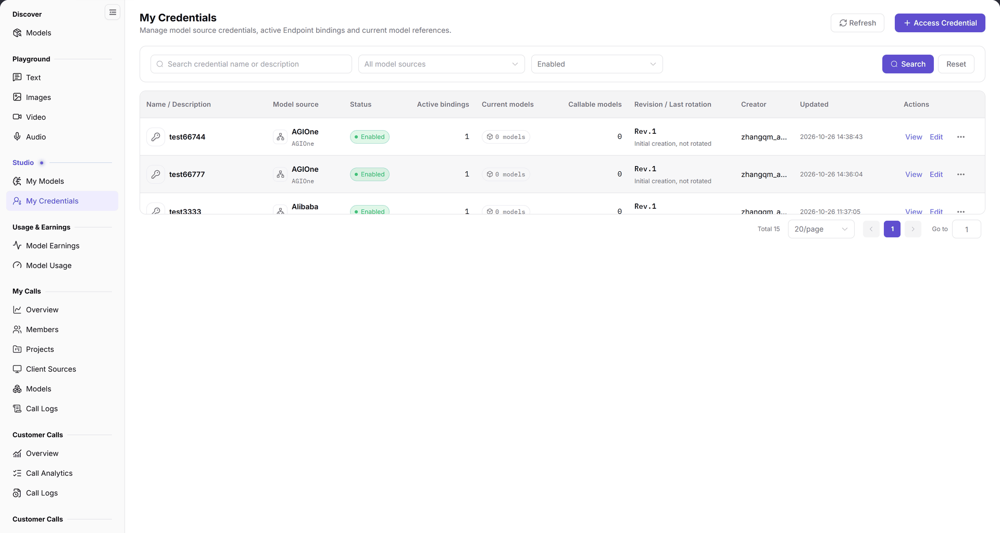
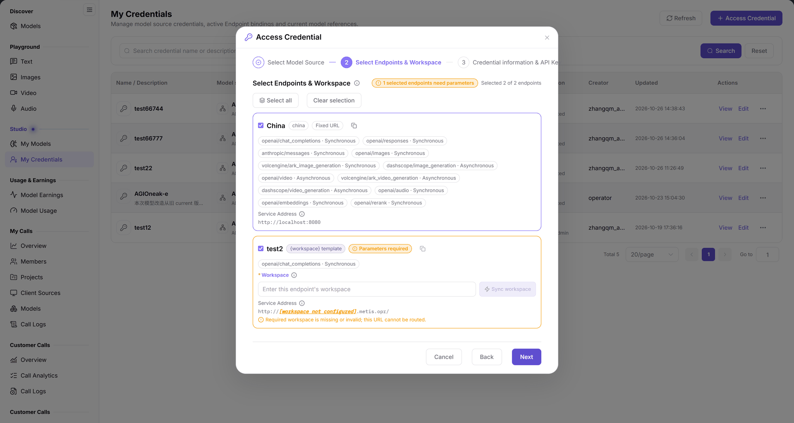
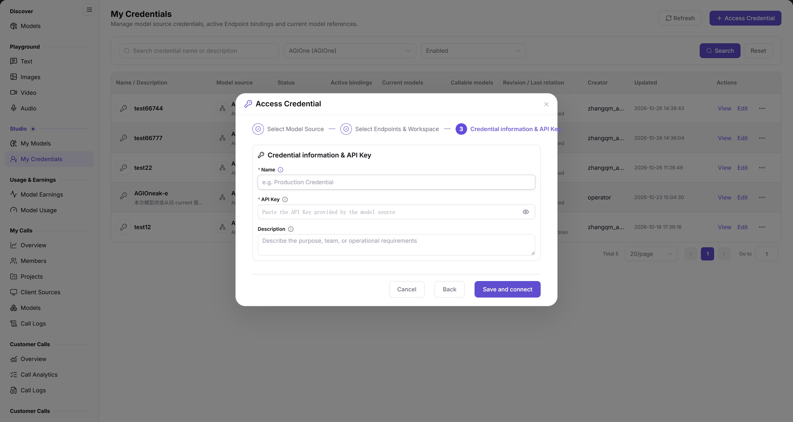

# My Credentials

::: info Document Information
Version: v2.0
Updated: 2026-11-04
:::

## Feature Overview

| Item | Content |
| --- | --- |
| Applies to | Model Provider |
| Navigation | **Model Services** > **Studio** > **My Credentials** |
| Route | `/modelone/credentials` |
| Managed objects | Model source credentials, Endpoint bindings, linked models, and revisions |

#### Beginner Explanation

My Credentials manages the credentials a publisher uses to connect upstream model sources. Each credential binds to a model source and active Endpoint and shows how many models reference it; rename or rotate credentials here.

#### Terms Quick Reference

| Term | Description |
| --- | --- |
| Model Source Credential | Authentication credentials (such as API keys) used to access upstream vendor services like AGIOne or OpenAI. |
| Active Endpoint Binding | The number of Endpoints authorized and connected for network traffic, determining the deployable regional scope. |
| Credential Rotation | Updating the underlying API key without changing the credential ID or model bindings, incrementing the revision (e.g., Rev.1 -> Rev.2). |
| Linked Models | The set of published models currently referencing this credential to forward upstream requests. |

## Prerequisites

1. Your account has access to **Studio > My Credentials**.
2. The target model source and Endpoint are confirmed.
3. The upstream API key is ready before creating a credential.

## Page Description

The page title is `My Credentials`, with the description `Manage model source credentials, active Endpoint bindings and current model references.` and **Refresh** / **Access Credential** on the right.

Filters include the search box `Search credential name or description`, a model source selector (`All model sources`), a status selector (`Enabled`), **Search**, and **Reset**.

Columns are `Name / Description`, `Model source`, `Status`, `Active bindings`, `Current models`, `Callable models`, `Revision / Last rotation`, `Creator`, `Updated`, and `Actions`. Row actions provide **View**, **Edit**, and more.

The figure shows columns are `Name / Description`, `Model source`, `Status`, `Active bindings`, `Current models`, `Callable models`, `Revision / Last rotation`, `Creator`, `Updated`, and `Actions`. Example rows show `Enabled`, `1` active binding, and `0 models`.

| Area | Description |
| --- | --- |
| Top Action Bar | Contains page description, list refresh, and the **Access Credential** wizard button. |
| Search and Filters | Supports fuzzy search by credential name/description and filters by model source and status. |
| Credential Table | Displays credential name, model source, status, active bindings, current models, and update time. |
| Row & More Actions | Provides **View** details, **Edit** metadata, and entries for Endpoints, models, rotation, and disabling. |

## Main Operations

### Access a credential

1. Click **"Access Credential"** to open the three-step wizard.
2. In `1 Select Model Source`, choose the model source.
3. Click **"Next"**, then choose the active Endpoint in `2 Select Endpoints & Workspace`.
4. In `2 Select Endpoints & Workspace`, select the target Endpoint. The page shows `Selected N of M endpoints`, region, fixed URL, protocols, and service address. Fill `Workspace` when the Endpoint requires a workspace parameter.
5. Click **"Next"**, then in `3 Credential information & API Key` fill `Name`, `API Key`, and the optional `Description`.
6. Click **"Save and connect"**; verify the model source, Endpoint, name, and API key before submitting.

The figure shows `2 Select Endpoints & Workspace` with `Selected 1 of 2 endpoints`; the China Endpoint is labeled `China`, `china`, `Fixed URL`, and lists protocols such as `openai/chat_completions` plus the service address. Endpoints with `{workspace}` require a `Workspace`.

The figure shows `3 Credential information & API Key` provides required `Name` and `API Key` fields plus an optional `Description`; the footer buttons are **"Back"** and **"Save and connect"**.

### View credential details

1. Click **"View"** on the target row.
2. In `Credential details`, check `Credential display name`, `Model source`, `Rev.`, and `Description`.
3. Under `Bound Endpoints & network configuration`, check `1 active / 1 total Endpoints bound` and the Endpoint address.
4. Click **"Close"** when finished.

### Edit credential metadata

1. Click **"Edit"** on the target row.
2. In `Edit Credential metadata`, change `Credential display name` or `Description`.
3. Click **"Save metadata"**; use **"Close"** to leave without saving.

### Rotate or disable a credential

1. Open the row's more-actions menu; it contains `Endpoint`, `Models`, `Audit`, `Rotate`, and `Disable`.
2. Choose `Rotate`, then verify the model source, `Rev.`, active Endpoint bindings, and current linked models in `Rotate API Key`.
3. Enter the `New API Key` and click **"Confirm Rotation"**; use **"Close"** to leave without rotating.
4. To disable, choose `Disable` and confirm the impact scope first.

### Filter credentials

1. Enter a credential name or description in the search box.
2. Select a model source and status.
3. Click **"Search"** or **"Reset"**.

## Parameter Quick Reference

| Field Name | Required | Field Type | Example | Description |
| --- | --- | --- | --- | --- |
| Credential display name | Yes | Text, 1–128 chars | `test66744` | Must be unique within the tenant and model source after trimming |
| Description | No | Text | `Text chat test credential` | Identifies the credential purpose |
| Model source | Yes | Selector | `AGIOne` | Upstream model source |
| Endpoint | Yes | Selector | `China` | Active Endpoint bound to the credential |
| API Key | Yes | Secret | — | Upstream key, not displayed after saving |
| Status | System | Tag | `Enabled` | Current availability |
| Active bindings | System | Number | `1` | Number of active Endpoint bindings |
| Current models | System | Number | `0 models` | Models that reference the credential |
| Callable models | System | Number | `0` | Models currently callable |
| Revision / Last rotation | System | Version | `Rev.1` / `Initial creation, not rotated` | Credential revision history |
| Creator | System | Text | `provider_admin` | Account that created the credential |
| Updated | System | Time | `2026-10-26 14:38:43` | Last update time |

## Pitfalls

- The credential display name must be unique within the same tenant and model source; duplicates are rejected.
- `1 active / 1 total Endpoints bound` means only one Endpoint is bound; confirm model calls before changing the binding.
- `Current models: 0 models` does not mean the credential is unusable; it means no model references it yet.
- The API key is entered only during creation or rotation and is not displayed in full afterwards.

## Result Validation

| Check Item | Success Signal | If Abnormal |
| --- | --- | --- |
| Credential created | A new credential row appears in the table with status `Enabled`. | If missing, verify that filters are not excluding the status, or check the creation error message. |
| Endpoint binding | `Active bindings` displays the correct number of bound Endpoints. | If 0, open row more actions, select `Endpoint`, and review network call configurations. |
| Linked models | `Current models` accurately counts and displays models referencing this credential. | If not updated after publishing, refresh the page or confirm the model publish form selected this credential. |
| Metadata updated | The credential display name or description updates immediately in the list. | Check whether the content exceeds 128 characters or duplicates an existing name under the same source. |
| Rotation version | `Revision / Last rotation` shows the new `Rev.` version number and timestamp. | If unchanged, verify the API key format is valid and confirm the rotation dialog submission completed. |

## FAQ

#### The credential name cannot be saved

**Symptom:**

Clicking **"Save metadata"** prompts an error or the name remains unchanged.

**Possible Causes:**

The credential name exceeds the 1–128 character limit, contains only spaces after trimming, or duplicates an existing credential under the same model source in the tenant.

**Resolution:**

1. Ensure the entered name is between 1 and 128 characters and unique after trimming leading/trailing spaces.
2. Confirm there is no duplicate credential name under the current model source.

#### The target credential is missing

**Symptom:**

The table is empty or searching by credential name returns no matching results.

**Possible Causes:**

Search keyword is inaccurate, model source filter is restricted to another source, status filter excludes active credentials, or the credential belongs to another tenant.

**Resolution:**

1. Click **"Reset"** to clear the search keyword and all filter dropdowns.
2. Verify the current tenant login context and confirm whether the credential was created by the current tenant.

## Notes

- API keys are sensitive; do not screenshot them, copy them into documents, or send them to external tools.
- Changing bindings or rotating keys affects models that use the credential; confirm the impact first.
- Before changing a binding or rotating a credential, confirm the models and calls that depend on it.

## Next Steps

1. Bind the credential in the model publish wizard in [My Models](../my-models/).
2. Verify that models using this credential are functioning in [Models](../../discover/models/).
3. Monitor call connectivity and token usage logs in [My Calls](../../my-calls/overview/).

Related pages:
- [My Models](../my-models/)
- [Models](../../discover/models/)
- [My Calls](../../my-calls/overview/)
