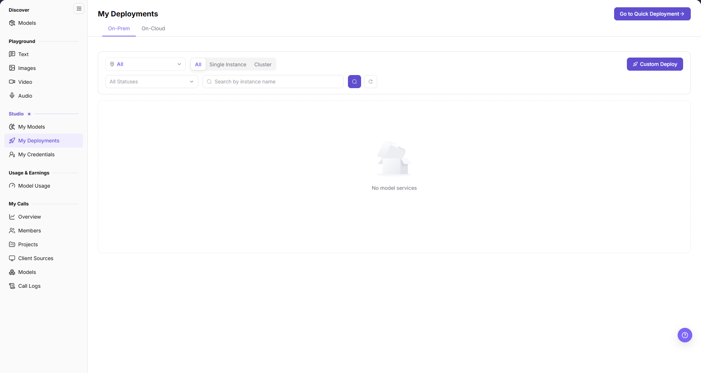

# My Deployments

::: info Document Information
Version: v2.0
Updated: 2026-11-04
:::

## Feature Overview

| Item | Content |
| --- | --- |
| Applicable Role | User |
| Navigation path | Model Services > Studio > My Deployments |
| Page route | `/modelone/my-deployments/models` |
| Managed objects | Unified overview and fast cross-subsystem navigation entries for deployed model instances across compute environments (On-Prem Heterogeneous GPU Management and On-Cloud Multi-Platform Scheduling) |

#### Beginner Explanation

My Deployments is the model instance dashboard under Model Services. Users can view all deployments across On-Prem and On-Cloud environments without repeatedly switching top-level navigation. This page primarily provides search and cross-subsystem links. Clicking an instance or quick deployment button redirects to the infrastructure subsystem for creation and lifecycle management.

#### Terms Quick Reference

| Term | Description |
| --- | --- |
| On-Prem Deployment | A model instance running on locally managed heterogeneous accelerator clusters; click to jump to the On-Prem subsystem for management. |
| On-Cloud Deployment | A model service scheduled and deployed on external cloud or multi-architecture compute platforms; click to jump to the On-Cloud subsystem for management. |

## Prerequisites

- Successfully logged into the AGIOne platform with permissions to view model deployments.
- When creating a new deployment through redirection, ensure the tenant has available compute quota or a healthy account balance.

## Page Description

The page includes a top environment tab switcher, a filter and search toolbar, and a central deployment instance list.

The figure shows the My Deployments list interface, including On-Prem and On-Cloud tab switching, deployment mode filtering, and cross-subsystem jump entries.

## Main Operations

### 1. Switch Compute Environments to View Deployments

Click the tabs at the top of the page:
- Click **On-Prem**: View model services deployed on locally managed heterogeneous compute clusters.
- Click **On-Cloud**: View model services hosted on external public clouds or third-party platforms via multi-platform scheduling.

### 2. Filter and Search Instances

- Select a target compute region in the Region dropdown (defaults to All).
- Select **All**, **Single Instance**, or **Cluster** in the type bar to filter corresponding deployment topologies.
- Filter by status in the dropdown menu to display Running, Stopped, or Abnormal instances.
- Enter an instance name in the search box, click the search icon button for exact keyword matching, or click reset to clear inputs and restore full view.

### 3. Redirect to Underlying Subsystems for Management

As an aggregation dashboard, core lifecycle operations seamlessly link to the underlying compute subsystem:
- **View and Manage Instances**: Click an instance name or action button in the list to automatically navigate to the instance console in **On-Prem** (`/powerone/quickstart/model-service`) or **On-Cloud** (`/infrahub/user/model/deployment`), where you can start, stop, delete, inspect logs, and monitor metrics.
- **Create New Deployments**: Click **Go to Quick Deployment** at the top right or **Custom Deploy** on the right of the filter toolbar to jump directly to the deployment wizard in the respective compute subsystem and finalize setup.

## Parameter Quick Reference

| Field Name | Required | Field Type | Example | Description |
| --- | --- | --- | --- | --- |
| Region | No | Dropdown | All | Filters model instances deployed in a specific region or availability zone |
| Topology | No | Segmented Radio | All | Options include All, Single Instance, and Cluster to filter different deployment architectures |
| Status | No | Dropdown | All Statuses | Options include All Statuses and specific lifecycle states to filter instances |
| Search by instance name | No | Text Input | qwen2.5 | Enter instance name keywords for precise filtering |

## Pitfalls

- Clicking an instance or deployment button redirects your browser to the corresponding On-Prem or On-Cloud subsystem; this is standard cross-subsystem navigation behavior rather than an error.
- If a target service is not found in the current compute environment tab, check whether it was deployed in the other environment and toggle between the On-Prem and On-Cloud tabs.

## Result Validation

| Check Item | Success Signal | If Abnormal |
| --- | --- | --- |
| Tab Switching | The clicked tab is highlighted and the list refreshes corresponding data | Refresh the page to reload the instance list |
| Cross-System Navigation | Clicking an instance or deployment button redirects the URL to the target subsystem console | Check network connectivity or permissions |
| Keyword Search | The list only displays instances matching the search keyword | Clear the input field and click Reset to restore all records |

## FAQ

**Symptom:** Why does clicking an action button navigate away from Model Services?
**Possible Causes:** This page functions as a unified aggregation view; actual compute instances are hosted within specific underlying compute subsystems.
**Resolution:** This is standard platform behavior. Follow the instructions in the destination subsystem to manage the instance, then click **Model Services** in the top navigation bar at any time to return.

## Notes

- This page does not support directly modifying low-level resource configurations such as VRAM or container specifications; all infrastructure-level adjustments must be made in the redirected subsystem.
- After an instance is deleted or stopped, a synchronization delay of a few seconds may occur on this dashboard; the real-time status in the underlying subsystem prevails.

## Next Steps

- Explore local heterogeneous compute deployments: See [Heterogeneous GPU Management - Instances](/usermanual/ai-infra-on-prem/user/model-deployment/instances/).
- Explore cloud compute scheduling: See [Multi-Platform Scheduling - My Deployments](/usermanual/ai-infra-on-cloud/user/model-services/my-deployments/).
- Request or manage API credentials: See [My Credentials](/usermanual/model-services/user/studio/credentials/).
