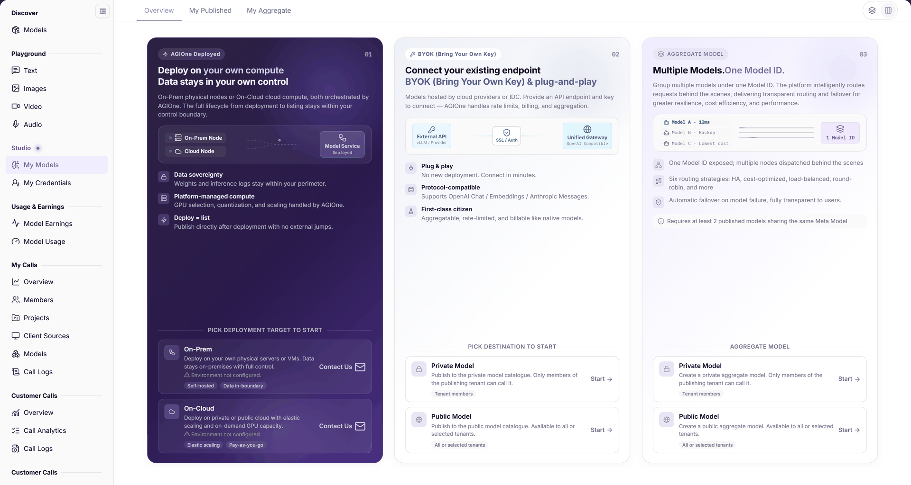
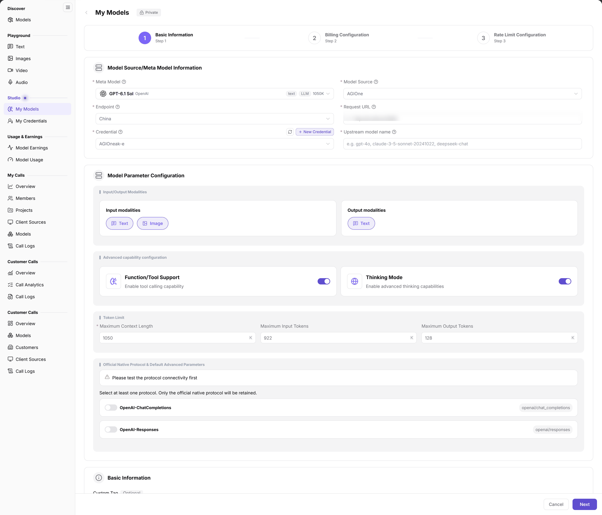

# My Models

## 1. Feature Overview

| Item | Content |
| --- | --- |
| Applies to | Model Provider |
| Navigation | **Model Services** > **Studio** > **My Models** |
| Routes | Overview `/modelone/model/my/overview`; publish form `/modelone/model/create?isPublic=0` |
| Managed objects | Published models, aggregate models, deployment entries, and publish configuration |

**New to this page**: My Models is the publisher workspace. `Overview` explains deployment, BYOK integration, and aggregation; `My Published` manages directly published models; `My Aggregate` manages models combined behind one Model ID.

## 2. Prerequisites

1. Your account has access to **Studio > My Models**.
2. The meta model, model source, Endpoint, request URL, and credential are confirmed.
3. Billing, price, rate limits, and publication scope are confirmed before publishing.

## 3. Page Description

The page has three tabs: `Overview`, `My Published`, and `My Aggregate`.

`Overview` is organized into three publication paths:

- `01 AGIOne Deployed`: explains on-prem nodes, cloud nodes, model service, and deploy-to-list. Two cards are provided: `On-Prem` and `On-Cloud`. Both currently show `Environment not configured.` and provide **Contact Us**.
- `02 BYOK (Bring Your Own Key)`: explains connecting an existing endpoint and provides `Private Model` and `Public Model` publish entries.
- `03 Multiple Models. One Model ID.`: explains aggregate routing and provides `Private Model` and `Public Model` aggregate entries.

**Figure note**: Three tabs sit at the top; the deployment area shows On-Prem/On-Cloud (environment not configured), and the BYOK and aggregate areas provide private and public entries.

### 3.1 My Published

`My Published` lists directly published models. Columns are `Model name`, `Model type`, `Billing mode`, `Billing rules`, `Status`, `Effective version`, `Pending version`, `Updated at`, and `Actions`. The toolbar provides **Publish Model**, search, and **Reset**; row actions provide **View details** and **Edit**.

### 3.2 My Aggregate

`My Aggregate` uses the same columns and provides **Create Aggregate Model**, `Public Model` / `Private Model` filters, an `All Model type` filter, search, **Reset**, and **Expand**.

## 4. Main Operations

### 4.1 Publish a model

1. Open **My Models** and switch to `My Published`, or start from the `02 BYOK` area on `Overview`.
2. Click **Publish Model** and choose `Private Model` or `Public Model` in the `Select publish type` dialog.
3. Click **Publish as Private Model** or **Publish as Public Model** to open the three-step form.
4. In `Step 1 Basic Information`, select the meta model, model source, and Endpoint, and fill in the request URL, credential, upstream model name, and input/output modalities.
5. Optionally enable `Function/Tool Support` and `Thinking Mode`, and set the maximum context, input, and output tokens.
6. Select at least one protocol under `Official Native Protocol & Default Advanced Parameters`, and test connectivity first.
7. Fill in the custom tag (up to 20 characters), review the model name preview, and choose the publication method and `Access Mode`.
8. Click **Next** to open `Step 2 Billing Configuration`, then complete `Step 3 Rate Limit Configuration` and submit.

**Figure note**: The wizard shows `1 Basic Information`, `2 Billing Configuration`, and `3 Rate Limit Configuration`. The visible area contains `Meta Model`, `Model Source`, `Endpoint`, `Request URL`, `Credential`, `Upstream model name`, input/output modalities, advanced capabilities, token limits, and protocol selection; `Access Mode` sits lower in the basic-information area.

### 4.2 Create an aggregate model

1. Switch to `My Aggregate` and click **Create Aggregate Model**.
2. Choose `Private Model` or `Public Model`.
3. Select published models, then configure routing, billing, and rate limits.
4. After submission, verify the record and status in `My Aggregate`.

### 4.3 View and edit a published model

1. Use search or **Reset** in `My Published` to locate a model.
2. Click **View details** to check billing rules, versions, and status.
3. Click **Edit** to change the configuration.

## 5. Parameter Quick Reference

| Field | Required | Field type | Example | Description |
| --- | --- | --- | --- | --- |
| Publish type | Yes | Card | `Private Model` / `Public Model` | Determines visibility and call scope |
| Meta Model | Yes | Selector | `GPT-6.1 Sol` | Capability and protocol definition |
| Model Source | Yes | Selector | `AGIOne` | Upstream service source |
| Endpoint | Yes | Selector | `China` | Access point under the model source |
| Request URL | Yes | Text | `<BASE_URL><ENDPOINT_PATH>` | Upstream call address |
| Credential | Yes | Selector | `example-credential` | Upstream credential; **New Credential** creates one |
| Upstream model name | Yes | Text | `openai/gpt-6.1-sol` | Model ID sent upstream |
| Input/Output Modalities | Yes | Checkbox | `Text`, `Image` | Supported input and output types |
| Function/Tool Support | No | Toggle | Enabled | Enables tool calling |
| Thinking Mode | No | Toggle | Enabled | Enables advanced reasoning |
| Maximum Context / Input / Output Tokens | No | Number | `1050K` | Token limits |
| Official Native Protocol | Yes | Multi-select | `OpenAI-ChatCompletions` | At least one protocol is required |
| Custom Tag | No | Text, max 20 chars | `#High Speed` | Differentiates models under the same meta model |
| Publication method | Yes | Single select | `Immediate Release` | Controls when the model goes live |
| Access Mode | Yes | Single select | `Global` / `Authorized` | Controls tenant authorization |
| Billing type | Yes | Selector | `Token` | Billing method |
| Pricing Dimension | Yes | Selector | `Input / Output` | Price matrix dimension |
| Enable Rate Limiting | Yes | Toggle | `Enabled` / `Not enabled` | Controls rate-limit configuration |
| Model name | System | Text | `GPT-6.1 Sol` | Display name in lists and provider cards |
| Model type | System | Tag | `Text`, `Multimodal` | Model modality |
| Billing mode | System | Tag | `Token`, `Per second` | Current billing method |
| Status | System | Tag | `Listed`, `Delisting scheduled`, `Delisted` | Current model status |
| Effective version / Pending version | System | Version tag | `Rev.1` | Current and pending revisions |

## 6. Pitfalls

- The first step requires a protocol connectivity test. Until it passes, the page shows `Please test the protocol connectivity first`.
- `Access Mode` `Global` allows all tenants and users without extra authorization; `Authorized` keeps the model visible in the marketplace but requires tenant-level authorization.
- `My Published` shows both `Effective version` and `Pending version`; rows with `Delisting scheduled` remain in the list.
- The custom tag is limited to 20 characters and affects display only, not model capability.

## 7. Result Validation

| Check | What you can see |
| --- | --- |
| Publish record | The model appears in `My Published` with type, billing mode, status, and update time |
| Aggregate record | The aggregate model appears in `My Aggregate` |
| Version status | `Effective version` and `Pending version` show revision numbers and review results |
| Wizard progress | The form advances from `Step 1 Basic Information` to `Step 2 Billing Configuration` and `Step 3 Rate Limit Configuration` |

## 8. FAQ

#### The publish form cannot continue

**Symptom**: Clicking **Next** in `Step 1 Basic Information` does not open billing configuration.

**Resolution**:

1. Check the meta model, model source, Endpoint, request URL, credential, and upstream model name.
2. Confirm at least one protocol is selected and connectivity testing has passed.

#### The published model is missing

**Symptom**: The record is not in `My Published`.

**Resolution**:

1. Confirm the `My Published` tab and clear search conditions.
2. Check whether the submission succeeded and whether the model is still under review.

#### The deployment cards cannot be used

**Symptom**: `On-Prem` or `On-Cloud` shows `Environment not configured.`

**Resolution**: These cards currently provide **Contact Us** only; enter the deployment flow after the environment is configured.

## 9. Notes

- Publishing and editing affect customer calls and billing; confirm the impact first.
- Credentials and request URLs are sensitive; never write them into documents, screenshots, or external chat tools.
- Price, billing method, and rate limits directly affect real call cost; verify them before submission.

## 10. Next Steps

- Review revenue in [Model Earnings](../../usage-earnings/model-earnings/).
- Review customer traffic in [Customer Calls](../../customer-calls/overview/).
- Manage upstream credentials and Endpoint bindings in [My Credentials](../../studio/credentials/).
