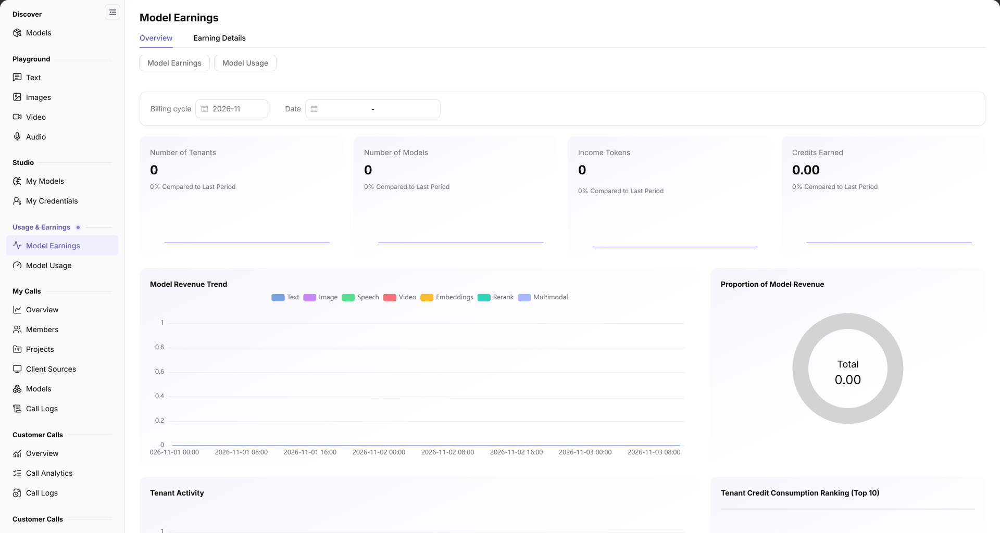

# Model Earnings

## 1. Feature Overview

| Item | Content |
| --- | --- |
| Applies to | Model Provider |
| Navigation | **Model Services** > **Usage & Earnings** > **Model Earnings** |
| Route | `/modelone/accounting/useage/overview/model` |
| Managed objects | Model earnings, tenants, models, income tokens, and earned credits |

**New to this page**: Model Earnings is the revenue dashboard for publishers. Select a billing cycle, read tenant and model counts plus income tokens and credits, then use trends and rankings to find revenue sources.

## 2. Prerequisites

1. Your account can open **Usage & Earnings > Model Earnings**.
2. Published models have customer calls or billing records.
3. The billing cycle and date range are confirmed.

## 3. Page Description

The page shows the `Model Earnings` title and two tabs, `Overview` and `Earning Details`; below the tabs, `Model Earnings` and `Model Usage` provide quick switching, and the left menu also lists both.

`Overview` contains:

- Filters: `Billing cycle` and `Date`.
- KPI cards: `Number of Tenants`, `Number of Models`, `Income Tokens`, and `Credits Earned`; each card shows `Compared to Last Period`.
- Charts: `Model Revenue Trend`, `Proportion of Model Revenue` (`Total`), `Tenant Activity`, `Tenant Credit Consumption Ranking (Top 10)`, `Trend of Model Call Frequency`, and `Distribution of Model Call Times`.

**Figure note**: The page provides `Overview` and `Earning Details` tabs; KPI cards show `Number of Tenants`, `Number of Models`, `Income Tokens`, and `Credits Earned`, each with `Compared to Last Period`; the chart area includes `Model Revenue Trend`, `Proportion of Model Revenue`, `Tenant Activity`, and `Tenant Credit Consumption Ranking (Top 10)`.

## 4. Main Operations

### 4.1 Read the earnings overview

1. Open **Usage & Earnings > Model Earnings**; `Overview` is selected by default.
2. Choose `Billing cycle` and `Date`.
3. Read `Number of Tenants`, `Number of Models`, `Income Tokens`, `Credits Earned`, and their `Compared to Last Period` values.
4. Review revenue trends, revenue share, and tenant consumption rankings.

### 4.2 Open earning details

1. Click the `Earning Details` tab.
2. Review the details for the selected billing cycle and date.

### 4.3 Switch to usage details

1. In the left `Usage & Earnings` group, click `Model Usage`.
2. Or continue from the usage overview after switching.

## 5. Parameter Quick Reference

| Field | Required | Type | Example | Description |
| --- | --- | --- | --- | --- |
| Billing cycle | Yes | Selector | `2026-11` | Billing period |
| Date | No | Date range | `2026-11-01` to `2026-11-03` | Statistics date range |
| Number of Tenants | System | Number | `0` | Tenants that generated revenue |
| Number of Models | System | Number | `0` | Models that generated revenue |
| Income Tokens | System | Number | `0` | Billed token total |
| Credits Earned | System | Amount | `0.00` | Earned credits |
| Compared to Last Period | System | Percentage | `0%` | Change versus the previous period |
| Model Revenue Trend | System | Chart | — | Revenue over time |
| Proportion of Model Revenue | System | Chart | — | Revenue share by model |
| Tenant Activity | System | Chart | — | Tenant activity |
| Tenant Credit Consumption Ranking (Top 10) | System | Ranking | — | Tenants with the highest credit consumption |

## 6. Pitfalls

- KPI cards show both the current value and `Compared to Last Period`; confirm the billing cycle and date range before reading trends.
- With no revenue data in the test environment, metrics show `0` or `0.00` and charts are empty; this does not mean the page is unavailable.
- `Model Earnings` and `Model Usage` are separate menu pages with different scopes; do not mix their figures.

## 7. Result Validation

| Check | What you can see |
| --- | --- |
| Tabs switch | `Overview` and `Earning Details` switch normally |
| Period applied | KPI cards and charts follow `Billing cycle` and `Date` |
| Metrics complete | `Number of Tenants`, `Number of Models`, `Income Tokens`, `Credits Earned` are shown |
| Charts complete | Revenue trend, revenue share, tenant activity, and Top 10 ranking are shown |

## 8. FAQ

#### All metrics are 0

**Symptom**: Tenant count, model count, and revenue are `0`.

**Resolution**: Confirm the current billing cycle has customer calls and billing records, or switch to a cycle with data.

#### Charts are empty

**Symptom**: Trend and share charts show no data.

**Resolution**: Check the billing cycle, date range, and model scope; widen the date range if the current scope has no data.

## 9. Notes

- Revenue is aggregated by billing cycle; align periods before comparing.
- The page shows summaries and trends, not reconciliation; use the billing and settlement pages for reconciliation.
- Do not screenshot or share customer names, amounts, or contract information.

## 10. Next Steps

- Check token consumption and deductions in [Model Usage](../model-usage/).
- Review customer traffic in [Customer Calls](../../customer-calls/overview/).
- Adjust model pricing or billing in [My Models](../../studio/my-models/).
