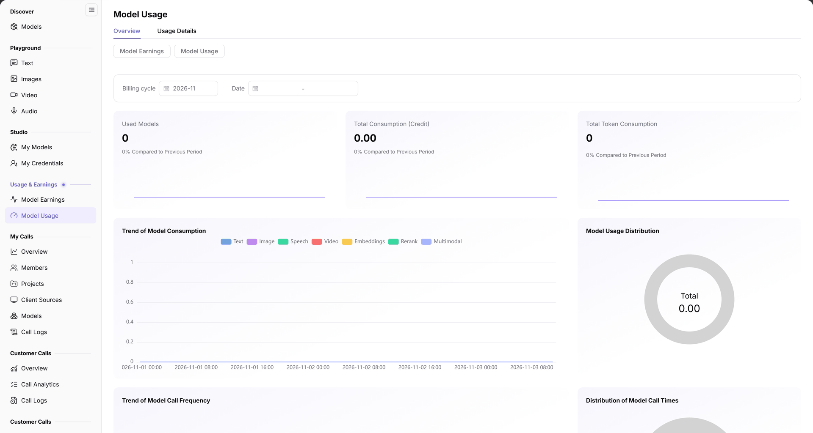

# Model Usage

## 1. Feature Overview

| Item | Content |
| --- | --- |
| Applies to | Model Provider |
| Navigation | **Model Services** > **Usage & Earnings** > **Model Usage** |
| Route | `/modelone/accounting/deduction/overview/model` |
| Managed objects | Model consumption, used model count, total credits, and tokens |

**New to this page**: Model Usage is the consumption ledger for publishers. Select a billing cycle, read how many models were used and how many credits and tokens were consumed, then use trends and distribution to find where consumption concentrates.

## 2. Prerequisites

1. Your account can open **Usage & Earnings > Model Usage**.
2. Model calls or billing records exist.
3. The billing cycle and date range are confirmed.

## 3. Page Description

The page shows the `Model Usage` title and two tabs, `Overview` and `Usage Details`; below the tabs, `Model Earnings` and `Model Usage` provide quick switching, and the left menu also lists both.

`Overview` contains:

- Filters: `Billing cycle` and `Date`.
- KPI cards: `Number of Models Used`, `Total Consumption (Credits)`, and `Total Token Consumption`; each card shows `Compared to Last Period`.
- Charts: `Model Consumption Trend`, `Model Usage Distribution` (`Total`), `Trend of Model Call Frequency`, and `Distribution of Model Call Times`.

**Figure note**: The page provides `Overview` and `Usage Details` tabs; KPI cards show `Number of Models Used`, `Total Consumption (Credits)`, and `Total Token Consumption`, each with `Compared to Last Period`; the chart area includes `Model Consumption Trend`, `Model Usage Distribution`, `Trend of Model Call Frequency`, and `Distribution of Model Call Times`.

## 4. Main Operations

### 4.1 Read the consumption overview

1. Open **Usage & Earnings > Model Usage**; `Overview` is selected by default.
2. Choose `Billing cycle` and `Date`.
3. Read `Number of Models Used`, `Total Consumption (Credits)`, `Total Token Consumption`, and their `Compared to Last Period` values.
4. Review consumption trends and model usage distribution.

### 4.2 Open usage details

1. Click the `Usage Details` tab.
2. Review details for the selected billing cycle and date.

### 4.3 Switch to model earnings

1. In the left `Usage & Earnings` group, click `Model Earnings`.
2. Or continue from the earnings overview after switching.

## 5. Parameter Quick Reference

| Field | Required | Type | Example | Description |
| --- | --- | --- | --- | --- |
| Billing cycle | Yes | Selector | `2026-11` | Billing period |
| Date | No | Date range | `2026-11-01` to `2026-11-03` | Statistics date range |
| Number of Models Used | System | Number | `0` | Models that generated consumption |
| Total Consumption (Credits) | System | Amount | `0.00` | Total credits consumed |
| Total Token Consumption | System | Number | `0` | Combined input and output tokens |
| Compared to Last Period | System | Percentage | `0%` | Change versus the previous period |
| Model Consumption Trend | System | Chart | — | Consumption over time |
| Model Usage Distribution | System | Chart | — | Consumption share by model |
| Trend of Model Call Frequency | System | Chart | — | Call count over time |
| Distribution of Model Call Times | System | Chart | — | Call share by model |

## 6. Pitfalls

- KPI cards show both the current value and `Compared to Last Period`; confirm the billing cycle and date range before reading trends.
- With no consumption data in the test environment, metrics show `0` or `0.00` and charts are empty; this does not mean the page is unavailable.
- `Model Usage` and `Model Earnings` are separate menu pages for consumption and revenue; do not mix their figures.

## 7. Result Validation

| Check | What you can see |
| --- | --- |
| Tabs switch | `Overview` and `Usage Details` switch normally |
| Period applied | KPI cards and charts follow `Billing cycle` and `Date` |
| Metrics complete | `Number of Models Used`, `Total Consumption (Credits)`, `Total Token Consumption` are shown |
| Charts complete | Consumption trend, usage distribution, and call frequency charts are shown |

## 8. FAQ

#### All metrics are 0

**Symptom**: Used model count, total consumption, and token total are `0`.

**Resolution**: Confirm the current billing cycle has model calls and billing records, or switch to a cycle with data.

#### Charts are empty

**Symptom**: Trend and distribution charts show no data.

**Resolution**: Check the billing cycle, date range, and model scope; widen the date range if the current scope has no data.

## 9. Notes

- Consumption is aggregated by billing cycle; align periods before comparing.
- The page shows summaries and trends, not reconciliation; use the billing and settlement pages for reconciliation.
- Do not screenshot or share customer names, amounts, or call details.

## 10. Next Steps

- Review revenue and tenant consumption rankings in [Model Earnings](../model-earnings/).
- Review your own consumption in [My Calls](../../my-calls/overview/).
- Adjust billing and rate limits in [My Models](../../studio/my-models/).
