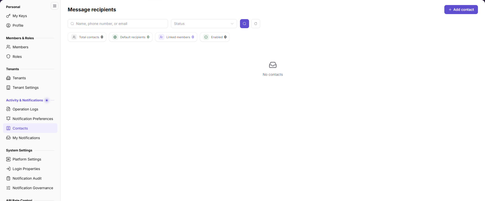

# Contacts

::: info Document Information
Version: v2.0
Updated: 2026-11-04
:::

## Feature Overview

| Item | Content |
| --- | --- |
| Applicable Role | Operator |
| Navigation path | Settings > Activity & Notifications > Contacts |
| Page route | `/user/user-space/notification/contacts` |
| Managed objects | Contact name, position, phone number, email, linked platform user, tenant general contact, status, and update time |

#### Beginner Explanation

Contacts is the tenant's notification recipient list. A tenant general contact becomes the default recipient, while business owners can be contacts for specific business areas.

#### Terms Quick Reference

| Term | Description |
| --- | --- |
| Contact | The name and contact details of a notification recipient. |
| Tenant general contact | The default recipient for tenant notifications. |
| Linked platform user | The platform account linked to the contact. |
| Business owner | A contact responsible for a specific business area. |

## Prerequisites

1. The current account can open `Settings > Activity & Notifications > Contacts`.
2. You have authorization to use the contact information before adding or changing a contact.
3. You have confirmed which notifications the contact should receive.

## Page Description

The page provides contact search, status filtering, contact creation, and a contact list.

| Area | Description |
| --- | --- |
| Search | Search by name, phone number, or email. |
| Status | Filter enabled or disabled contacts. |
| Add contact | Opens the contact creation form. |
| List | Shows contact, phone number, email, linked platform user, status, update time, and actions. |

## Main Operations

### View Contacts

1. Go to `Settings > Activity & Notifications > Contacts`.
2. Search by name, phone number, or email, or filter by status.
3. Review the phone number, email, linked platform user, and status.
4. Click `Reset` to clear the filters.

### Add a Contact

1. Click `Add contact`.
2. Enter `Name`, `Position`, `Phone number`, and `Email`, then select a `Linked platform user`.
3. Enable `Tenant general contact` when the contact should be the default recipient for tenant notifications.
4. Review the contact details before clicking `Save`. For read-only inspection, click `Cancel` without submitting.

### Edit a Contact

1. Locate the target contact in the list.
2. Click `Edit`.
3. Change the contact details, linked platform user, or tenant general contact setting.
4. After saving, return to the list and verify the update time and status.

## Parameter Quick Reference

| Field Name | Required | Field Type | Example | Description |
| --- | --- | --- | --- | --- |
| Name | Yes | Text | `Example Contact` | The display name of the contact. |
| Position | No | Enum | Business Owner | The contact's role in the business. |
| Phone number | No | Text | `188****8888` | Used for notification or contact. |
| Email | No | Text | `user@example.com` | Used for email notifications. |
| Linked platform user | No | Select | `Example User` | The linked platform account. |
| Tenant general contact | No | Switch | Enabled | Makes the contact the default recipient for tenant notifications. |

## Pitfalls

- A tenant general contact affects the default recipient scope. Confirm the impact before enabling it.
- Invalid phone numbers or email addresses prevent notification delivery.
- Duplicate contacts can cause duplicate notifications or unclear ownership.
- Do not write real names, phone numbers, email addresses, tenant IDs, or platform accounts into documentation or screenshots.

## Result Validation

| Check Item | Success Signal | If Abnormal |
| --- | --- | --- |
| Contact search | The list refreshes by name, phone number, or email. | Check the keyword and filters. |
| Add contact | The new contact appears in the list after saving. | Check required fields, format, and the save message. |
| Edit contact | The list shows the updated details and status. | Refresh the page and confirm the save result. |
| Tenant general contact | The target contact is marked as the general contact. | Check the switch state and save result. |

## FAQ

#### The contact does not receive notifications

**Symptom:**

A contact is configured but receives no email or in-app notification.

**Possible cause:**

The contact is disabled, the email format is invalid, the tenant general contact is not enabled, or the notification type and channel are disabled.

**Resolution:**

Check the contact status and email address, then review Notification Preferences and Notification Audit.

#### Why can't I add a contact?

**Symptom:**

The `Add contact` entry is unavailable or saving fails.

**Possible cause:**

The current account lacks contact-management permission, or required fields or contact formats are invalid.

**Resolution:**

Confirm the account permission and required fields. If it still fails, contact the tenant administrator.

## Notes

- Contact information is sensitive. Use it only within the authorized scope.
- Changing the tenant general contact affects the default notification recipient scope.
- Do not write real names, phone numbers, email addresses, tenant IDs, or platform accounts.

## Next Steps

1. To configure notification delivery, go to [Notification Preferences](../notification-settings/).
2. To review delivery results, go to [Notification Audit](../../system-settings/notification-center/).
