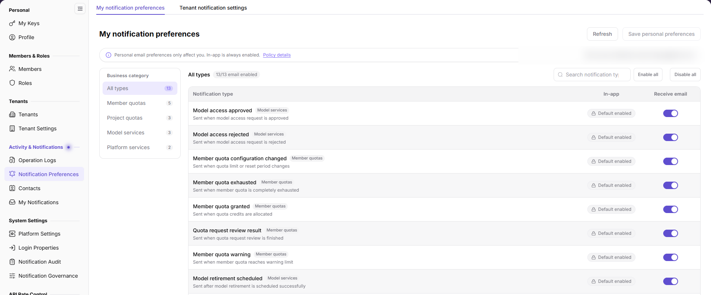

# Notification Preferences

## Feature Overview

| Item | Content |
| --- | --- |
| Applicable Role | Operator |
| Navigation path | Settings > Activity & Notifications > Notification Preferences |
| Page route | `/user/user-space/notification/receiving` |
| Managed objects | Personal notification preferences, tenant notification settings, notification types, channels, and recipients |

#### Beginner Explanation

Notification Preferences has two tabs. My Notification Preferences controls only the current account's email choices. Tenant Notification Settings shows the channels and recipients used for notifications in the tenant. In-app notifications cannot be disabled at the personal level.

#### Terms Quick Reference

| Term | Description |
| --- | --- |
| Personal notification preferences | The current account's email choice for each notification type. |
| In-app notification | A platform notification.; It cannot be disabled at the personal level. |
| Tenant notification settings | The channels and recipients configured for notification types in a tenant. |
| Default recipient | The default recipient used for tenant notifications. |

## Prerequisites

1. The current account can open `Settings > Activity & Notifications > Notification Preferences`.
2. Before changing personal preferences, you have confirmed which notification types should send email.
3. Before changing tenant notification settings, you have confirmed the affected tenant and recipients.

## Page Description

The page contains two tabs:

| Tab | Description |
| --- | --- |
| My notification preferences | Shows in-app and email switches by notification type; in-app cannot be disabled. |
| Tenant notification settings | Shows the business topic, severity, channels, recipients, and Settings entry for each notification type. |

The personal tab provides `Refresh` and `Save personal preferences`. The tenant tab provides notification-name, channel, and severity filters plus business-topic buttons.

## Main Operations

### View Personal Notification Preferences

1. Go to `Settings > Activity & Notifications > Notification Preferences`.
2. Keep the `My notification preferences` tab selected.
3. Review the in-app and email status for each notification type; the in-app switch stays enabled.
4. Click `Refresh` when the page needs reloading.

### Change Personal Email Delivery

1. In `My notification preferences`, locate the target notification type.
2. Toggle `Receive email` for that type.
3. Click `Save personal preferences` after confirming the change.
4. Return to the page and verify the switch state. A disabled save button when nothing has changed is expected.

### View Tenant Notification Settings

1. Switch to the `Tenant notification settings` tab.
2. Filter by notification name, notification channels, or severity.
3. Use business-topic buttons to narrow the list, such as Account & Fund Messages, Product Messages, Security Messages, Anomaly Notifications, Activity Messages, or Service Messages.
4. Review the channels and recipients for each notification type.

### Configure Tenant Notification Delivery

1. In `Tenant notification settings`, locate the target notification type.
2. Click `Settings` on that row.
3. Adjust the channels and recipients provided on the page.
4. Confirm the affected tenant members before saving. For read-only inspection, cancel without submitting changes.

## Parameter Quick Reference

| Field Name | Required | Field Type | Example | Description |
| --- | --- | --- | --- | --- |
| Notification type | System-generated | Text | Account balance low | The business event that triggers the notification. |
| In-app notification | System-fixed | Switch | Enabled | Cannot be disabled at the personal level. |
| Receive email | No | Switch | Enabled | Controls whether the current account receives email for this type. |
| Business topic | System-generated | Enum | Account & Fund Messages | The business category of the notification. |
| Severity | System-generated | Enum | Info | The severity of the notification. |
| Notification channels | System-generated | Multi-select | In-app Notification, Email | The delivery channels used for tenant notifications. |
| Recipients | System-generated | Text | Default recipient | The default recipient of tenant notifications. |

## Pitfalls

- Personal email switches affect only the current account; in-app notifications cannot be disabled personally.
- Actual delivery also depends on platform channel configuration, type enablement, templates, and recipient eligibility.
- Later changes to defaults do not overwrite personal choices that have already been saved.
- Tenant notification settings affect tenant members. Confirm the recipient scope before changing them.
- Do not write real email addresses, phone numbers, tenant IDs, or business data from notifications into documentation or screenshots.

## Result Validation

| Check Item | Success Signal | If Abnormal |
| --- | --- | --- |
| Tab switching | `My notification preferences` and `Tenant notification settings` switch normally. | Refresh the page; if it still fails, check account permission. |
| Personal preference save | The switch state matches the saved choice. | Check for unsaved changes and the page message. |
| Tenant filter | The list refreshes by notification name, channel, or severity. | Clear filters and query again. |
| Settings entry | The target notification type opens `Settings`. | Check the current account's tenant notification permission. |

## FAQ

#### Why is no email notification received?

**Symptom:**

Email delivery is enabled in personal preferences, but no email arrives.

**Possible cause:**

The platform email channel is not configured, the notification type is disabled, the template or recipient eligibility is not satisfied, or the email was marked as spam.

**Resolution:**

Confirm that personal preferences are saved, then check platform notification settings and email settings, and finally review the delivery status in Notification Audit.

#### Why can't the in-app switch be disabled?

**Symptom:**

The in-app switch is disabled.

**Possible cause:**

In-app notifications are designed to be non-disableable at the personal level so that critical notifications remain reachable.

**Resolution:**

Keep in-app notifications enabled. If a notification type should not be sent, ask an administrator to adjust the platform notification configuration.

#### Why is Save Personal Preferences unavailable?

**Symptom:**

The `Save personal preferences` button is disabled when the page opens.

**Possible cause:**

There are no unsaved changes.

**Resolution:**

Change an email switch and check the button again. Do not submit unrelated changes only to enable the button.

## Notes

- Notification settings cover personal preferences and tenant scope. Confirm the affected object before changing them.
- In-app notifications cannot be disabled personally. Do not bypass the page configuration.
- Tenant notification changes affect member delivery. Record the reason for the change.
- Do not write real email addresses, phone numbers, tenant IDs, notification content, or internal business data.

## Next Steps

1. To view personal notifications, go to [My Notifications](../inbox/).
2. To view platform notification types and channels, go to [Notification Governance](../../system-settings/notification-config/).
