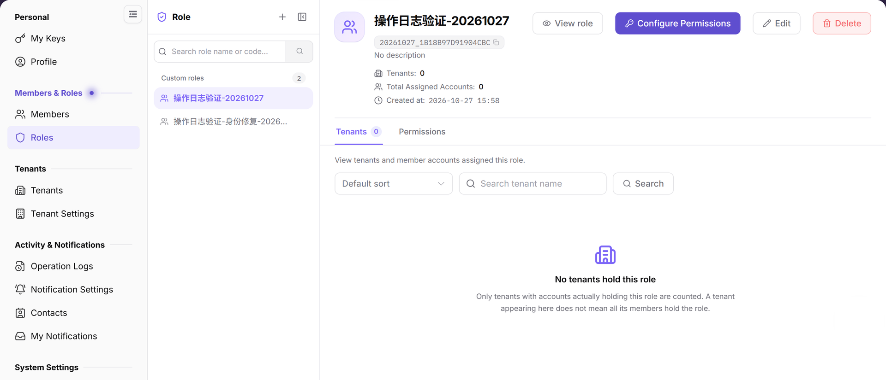
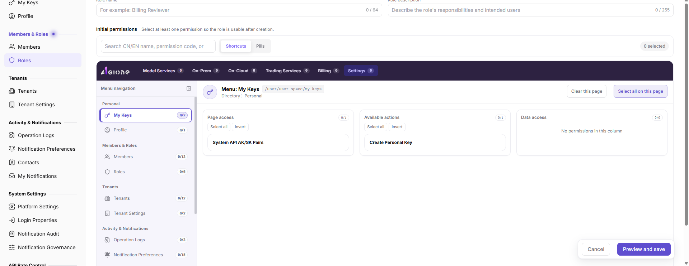

# Roles

## Feature Overview

| Item | Content |
| --- | --- |
| Applicable Role | Operator |
| Navigation path | Settings > Members & Roles > Roles |
| Page route | `/user/user-space/roles` |
| Managed objects | Role names, role codes, descriptions, associated tenant count, assigned account count, and functional permissions |

#### Beginner Explanation

Operator roles are platform-console permission templates. They define which system modules an administrator can view, which settings the administrator can change, and which approvals the administrator can process. They are different from project collaboration roles.

#### Terms Quick Reference

| Term | Description |
| --- | --- |
| Platform role | A set of operator-administration permissions.; Separate roles by responsibility. |
| Role code | A stable identifier for the role.; Changing it after it is referenced can affect permission identification and auditing. |
| Configure Permissions | Select the services, menus, and actions available to a role.; Changes affect the scope visible to members. |
| Associated tenants | Tenants and member accounts that actually hold the role.; Review them before deletion. |
| Features & Permissions | The tab that shows the role's current functional scope and permission details. |

## Prerequisites

1. The current account has permission to manage roles.
2. You have opened `Settings > Members & Roles > Roles`.
3. Before configuring permissions or deleting a role, you have confirmed the affected members and tenants.

## Page Description

The left side is the role list, and the right side shows the selected role details.

The role list and details show the role code, associated tenant count, assigned account count, and the View Role/Configure Permissions/Edit/Delete entries.

| Area | Description |
| --- | --- |
| Role list | Search by role name or code; shows the custom role count. |
| Add Role | Opens the role creation flow. |
| Role details | Shows the role name, role code, associated tenant count, assigned account count, and creation time. |
| Action buttons | `View Role`, `Configure Permissions`, `Edit`, and `Delete`. |
| Tabs | `Associated Tenants` shows tenants and member accounts that hold the role; `Features & Permissions` shows the permission scope. |

## Main Operations

### View Roles

1. Go to `Settings > Members & Roles > Roles`.
2. Search the left list by role name or code, then select the target role.
3. Review the role name, role code, associated tenant count, assigned account count, and creation time on the right.
4. Switch between `Associated Tenants` and `Features & Permissions` to confirm the role's actual usage and permission boundary.

### Add a Role

1. Click **"Add Role"** in the upper-right corner.
2. In the role creation form, enter `Role name`, the required `Role code`, and an optional `Role description`.

The Add Role form contains role name, role code, role description, and initial permissions. Confirm the least-privilege scope before creating.
3. Before clicking `Confirm`, verify that the name, code, and intended permission scope follow the least-privilege principle.
4. For learning or screenshots only, review the fields and click `Cancel` without submitting a real role configuration.

### Edit a Role

1. Select the target role in the left list.
2. Click **"Edit"** in the details area.
3. Change the role name or description where allowed, then save after confirming the impact.
4. Return to the role details and verify the name, description, and creation time.

### Configure Permissions

1. Select the target role in the left list.
2. Click **"Configure Permissions"** in the details area.
3. Select permissions from the services, menus, and actions provided on the page, and confirm the selected permission count and impact.
4. Review the permission changes before saving. For read-only inspection, use `Cancel` and do not submit changes.
5. After saving, return to the role details and verify the result in the `Features & Permissions` tab.

### Delete a Role

1. Use the `Associated Tenants` tab to confirm that no member or tenant still uses the role.
2. Click **"Delete"** in the details area.
3. In the confirmation dialog, verify the role name and impact, then delete it.
4. Confirm that the role disappears from the left list and that member menus and actions behave as expected.

## Parameter Quick Reference

| Field Name | Required | Field Type | Example | Description |
| --- | --- | --- | --- | --- |
| Role name | Yes | Text | `Audit Admin` | The display name of the operator role. |
| Role code | Yes | Text | `audit_admin` | The unique role identifier. Use a stable, readable code that is easy to audit. |
| Role description | No | Text | `View audit logs and basic operator information` | Describes the role purpose and permission boundary. |
| Permission items | Yes | Multi-select | `View Operation Logs` | Controls the services, menus, and actions available to the role. |
| Associated tenant count | System-generated | Number | `0` | Shows how many tenants hold the role. |
| Assigned account count | System-generated | Number | `0` | Shows how many accounts are assigned the role. |
| Actions | System-generated | Button | `View Role / Configure Permissions / Edit / Delete` | Provides role maintenance entry points. |

## Pitfalls

- Do not change a high-privilege role directly. Create or copy a low-risk role first to validate the permission scope.
- Before deleting a role, confirm that no member or tenant still uses it; use the `Associated Tenants` tab as the reference.
- Permission changes affect platform-level entry points. Record the reason and approval basis.
- Adding a role creates a new platform permission template. Later permission configuration and member binding can affect platform administration.
- `Confirm` is the final submit action. For learning or screenshots, only view the fields and use `Cancel`.
- Once `Role code` is referenced, later changes may affect permission identification, auditing, and automation configuration.
- Do not write real internal role codes, accounts, member IDs, customer names, or internal test data.

## Result Validation

| Check Item | Success Signal | If Abnormal |
| --- | --- | --- |
| Role search | The left list refreshes by role name or code. | Check that the name or code is correct. |
| Role details | The right side shows the role name, code, associated tenant count, and creation time. | Reselect the role; if still empty, check role-management permission. |
| Add role | Clicking `Add Role` opens the creation form. | Check whether the current account can create roles. |
| Configure permissions | The target role opens the permission configuration page. | Check the current account's role-management permission. |
| Delete entry | Delete is displayed according to permission. | Confirm that no member or tenant depends on the role before deletion. |

## FAQ

#### A member cannot see a menu

**Symptom:**

A member cannot see a menu or button after signing in.

**Possible cause:**

The role assigned to the member does not include the required menu or action permission.

**Resolution:**

Open the role's `Configure Permissions` entry to review the permission scope, then confirm that the member is assigned to the correct role.

#### Can a role be deleted directly?

**Symptom:**

The role details provide a Delete action.

**Possible cause:**

The role may still be assigned to members or tenants, and deleting it can remove their access.

**Resolution:**

Use the `Associated Tenants` tab to confirm the role usage scope, then follow the permission-change process.

#### Why is the operator role list empty?

**Symptom:**

The page does not show platform administrator, auditor, or configuration administrator roles.

**Possible cause:**

The current account lacks operator role-management permission, the roles belong to another administration tenant, or system roles cannot be edited in the list.

**Resolution:**

Confirm that you are using operator-side Settings and verify the role-management permission. Ask a super administrator to check abnormal built-in roles.

## Notes

- Permission configuration changes affect menu visibility and button availability.
- Before deleting a role, confirm that no critical member or tenant depends on it.
- `Confirm` is the final submit action. Before adding a role, verify the role name, role code, and intended permission scope.
- Once `Role code` is referenced, later changes may affect permission identification, auditing, and automation configuration.
- For learning or screenshots only, open the form to view fields and use `Cancel`.
- Do not write real internal role codes, accounts, member IDs, customer names, or internal test data.

## Next Steps

1. To view members assigned to roles, go to [Members](../members/).
2. To trace permission changes, go to [Operation Logs](../../activity-notifications/operation-logs/).
