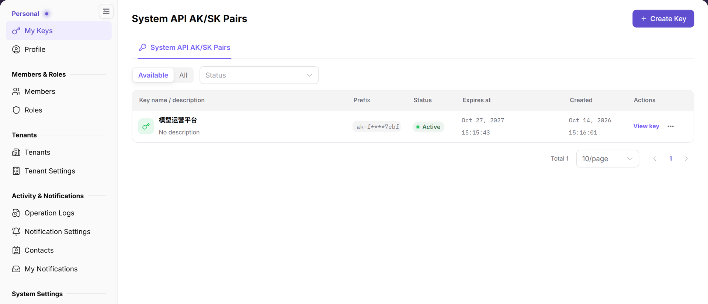
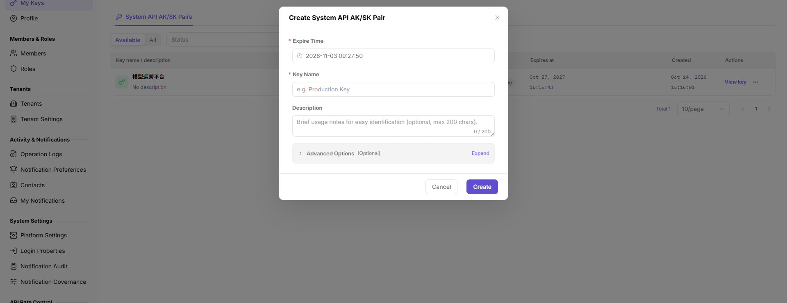

# My Keys

::: info Document Information
Version: v2.1
Updated: 2026-11-12
:::

## Feature Overview

| Item | Content |
| --- | --- |
| Applicable Role | Operator Account |
| Navigation path | Settings > Personal > My Keys |
| Page route | `/user/user-space/my-keys/system` |
| Managed objects | System API AK/SK Pairs, status, expiration, and creation records |

#### Beginner Explanation

An AK/SK pair is a system API credential for controlled administrative or automation calls. Treat it as a high-sensitivity credential: define its purpose, set an appropriate expiration time, store the generated values only through the approved security process, and never place the complete pair in documentation.

#### Terms Quick Reference

| Term | Description |
| --- | --- |
| System API AK/SK Pair | A system API access identifier and secret pair. Use it only for the intended system integration. |
| Prefix | The non-secret identifier shown in the list. Use it to recognize a credential; it is not the complete secret. |
| Expiration | The time after which the pair is no longer valid. Replace the pair before an automation reaches this time. |
| Status | The current availability state of the pair. Check it before troubleshooting a failed call. |

## Prerequisites

1. The current account has permission to view and create System API credentials.
2. You have opened `Settings > Personal > My Keys` from the Operator menu.
3. Before creating a pair, you have confirmed its caller, purpose, expiration plan, and secure handoff method.

## Page Description

The current Operator page exposes the `System API AK/SK Pairs` tab only. It does not expose a `Model API Keys` tab in this role.

The figure shows the System API AK/SK list with `Key name / description`, `Prefix`, `Status`, `Expires at`, `Created`, and `Actions`. This review does not open secret values.

| Area | Description |
| --- | --- |
| Top button | `+ Create Key` opens the `Create System API AK/SK Pair` dialog. |
| Type tab | `System API AK/SK Pairs` is the visible Operator tab. |
| Availability | `Available` and `All` switch the list scope. |
| Status | Filters the list by credential status. |
| Credential list | Shows `Key name / description`, `Prefix`, `Status`, `Expires at`, `Created`, and `Actions`. |
| Empty state | When no pair exists, the page shows `No keys yet` and instructs the operator to click **"+ Create Key"**. |

## Main Operations

### View System API Keys

1. Go to `Settings > Personal > My Keys`.
2. Confirm that the `System API AK/SK Pairs` tab is selected.
3. Use `Available` or `All` and the `Status` selector to review the list.
4. Check `Key name / description`, `Prefix`, `Status`, `Expires at`, `Created`, and `Actions`. Do not open secret values during this review.

### Open the System API Key Creation Dialog

1. Click **"+ Create Key"** in the upper-right corner.
2. In `Create System API AK/SK Pair`, check `Expire Time` (default: `1 year`), the required `Key Name`, and optional `Description` (up to 200 characters).
3. Click `Expand` under `Advanced Options` (`(Optional)`) to inspect `Enable IP Whitelist` and its explanation. It is disabled by default, with no IP restrictions; when enabled, only specified IP addresses or CIDR blocks can access this API Key. Do not enable it during this review.
4. Click **"Cancel"** to close the dialog. Do not click `Create` or generate a real credential.

The figure shows the `Create System API AK/SK Pair` dialog with `Expire Time`, `Key Name`, and `Description`. This flow reviews the form without submitting `Create`.

## Parameter Quick Reference

| Field Name | Required | Field Type | Example | Description |
| --- | --- | --- | --- | --- |
| Expire Time | Yes | Date time | `2026-12-31 23:59` | Defines when the System API AK/SK Pair expires; the form defaults to `1 year`. |
| Key Name | Yes | Text | `Backend job credential` | Identifies the purpose of the pair. |
| Description | No | Text | `Model service administration` | Optional usage notes, up to 200 characters. |
| Advanced Options | No | Expandable area | `Expand` / `Collapse` | Marked `(Optional)`; reveals the IP whitelist switch and its explanation. |
| Enable IP Whitelist | No | Switch | Disabled by default | The page explanation states that there are no IP restrictions by default; when enabled, only specified IP addresses or CIDR blocks can access this API Key. Do not enable it during this review. |
| Prefix | System generated | Text | `<ACCESS_KEY_ID>` | A masked identifier shown in the list; it is not the complete credential. |
| Status | System generated | Enum | `Enabled` | Indicates whether the pair is currently available. |
| Created | System generated | Date time | `2026-08-26` | The list column for the pair creation record. |
| Actions | System generated | Button / menu | `Actions` | Lists available row actions; this review does not open secret values. |

## Pitfalls

- The current Operator page does not expose a `Model API Keys` tab. Do not use this Operator page as evidence for Provider or End User Model API Key behavior.
- The base fields are followed by `Advanced Options` (`(Optional)`). `Enable IP Whitelist` is disabled by default; this review only reads its IP-address or CIDR-block explanation. Do not enable it, submit the form, or add unobserved permission-scope, quota, reset-cycle, or warning-threshold fields.
- `Create` is the final high-risk action. Do not click it during learning, screenshots, or page validation.
- Never copy a complete AK/SK pair, token, account, endpoint, or secret into documentation, screenshots, tickets, or examples.
- A prefix is only an identifier; it is not the complete credential.

## Result Validation

| Check Item | Success Signal | If Abnormal |
| --- | --- | --- |
| Operator entry | `Settings > Personal > My Keys` opens the page. | Confirm the current role and visible menu; do not infer behavior from another role. |
| Type tab | `System API AK/SK Pairs` is visible. | Confirm that this is the Operator page. |
| List columns | `Key name / description`, `Prefix`, `Status`, `Expires at`, `Created`, and `Actions` are visible. | Check the current headers without opening secret values. |
| Base form | The dialog shows `Expire Time`, `Key Name`, and `Description`; expiration defaults to `1 year` and the description counter is `0 / 200`. | Review labels and prompts without submitting `Create`. |
| Optional area | Expanding `Advanced Options` reveals `Enable IP Whitelist`, disabled by default, and an IP-address or CIDR-block explanation. | Confirm that the optional area is expanded; do not enable the switch. |
| Safe exit | `Cancel` closes the dialog; this flow does not click `Create` or open secret values. | Stop the review and ask an administrator to verify the environment. |

## FAQ

#### Why is the Model API Keys tab missing?

**Symptom:**

Only `System API AK/SK Pairs` is shown on the current page.

**Possible Causes:**

This check covers the Operator page; the observed tab does not include `Model API Keys`.

**Resolution:**

Confirm the current role and page. Check other roles on their own pages rather than inferring their Key behavior here.

#### How can the optional IP whitelist settings be inspected?

**Symptom:**

`Advanced Options` (`(Optional)`) appears below the base fields.

**Possible Causes:**

The whitelist is in the optional advanced area; `Enable IP Whitelist` is disabled by default.

**Resolution:**

Click `Expand` to read the IP-address or CIDR-block explanation without enabling the switch. Click `Cancel` to close the dialog; do not submit `Create`.

## Notes

- Never copy, paste, or capture a complete AK/SK pair, token, or secret.
- Do not include real credentials, accounts, endpoints, customer names, IDs, or internal test values in documentation, screenshots, tickets, or examples.
- `Create` is a final high-risk action.
- Before rotating or disabling a credential, confirm that its callers have completed the switch.

## Next Steps

1. Click `Cancel` to return to the list; do not submit `Create` or enable the IP whitelist.
2. To review account details, go to [Profile](../profile/).
3. To review member permissions, go to [Members](../../members-roles/members/).
