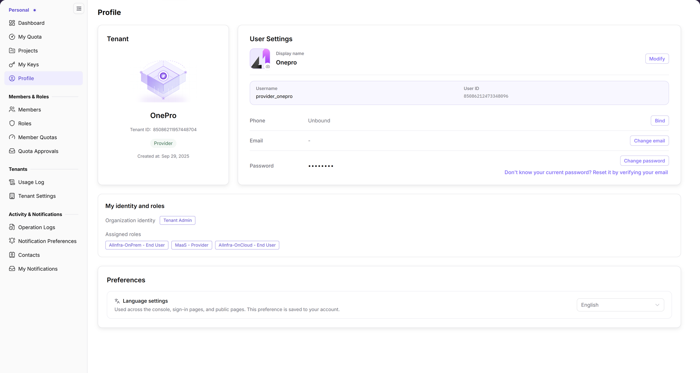
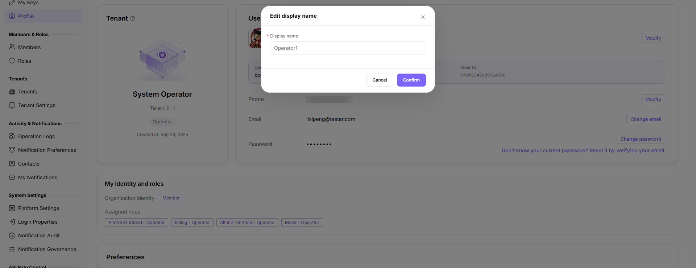

# Profile

::: info Document Information
Version: v2.0
Updated: 2026-11-04
:::

## Feature Overview

| Item | Content |
| --- | --- |
| Applicable Role | Operator |
| Navigation path | Settings > Personal > Profile |
| Page route | `/user/user-space/profile` |
| Managed objects | Tenant information, user settings, contact details, password status, identity roles, and language preference |

#### Beginner Explanation

Profile is the identity card for a platform administrator. It shows the administrator's tenant, sign-in identity, contact details, role scope, and interface language. It is not a user-side tenant profile.

#### Terms Quick Reference

| Term | Description |
| --- | --- |
| Tenant | The business and billing entity that owns the account. The page shows the tenant name, tenant ID, business identity, and creation time. |
| Display name | The administrator name shown on the page. Use `Edit` next to it to change it. |
| Username | The sign-in identifier. It is usually read-only; use the account-management process for changes. |
| Identity source | The local or unified identity source that owns the account. Check it when a field cannot be edited. |
| Preferences | The interface language used by the current account. The selection is saved to the account. |

## Prerequisites

1. The current account is signed in.
2. You have opened `Settings > Personal > Profile`.
3. Before changing contact details or the password, you have confirmed the current account and impact.

## Page Description

The page shows the current account in four areas: Tenant, User Settings, My Identity and Roles, and Preferences.

Profile is grouped into Tenant, User Settings, My Identity and Roles, and Preferences. Phone, email, and password are changed through their own entries.

| Area | Description |
| --- | --- |
| Tenant | Shows the tenant name, tenant ID, business identity, and creation time. |
| User Settings | Shows the avatar, display name, username, user ID, phone number, email address, and password status. |
| My Identity and Roles | Shows the organization identity and assigned roles. |
| Preferences | Sets the interface language for the current account. |

User Settings provides `Change Avatar`, `Edit` next to the display name, `Edit` next to the phone number, `Change Email`, `Change Password`, and `Forgot the old password? Reset via email verification`.

## Main Operations

### View Account Information

1. Go to `Settings > Personal > Profile`.
2. Review the tenant name, tenant ID, business identity, and creation time.
3. Review the display name, username, user ID, phone number, email address, and password status.
4. In My Identity and Roles, confirm that the organization identity and assigned roles match the current responsibility.
5. Hide email addresses, phone numbers, and user IDs before taking or sharing screenshots.

### Change the Display Name

1. In User Settings, locate the display name.
2. Click `Edit` next to the display name.

The edit dialog allows changes to the display name and other editable fields. Protected fields such as username and user ID remain read-only.
3. Enter the new display name in the window, confirm the impact, and save.
4. Return to Profile and verify the new display name. If it does not change, refresh the page or sign in again.

### Change the Phone Number

1. In User Settings, locate the phone number.
2. Click `Edit` next to the phone number.
3. Complete verification, enter the new phone number, and save.
4. Return to Profile and verify the displayed phone number.

### Change the Email Address

1. In User Settings, locate the email address.
2. Click `Change Email`.
3. Complete email verification and submit the new address.
4. Return to Profile and verify the email address. If it does not change, check the verification email and account status.

### Change the Password

1. In User Settings, locate the password status.
2. Click `Change Password`.
3. Enter the current password and the new password, then submit.
4. If you do not know the old password, use `Forgot the old password? Reset via email verification`.
5. Sign in again with the new password to confirm it works.

### Change the Interface Language

1. Open the Preferences area.
2. Select the target language in `Language Settings`.
3. Confirm that the console, sign-in page, and promotional pages use the selected language.
4. The selection is saved to the current account and does not change other accounts.

## Parameter Quick Reference

| Field Name | Required | Field Type | Example | Description |
| --- | --- | --- | --- | --- |
| Display name | Yes | Text | `Example Admin` | The name shown on the page; use `Edit` to change it. |
| Username | System-generated | Text | `operator` | The sign-in identifier; usually read-only. |
| User ID | System-generated | Text | `Example User ID` | The system identifier of the account. |
| Phone number | No | Text | `188****8888` | Used for contact, notifications, or security verification. |
| Email address | System-generated | Text | `user@example.com` | The bound email address; use `Change Email` to update it. |
| Password | System-generated | Password | `******` | Shows password status; use `Change Password` to update it. |
| Language Settings | Yes | Enum | `English` | The interface language used by the current account. |

## Pitfalls

- Operator account fields may be synchronized from a unified identity source. A read-only field does not necessarily mean the page is broken.
- When troubleshooting sign-in, check Login Properties, the identity source, and account status together.
- Do not expose administrator email addresses, phone numbers, user IDs, sign-in IP addresses, or security details in screenshots.
- `Edit`, `Change Email`, and `Change Password` change real account information. Confirm the impact before using them.
- After changing the email address or password, complete the verification step; the old value may remain active until verification succeeds.
- Do not write real phone numbers, email addresses, user IDs, account names, customer names, or internal test data into documentation.

## Result Validation

| Check Item | Success Signal | If Abnormal |
| --- | --- | --- |
| Information display | Tenant, User Settings, identity roles, and Preferences are visible. | Refresh the page or sign in again. |
| Account identity | The displayed account matches the current operator. | Sign out and confirm the signed-in account. |
| Display name change | The new display name appears after saving. | Check required fields, format, and the save message. |
| Email change | The new email address appears after verification. | Check the verification email, code, and account status. |
| Password change | The new password can be used to sign in. | Check the old password, password rules, and verification flow. |
| Language change | The console, sign-in page, and promotional pages use the target language. | Refresh the page; if it still does not change, sign in again. |

## FAQ

#### The security contact information is incorrect

**Symptom:**

The displayed phone number or email address differs from the expected value.

**Possible cause:**

The account profile was not updated, verification was not completed, or the signed-in account is not the target account.

**Resolution:**

Confirm the signed-in account, then use `Edit` next to the phone number, `Change Email`, or the email verification flow to update it.

#### Why is some operator profile information missing?

**Symptom:**

The operator Profile page lacks security information, sign-in details, or contact information.

**Possible cause:**

Operator profile data is synchronized from a unified identity source, sensitive fields are hidden by permission, or the account profile has not been initialized.

**Resolution:**

Confirm the account source and synchronization status. Complete editable fields through the platform account process. Ask a platform administrator to check missing sensitive fields.

#### Why can't I edit some operator profile fields?

**Symptom:**

The operator profile is visible, but the contact details, username, or identity roles cannot be changed.

**Possible cause:**

The operator account is managed by a unified identity source, sensitive fields require administrator approval, or the current sign-in method does not support self-service changes.

**Resolution:**

Follow the platform account-management process. Maintain identity-source fields in the unified identity platform, then sign in again to confirm synchronization.

## Notes

- Profile information may contain phone numbers, email addresses, and user IDs.
- Do not send full profile screenshots to external communication channels.
- `Edit`, `Change Email`, and `Change Password` change real account information. Confirm the impact before using them.
- Usernames, user IDs, and identity roles are usually managed by the identity source; do not repeatedly attempt to change them here.
- Do not write real phone numbers, email addresses, user IDs, account names, customer names, or internal test data into documentation.

## Next Steps

1. To manage personal Keys, go to [My Keys](../my-keys/).
2. To manage members, go to [Members](../../members-roles/members/).
