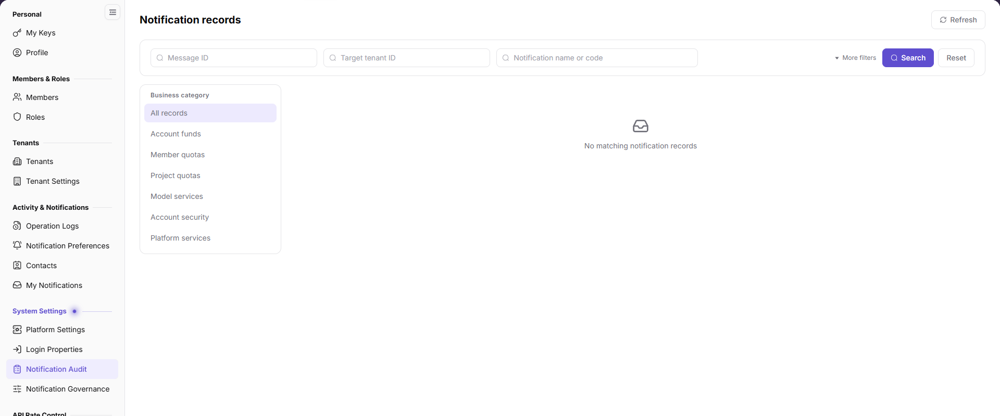

# Notification Audit

## Feature Overview

| Item | Content |
| --- | --- |
| Applicable Role | Operator |
| Navigation path | Settings > System Settings > Notification Audit |
| Page route | `/user/system/notification/center` |
| Managed objects | Notification name, business topic, target tenant, source service, delivery channels, dispatch status, and trigger time |

#### Beginner Explanation

Notification Audit is the platform delivery ledger. Use it to check whether a notification was generated, which tenant received it, which channels were used, and the final status. It does not replace the live state of the business page.

#### Terms Quick Reference

| Term | Description |
| --- | --- |
| Message ID | The unique identifier of a notification message. |
| Target tenant | The tenant that received the notification. |
| Source service | The backend service that generated the notification. |
| Delivery channels | In-app, email, and other delivery channels. |
| Dispatch status | The final delivery status. |

## Prerequisites

1. The current account can open `Settings > System Settings > Notification Audit`.
2. Before troubleshooting, you have the notification name, target tenant, or approximate trigger time.

## Page Description

The page provides Message ID, target tenant ID, notification name/code, more filters, and business-topic filters.

| Area | Description |
| --- | --- |
| Search | Query by Message ID, target tenant ID, or notification name/code. |
| More filters | Expand additional filter conditions. |
| Business topic | All records, Account & Fund Messages, Product Messages, Security Messages, Anomaly Notifications, Activity Messages, Service Messages. |
| List | Shows notification, business topic, target tenant, source service, delivery channels, dispatch status, trigger time, and actions. |

## Main Operations

### Query Notification Records

1. Go to `Settings > System Settings > Notification Audit`.
2. Enter a Message ID, target tenant ID, or notification name/code.
3. Expand `More filters` when needed and select a business topic.
4. Click `Search`; click `Reset` to clear conditions.

### View Notification Record Details

1. Locate the target record in the list.
2. Click `Details`.
3. Review the notification content, target tenant, source service, channels, dispatch status, and trigger time.
4. For further troubleshooting, compare Notification Governance, Contacts, and the business module state.

## Parameter Quick Reference

| Field Name | Required | Field Type | Example | Description |
| --- | --- | --- | --- | --- |
| Notification | System-generated | Text | Platform update completed | Notification name. |
| Business topic | System-generated | Enum | Service Messages | Notification category. |
| Target tenant | System-generated | Text | `Example Tenant` | Tenant that received the notification. |
| Source service | System-generated | Text | `Example Service` | Backend service that generated it. |
| Delivery channels | System-generated | Multi-select | In-app, Email | Channels used for delivery. |
| Dispatch status | System-generated | Enum | Completed | Delivery result. |
| Trigger time | System-generated | Date time | 2026-10-28 17:34:38 | When the notification was triggered. |

## Pitfalls

- The target tenant ID must match exactly; partial names may not return records.
- Records show delivery results, not whether business data is still consistent.
- The same notification may appear in multiple records for different channels; check the Message ID and channel together.
- Records may contain tenants, accounts, and business data. Redact before screenshots or external sharing.

## Result Validation

| Check Item | Success Signal | If Abnormal |
| --- | --- | --- |
| Search | The list refreshes by Message ID, tenant, or notification name. | Check the condition format and combined filters. |
| Business topic | The list matches the selected topic. | Clear other filters and retry. |
| Details | Clicking `Details` shows delivery information. | Refresh the page; if it still fails, check permission. |
| Pagination | Historical records can be paged. | Narrow the time or condition range. |

## FAQ

#### Why can't I find a notification record?

**Symptom:**

No expected record appears by notification name or tenant.

**Possible cause:**

The notification was not triggered, the target tenant ID does not match, the filters are too narrow, or the record exceeded retention.

**Resolution:**

Clear filters and query by Message ID or exact tenant ID. If it is still missing, check Notification Settings and the source service.

#### What should I do when the dispatch status is failed?

**Symptom:**

The record shows a failed or incomplete delivery.

**Possible cause:**

The channel is not configured, the contact is missing, recipient eligibility is not met, or an external service is abnormal.

**Resolution:**

Check Notification Governance, Contacts, and channel status. Contact a platform administrator when needed.

## Notes

- Notification Records is audit data. Do not modify or forge records.
- Redact tenants, accounts, and business content before sharing.
- Do not use records as a substitute for the live business state.

## Next Steps

1. To check notification types and channels, go to [Notification Governance](../notification-config/).
2. To check contacts, go to [Contacts](../../activity-notifications/contacts/).
