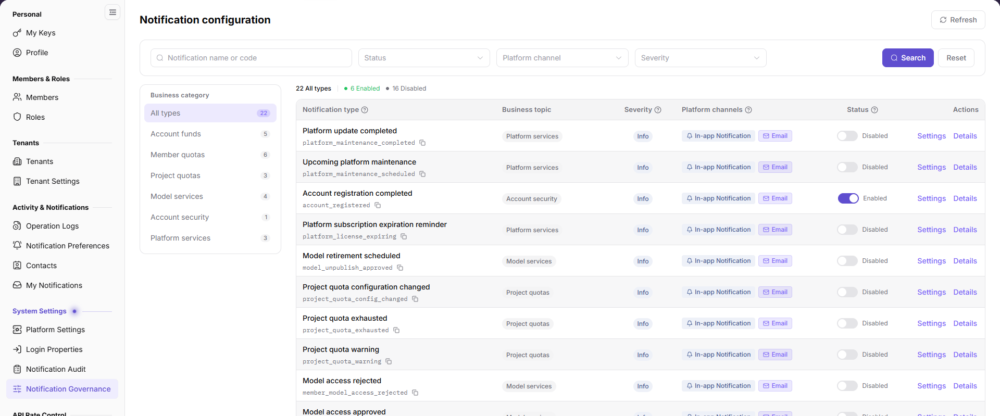

# Notification Governance

## Feature Overview

| Item | Content |
| --- | --- |
| Applicable Role | Operator |
| Navigation path | Settings > System Settings > Notification Governance |
| Page route | `/user/system/notification/business-config` |
| Managed objects | Notification types, type codes, business topics, severity, platform channels, enable status, and tenant channel policy |

#### Beginner Explanation

Notification Settings defines which notification types the platform supports, their business topics and channels, and whether tenants may customize delivery. Unclassified notification types cannot be enabled.

#### Terms Quick Reference

| Term | Description |
| --- | --- |
| Notification type | A platform event that can send a notification. |
| Type code | The stable identifier of the notification type. |
| Business topic | The business category of the notification. |
| Platform channels | In-app, email, and other channels allowed by the platform. |
| Enforce unified channels | Prevents tenants from customizing delivery channels. |

## Prerequisites

1. The current account can open `Settings > System Settings > Notification Governance`.
2. Before changing a type, you have confirmed the affected business topic, channels, and tenants.

## Page Description

The page provides notification-name/code, enable status, platform channel, severity, and business-topic filters.

| Area | Description |
| --- | --- |
| Search | Query by notification name or code. |
| Enable status | Filter enabled or disabled types. |
| Platform channel | Filter by in-app, email, and other channels. |
| Severity | Filter by Info, Warning, and other levels. |
| Business topic | All types, Unclassified, Account & Fund Messages, Product Messages, Security Messages, Anomaly Notifications, Activity Messages, Service Messages. |
| List | Shows notification type, code, business topic, severity, platform channels, enable status, and actions. |

## Main Operations

### View Notification Types

1. Go to `Settings > System Settings > Notification Governance`.
2. Filter by name, code, status, channel, severity, or business topic.
3. Review the type code, business topic, severity, and platform channels.
4. Click `Details` to review the type description.

### Enable or Disable a Notification Type

1. Locate the target notification type.
2. Use the enable switch. Unclassified types cannot be enabled.
3. Confirm the affected business topic and tenant scope before submitting.
4. After disabling, the type no longer sends notifications. Re-enable it and verify channels when restoring.

### Configure a Notification Type

1. Click `Settings` on the target row.
2. In Type Settings, adjust the business topic, severity, and enable status.
3. Enable `Enforce unified channels (prevent tenant changes)` when needed and select the platform channels.
4. Review the impact before saving. For read-only inspection, click `Cancel`.

## Parameter Quick Reference

| Field Name | Required | Field Type | Example | Description |
| --- | --- | --- | --- | --- |
| Notification type | System-generated | Text | Platform update completed | Notification event name. |
| Notification type code | System-generated | Text | `platform_maintenance_completed` | Stable type identifier. |
| Business topic | Yes | Enum | Service Messages | Notification category. |
| Severity | Yes | Enum | Info | Notification level. |
| Enable status | Yes | Switch | Enabled | Controls whether the type sends notifications. |
| Enforce unified channels | No | Switch | Disabled | Prevents tenants from customizing channels. |
| Platform channels | Yes | Multi-select | In-app, Email | Channels allowed by the platform. |

## Pitfalls

- Unclassified types cannot be enabled; set a business topic first.
- Disabling a type affects all tenants. Confirm the business impact first.
- Enforcing unified channels overrides tenant customization. Notify tenant administrators first.
- Do not change a type code after it is referenced.
- Do not write real tenants, accounts, or business data into documentation or screenshots.

## Result Validation

| Check Item | Success Signal | If Abnormal |
| --- | --- | --- |
| Filtering | The list refreshes by name, status, channel, or severity. | Clear filters and retry. |
| Enable switch | The switch state matches the save result. | Check whether the type is classified and the account permission. |
| Settings save | The business topic, severity, and channels update. | Check required fields and the save message. |
| Details | The type description is visible. | Refresh the page; if it still fails, check permission. |

## FAQ

#### Why can't a notification type be enabled?

**Symptom:**

The enable switch is unavailable or saving fails.

**Possible cause:**

The type is unclassified, or the current account lacks notification-configuration permission.

**Resolution:**

Select a business topic in `Settings` first, then enable it. If it still fails, check account permission.

#### Why can't a tenant change delivery channels?

**Symptom:**

Tenant-side channel settings are read-only.

**Possible cause:**

`Enforce unified channels (prevent tenant changes)` is enabled.

**Resolution:**

Confirm whether this is the intended policy. If tenants should customize channels, change it as an operator and notify the tenant.

## Notes

- Notification Settings affects all tenants. Confirm the business impact before changes.
- Unclassified types cannot be enabled. Do not bypass classification.
- Enforced channels restrict tenant customization; communicate before enabling.
- Do not write real tenants, accounts, or business data.

## Next Steps

1. To review delivery results, go to [Notification Records](../notification-center/).
2. To review tenant delivery settings, go to [Notification Settings](../../activity-notifications/notification-settings/).
